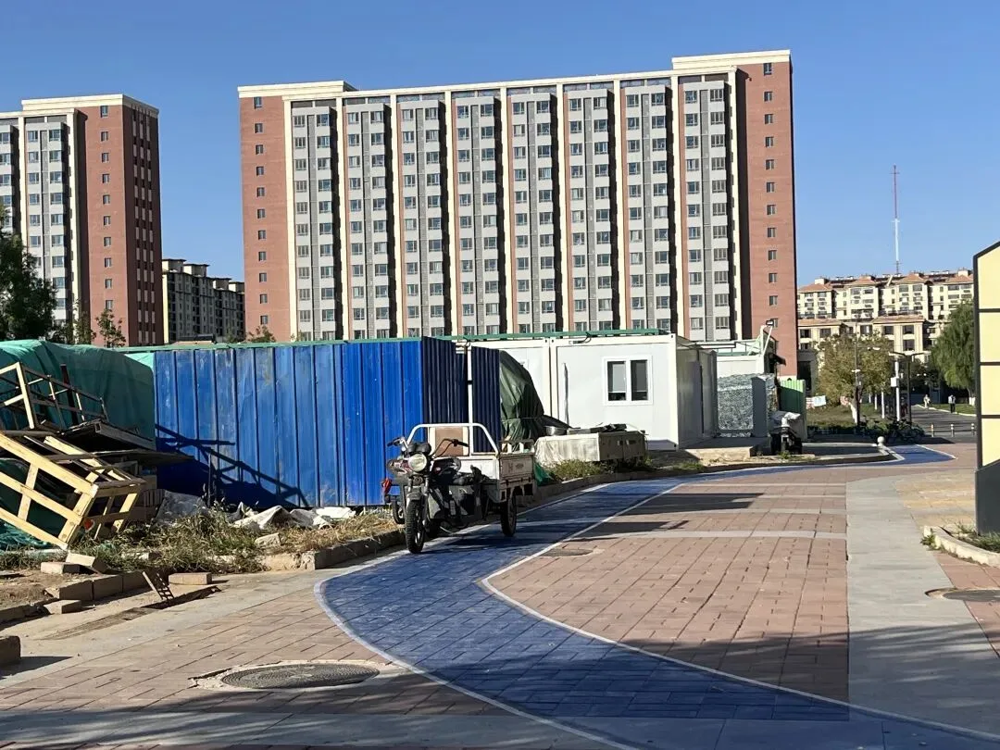
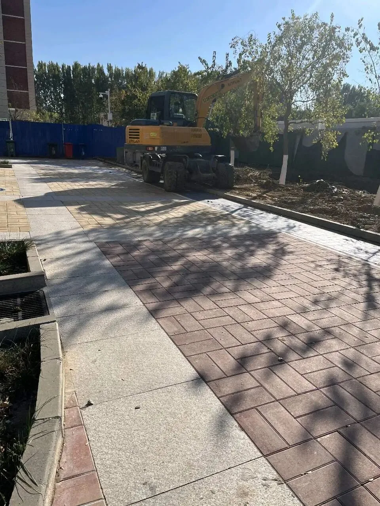
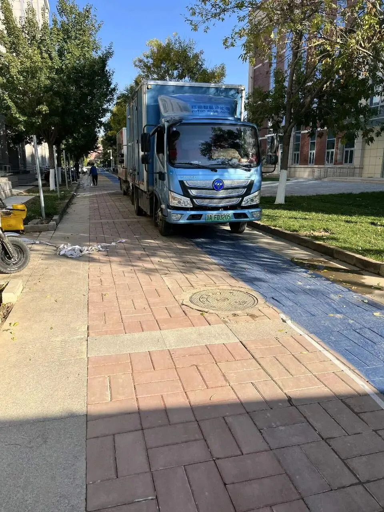

请相关部门及时关注并跟进问题。

## 1 教务问题

> “投稿，教务处最近有什么心事吗……为了你社本科评估是不准备把学生当人??突然通知要去补周一到周五的所有课，但很多老师都说他们觉得课时是不差的。那按教务处的逻辑，你觉得军训占用上课的时间应该还回来，那军训占用是周六周天是不是也应该等时间的补回来呢”

> “朋友们，真的没有人觉得补课这个决定太离谱了吗……我看其他高校也没说军训占用的行课时间需要补回来，前几届军训也没有这个情况，怎么社科大今年就决定要补军训第一周的课呢??有的课补课时间也太阴间了吧，怎么是在周末”

## 2 奖助补费&科研系统

## “1.科研系统只能填本人校内一作，因此导师一作等情况都无法上传成果。

2.学生独作、学生一作、导师一作学生二作应该有梯度区分！一概而论非常不合理。”

“关于新修订的奖学金评审计分细则，有几处不明白的地方，想请教各位共建双一流大学的老师和同学们～

1. 关于办法条例的公示。请问《中国社会科学院大学学生科研成果奖励办法》《中国社会科学院大学科研成果认定与登记办法》《中国社会科学院大学期刊分级办法》在哪里公示，没找到。

2. 关于学生参与教师项目。第一年启用科研系统时审核过了学生参与教师项目，没有与当年奖学金挂钩，今年却又挂钩了。为什么变？为什么想变的时候不事先通知？

3. 关于论文分值。评审计分比例是不是不太合理？以经济学为例，顶级 60 分、核心 20 分，发 3 篇 AMI 核心等于 1 篇经济研究。那么同理，在招聘教师时，三篇核心也等于一篇经济研究。

4. 关于社会实践活动。去年校内文体活动算，校外任何活动都不算；今年校内文体都不算，这个改动是不是有点夸张，为什么改？为什么等这一学年过了 90% 才改？为什么改了不发企业微信通知？”

## “投稿：

### 研究型大学不研究

奖学金评选通知出来后，我想有很多同学对这一方法有所不满，在这里，我说一下我的看法：

第一，评选办法中有关于科研成果、期刊分级的一系列文件并没有在通知中找到。

第二，新评选办法中，关于学生参与教师项目，在上一年以及本年通知学生需要导入老师课题时，并没有任何通知提到该操作会与奖学金挂钩，导致很多学生在上一年以及今年并没有实际导入参与教师项目，那么今年与明年的奖学金评选均存在一定的问题。

第三，参与导师课题项目数量限制为2，为什么学生参与老师众多的课题项目，却在最后的奖学金评选方法时被限制住，过去一年学生付出的努力就白费了？更重要的是，必须结项才行，请问制定该规则的老师，是否真的参与过课题研究，是否真的了解过课题申请、开题、中期以及结项所需要的时间？同时，无论是何等级，加分均一样。请问是否可以这样理解，即学校认为自科基金=社科基金=部委课题=司局级课题，那么学校在教师评职称时，是否采取了同样的标准？本来我不想吐槽，但是说到这里，我能指出学校部分部门与学院在一些关于课题的处理上存在严重的不妥。以某学院研创计划申请为例，我不认为一个从未发表过一篇论文或者说近十年未发表过核心以上期刊的老师能在课题申请时提出合适的建议。请问哪个学校哪个部门在申请课题时会请专职辅导员或班主任、或是从未发表过论文的老师进行评判？请问学校学院请来的老师是否真的了解每个学科的研究方向、研究方法？由小见大，学校的科研工作可以说是做的一塌糊涂。

第四，关于发表论文的分值是否存在不合理？AMI综合评价报告（2022）中顶级期刊仅有22个，权威期刊为55个，而核心期刊有605个，扩展期刊有775个，按照新办法中的评分细则，顶级=3核心，请问相差近30倍的期刊数量，分值上仅是3倍，是否合理？是否学校认为发表4篇核心的学生在科研能力上即可超过发表1篇顶级的学生？请问学校在招聘老师时，也会采用相同的评分标准吗？即学校会招聘1位发表4位核心的老师而不是发表1篇顶级的老师？

第五，关于实践活动的一些想法。在过去的一年中，各位同学按照老办法积极参与学校各类活动，而今年一刀切，且未做任何提前通知，并在学年末进行修改，是否不合理？

第六，学校的科研系统真的能用吗？在自检索科研成果时，居然检索不到知网的论文，请问该系统是摆设吗？在自己添加论文时，改不了一作二作的顺序，这系统真的能用吗？

最后想说的是，学校作为一所研究型大学，积极鼓励学生参与科研项目，但是在最后的评选方法时，却忽略了这么重要的一点，在科研成果评选上如此儿戏，很难不担心学校的未来发展，学校的高考分数线一降再降，双一流遥遥无期，学校尸位素餐的部分领导真的没想过，这些评选方法真的是用屁股想出来的吗？”

## “投稿：

研究型大学自废武功？

为什么不认可学生参与教师科研项目，给科研项目加分设置重重阻碍，是不鼓励学生参与教师科研项目吗？

研究生暑假期间应该参与支教，乡下等社会实践，而不是参与研究课题吗？那么请问学校在招聘老师时会因为该博士生在上学期间参与了社会实践而加分吗？”

## “关于奖学金科研项目需科研系统认定问题:

1.奖学金评定规则在学年末变更就算了，为什么不发一个全校性质的通告？悄悄放在校园门户一大堆公告里面夹着，不去专门搜寻压根找不着，这样做学生代表讨论过了不是只有学生代表知道，没参与讨论的同学怎么了解新规呢？这压根就不符合公开公正的原则。

2.新的奖学金评定规则最大的争议就是科研项目认定的问题，往年奖学金评定不需要把项目提交到科研系统里。这次弄的这个新规定参加科研项目必须提前加入科研系统，但是一是奖学金新规当时没有公开，二是当时学校让提交项目的时候没有说干嘛的，这样做是不是有点不太妥当？

3.学校只要重新开放科研系统，让同学们继续提交去年参加的科研项目即可，不知道为什么学校一直就不愿意，这个有什么很令人为难的吗？嫌麻烦？或者觉得学生没提交是学生自己的问题？”

“吵了这么久的奖学金评定标准，学校丝毫没有改变评定标准，难道没有一条可以修改和采纳的吗!!!!”

“投稿：我觉得一个学校奖学金如果连硕博的学费都不能覆盖，再花钱去开各种类似运动会这类玩意儿，实在是太抽象了。”

## 3 校园基建

## “投稿：

要命的蓝线

为“迎检”，学校不失机智规划了五公里的“跑步步道”。然而在已经喷涂好的步道上，随时停放有各种工程车辆、运输车辆。试问一个正常的体育运动空间，比如我们的操场，会允许这些车辆任意停放吗？这是否威胁跑者的安全，扰乱运动秩序？也许是因为步道刚刚落成，还没有明确管理法则，那请问学校后续准备出台怎样的规定，以保障步道清洁？如何保证可切实供跑者使用，而不是如大多数地区的盲道一般形同虚设？

另外，该步道途径南综合楼西南侧，该区域夜间无任何有效照明，恐怕构成另一安全隐患。学校后续有无计划加装有效照明装置？”

（见《

【读者投稿】无奈的抉择

》第2条）
