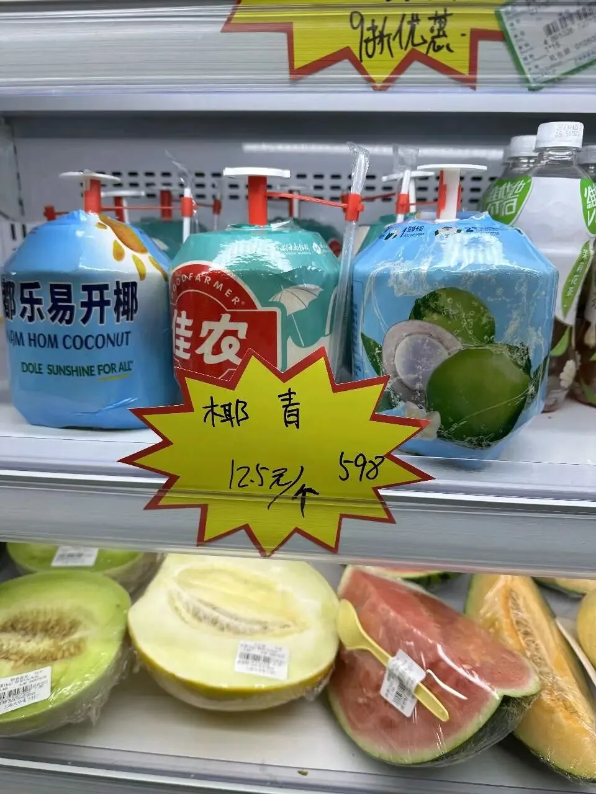
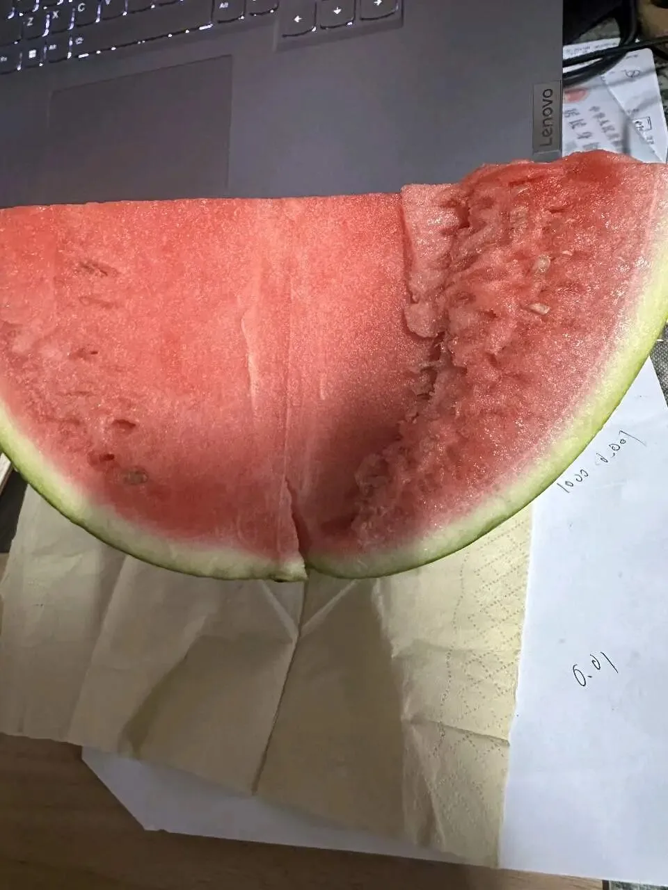
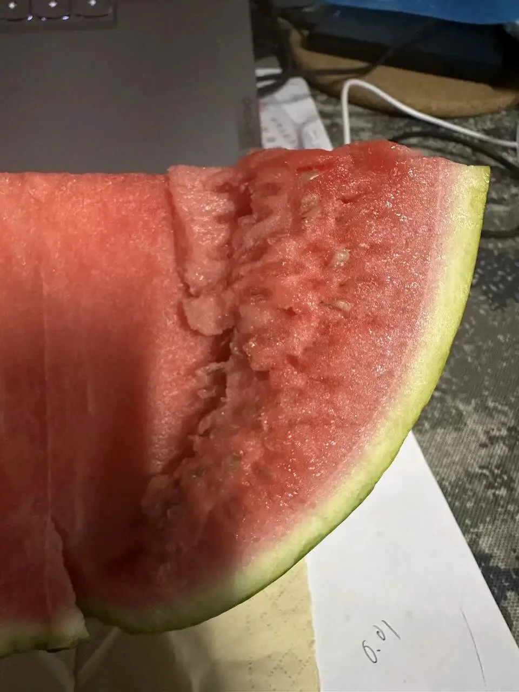
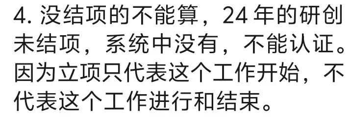
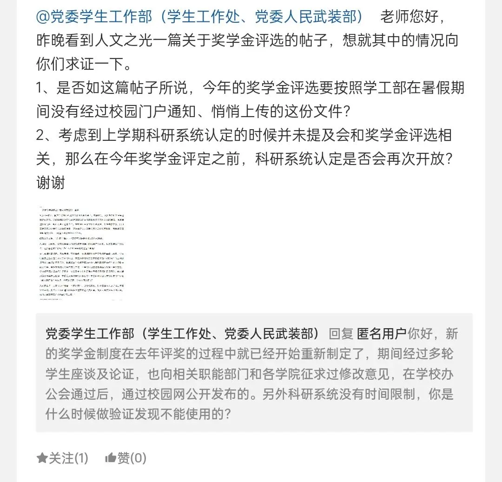

请相关部门及时关注并跟进问题。

## 1 学校超市

## “投稿，北综边上超市两则。

1:超市贩卖的椰子比天街卖的贵。

2:学校贩卖颜色不正常的西瓜。西瓜果肉都软了，甚至一部分都黑了。”

## 2 图书馆

## “十月二十二日晚九点五十，良乡图书馆二三层楼四个柜子，没有箱子可用。”

（见《[【读者投稿】学校里的清蒸fish](https://mp.weixin.qq.com/s?__biz=Mzg2MjcwNzQ1Mw==&mid=2247489431&idx=1&sn=658e32d85606b3733e81e12cd6f45f39&chksm=ce029c05f9751513cd2d9b9f109c2060cb0acea82cbae2a3aa5051a255bc6c78c7adfae38d29&scene=21#wechat_redirect)》第2条）

## 3 教务问题

## “投稿补课问题：

新生的课教务系统难道不是一开始写的就是2-16周吗？突然要补课，那我所有的课都要补一遍，救救孩子吧，哪有那么多时间？有的老师就是按照原定计划调整了课堂进度，现在又要补课就不合理。建议教务处灵活处理，老师同学商量后自愿选择补或不补。不要一刀切！不要拍脑袋就做决定！”

（见《[【读者投稿】奖补科研争议巨大 基建教务疑问声声](https://mp.weixin.qq.com/s?__biz=Mzg2MjcwNzQ1Mw==&mid=2247489454&idx=1&sn=f128922449461b566ccf35a1a27d22ca&chksm=ce029c3cf975152a8518a8a1fce7865bbc2abb6927d312e377ebd86509074a2430c9874f87e8&scene=21#wechat_redirect)》第1条）

## 4 奖金问题&科研系统

科研问题

“科研成果还要你科研系统审核通过才算？真是匪夷所思，之前也没通知过让填，现在得突击填。我发了论文，还得你系统认定一遍才算真发了是吧，真可以。”

> “评奖学金太抽象了，我主要是吐槽这个系统是哪个天才做的？能不能做一个清晰一点，容易操作一点的系统？什么评议前评议后需要提交的材料，哪一步需要干啥？为什么填了提交不了？我只想节省一点时间”

“投稿，社科院固然水平高，但社科大自己什么水平心里没数吗……人大复印资料转载视为“普通期刊”？”

> “咨询一下，咱们奖学金评审，CSSCI 扩展版，等同于 AMi 核心，扩展和入库期刊？AMi 那么多水刊，校外统一归到普刊。一个人独作发了几篇水刊，分数比二作的经济研究和管理世界还高？按照赋分比例，仅两位作者的话，二作的经济研究才 60\*0.4=24 分。3 篇非南核北核的独作 Ami 水刊，就 30 分了。这合理吗？不要自己搞分类，用公认的 CSSCI 和北核，多好？老师常教育我们，要爱惜自己的羽毛，不要发水刊，在公认的顶尖研究型大学，这种导向正确吗？这是鼓励大家灌水吗？”

“1.科研成果奖励办法第四条中，导师不分配贡献率是针对学生一作而言的，并不适用于其他任何情况！

2.学生独作 学生一作 导师一作，需要有梯度区分！根本不是一个难度。《科研成果奖励办法》在第二条奖励范围中，明确指出了‘（三）博士研究生以独立作者或第一作者身份发表或出版成果’。”

## “听说今年研创计划科研项目不能评奖学金了？我想骂人！”

奖金问题

“社论君你好，投稿，谢谢。【奖学金评定】看到那么多人对奖学金评定有疑问我就放心了。除此之外，补充几点：

第一，学校对于学生科研的论文成果认定想的真的是太周到了呢？上一学年发表的论文有录用通知，依然不予认定，理由是还未发表，领导老师们为什么不想想一个硕士生写文章发表的周期有多长，上半年录用最起码都要下半年见刊，那也是上一学年的论文成果啊！！！可学校依然嫌见刊时间慢，不知道领导们硕士阶段的时候发没发过文章呢？？？不要站着说话不腰疼！！！

第二，学生参与科研的认定，老师们有很多科研项目都是各个研究所管的，搞学生认定的时候系统里都没有老师的那些项目，难道参与老师在研究所的项目就不是参与了吗？如果不算那还搞什么科研？研究生的意义又何在？科教融合的背景下，学校如此规定，搞得学生都不知道该怎么办了，如果这样下去估计吃亏的不光学生还有学校自己吧，不要老不用脑子想问题好吧！我真是服了！

第三，为什么奖学金评选通知下来怨声载道，学校是否因该想想原因呢？弄个科研系统，一堆bug，更不要说评选细则的问题了，作为一个学生真的好无语啊！”

## “关于研究生奖学金评定细则，有几件事想请教一下各位老师：

第一，校内文体活动一律不算分，那学生是否还要参加学校组织的活动？

第二，学生干部的评分比去年翻了几倍，普通班委和校级三好学生一个分，去年给2分今年能给10分？？？这个按比例折合一下相当于考试平均成绩的2分，你们知道考试均分要提高2分有多难吗？是当个班委能相提并论的吗？

也难怪啦，评分细则肯定都是请学生干部们去做代表讨论的，对谁有利不必多说了捏~

补充一下，考试成绩均分提高两分，那得一学期每门课都考的很好，才有可能做到。那些什么文体委员心理委员宣传委员，一年下来转发几个通知，就能抵得上考试均分2分。这难道公平吗？一学期好好学习，每门课认真写论文还抵不过划水一年的班委，真是可笑”

“投稿：这个奖学金评选问题真是让人不吐不快。去翻了接诉即办，看到学工关于这个问题的回复，顿时明白了何为避实就虚、推诿塞责。首先人家问这事为何没有全校通告、只是在校园网不起眼角落上传了文件，回复仅是“通过校园网公开发布”，完美回避了没有广而告之的疑问，对于自己在公示通知中是否存在不足之处未见半点反思。可能有人是想说自己做的已是天下无敌的完美吧，所以没必要解释这个问题。

其次先不论你学工把锅推给“学生座谈”、“相关职能部门”、“各学院”、“学校办公会”，言下之意是自己在奖学金评定问题上没有半点责任；就说你自诩征求了意见。请问大家到现在对于新定细则争议如此之大、意见建议不断，这像是有好好征求过大家想法的结果吗？这能是一个充分做到民主科学决策的规定应有的效果吗？人家都在吐槽“当时同学提的一些意见可以说是大部分没有被采纳”，请问你又征集了什么呢？建议有的人没有征集意见民主决策的意向，就请不要出事再拿这个来当挡箭牌，真是好生不要脸。

最后再说回这个科研系统，回复通篇没有解释为何科研系统会在大家不知情的情况下突然与奖学金评选挂钩。不说这个，就说科研系统本身，科研系统设置的导向真是让人感到非常奇怪，相信大家用了之后也会是骂声一片。学工却自信回复说“你是什么时候做验证发现不能使用的？”，这除了回应不存在时间问题之外，也蕴含着学工对于科研系统的具体安排具有充足信心的意味，毕竟总不能是在不知道自己的系统究竟什么样子的情况下就贸然回复吧。现在这个科研系统批评不断，想问问学工你在当初自信设置的时候有没有做到科学民主决策呢？有没有真找相关方测试一下系统完善系统呢？

关于奖学金这个事，单说这一个关于奖学金评选的回复，就足以暴露出有些人缺乏科学与民主决策的工作能力与态度，出事之后花言巧语回避问题、回避不成便推诿塞责的工作作风。不知道还有没有人在管理你们了？如果你们行为从来都透着此等天下无敌般没脸没皮之气息的话，不得不让人思考我们大家的社科大怎么才能办好了。”

## “回应一下上期奖学金最后一条

奖学金钱少是有问题（且很大的问题），但是运动会也要开啊，哪个大学不开运动会……关运动会什么事……一个学校体育活动办的好应该表扬，不管你是什么研究型大学还是普通大学……话说回来2023-2024学年社科大都没开校运会，也是离谱”

（见《[【读者投稿】奖补科研争议巨大 基建教务疑问声声](https://mp.weixin.qq.com/s?__biz=Mzg2MjcwNzQ1Mw==&mid=2247489454&idx=1&sn=f128922449461b566ccf35a1a27d22ca&chksm=ce029c3cf975152a8518a8a1fce7865bbc2abb6927d312e377ebd86509074a2430c9874f87e8&scene=21#wechat_redirect)》第2条）

问题投票

## “麻烦设置一个投票

请问大家觉得用2024.7.25发布的新政策，评定2023.9——2024.8的工作是否合适?自认为新政策实行要在2024—2025学年。

新旧政策都有不合理之处（不知道会不会在本次评定中重新调整），如果必须选一个的话：

同意执行新政策

同意执行旧政策

仅旁观

选项是同意执行新政策；同意执行旧政策；仅旁观

问题是同意执行新政策还是旧政策？”

“投稿：希望学校调整奖助学金标准，最低档能覆盖学费（可以开一个投票吗，让学校发布比例前看看大家的意见）”

（关于现行奖学金政策标准何处不合理的投票，请参见《[【读者投稿】差距与不足](https://mp.weixin.qq.com/s?__biz=Mzg2MjcwNzQ1Mw==&mid=2247489378&idx=1&sn=d4998240e43aa5747f8eff1a4935181b&chksm=ce029cf0f97515e6c98b7f7ec81a4712ec3431a0316246a312a4fac81434aa7ceba84b05a2b3&scene=21#wechat_redirect)》文末，欲浏览更多相关讨论，请点击本文末“#奖助补费”tag）
