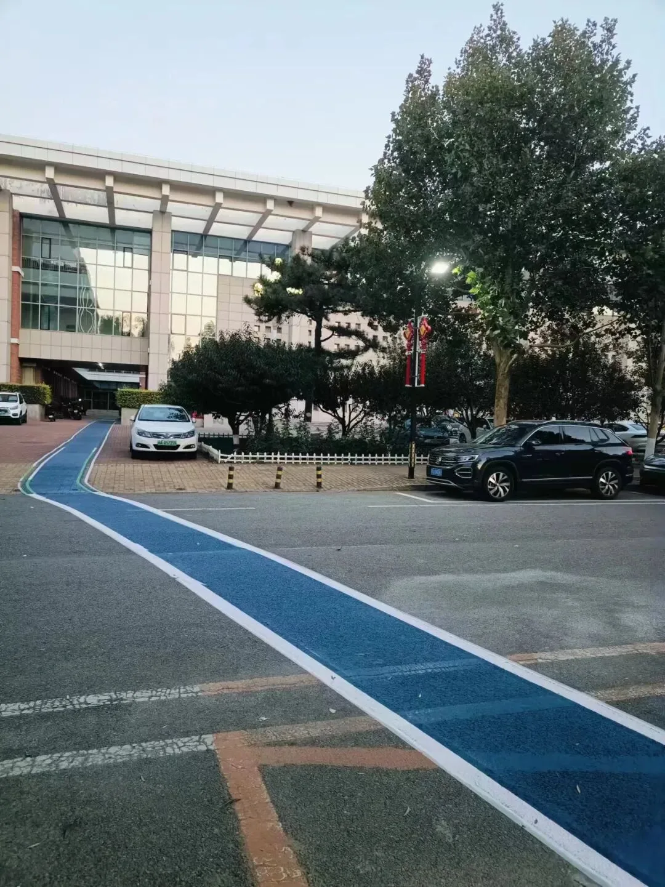
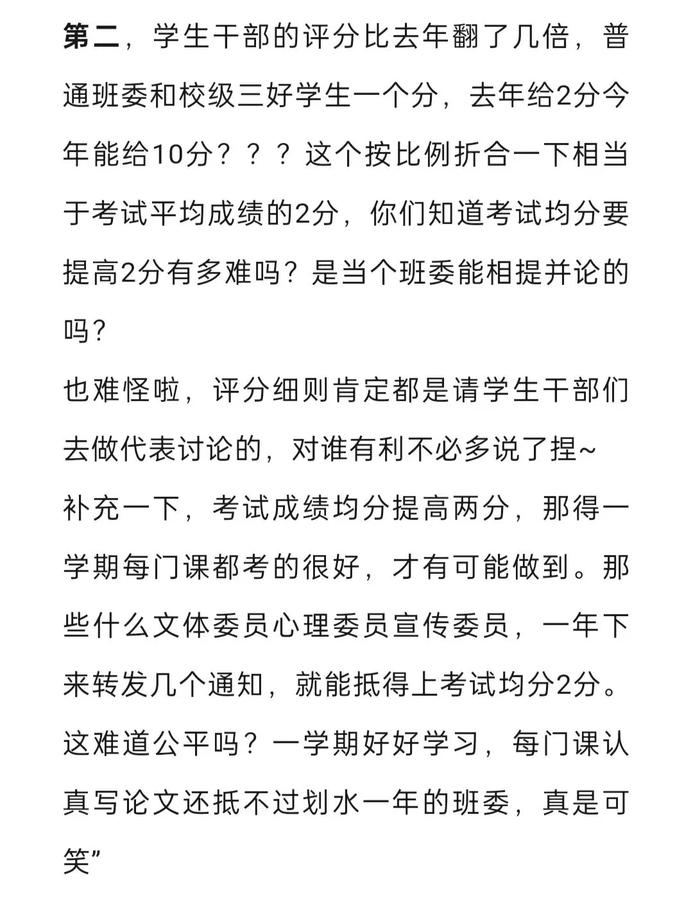
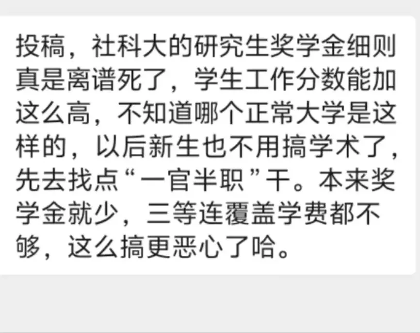
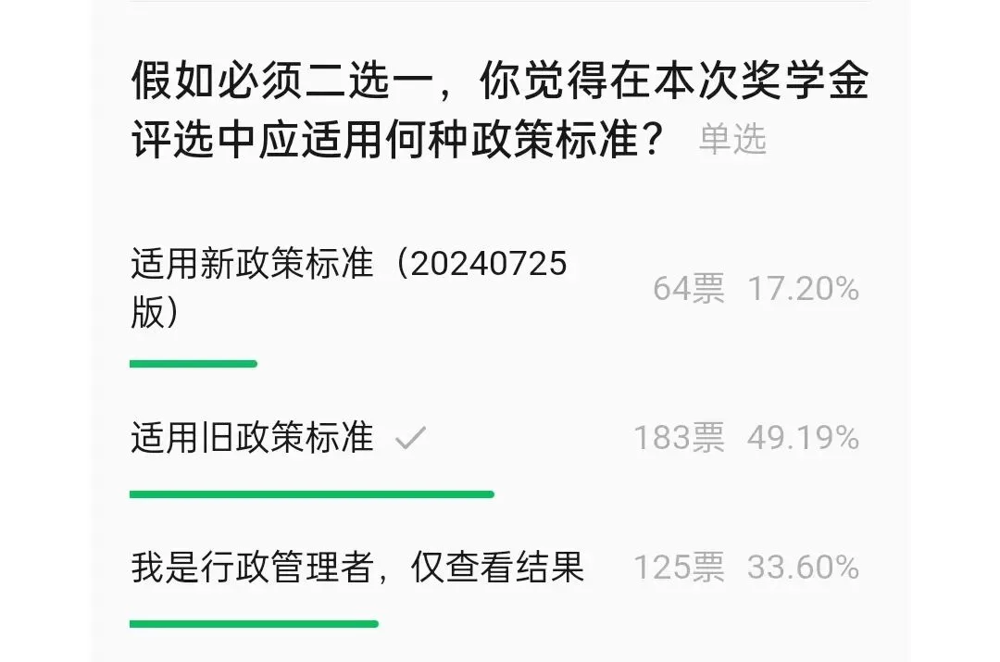
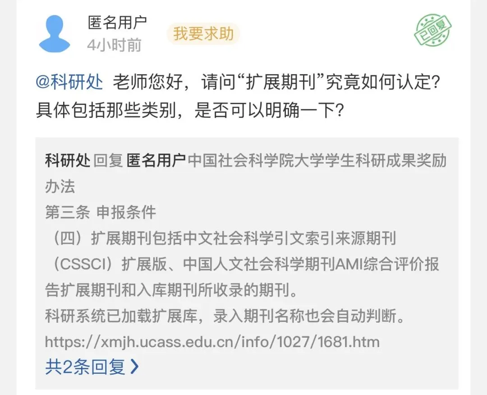
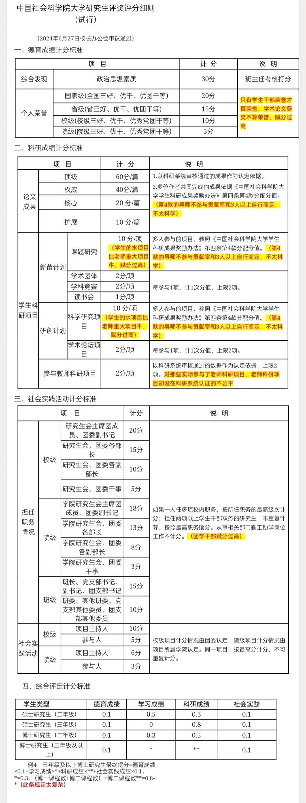
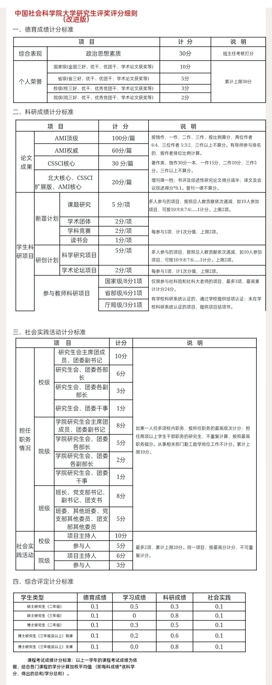

请相关部门及时关注并跟进问题。

## 1 校园基建

“投稿：难以容忍的丑！！！这不但横穿马路存在安全隐患，也破坏校容校貌吧！不可思议的脑回路～真的太丑了，丑遍全校每个角落！”

（见《

【读者投稿】奖补科研争议巨大 基建教务疑问声声

》第3条）

## 2 图书馆

“10.24晚九点五十，良乡图书馆一二三层楼五个柜子，没有箱子可用。以后不发了，没意思”

（见《[【读者投稿】奖金评选质疑继续 生活教务问题不绝](https://mp.weixin.qq.com/s?__biz=Mzg2MjcwNzQ1Mw==&mid=2247489486&idx=1&sn=6b350237ae22934f08baf31ad4ef33ee&chksm=ce029c5cf975154a36e23aa360c5645e84e01715c29043ee3fe4701f3df96fc2419ce5a2265f&scene=21#wechat_redirect)》第2条）

## 3 奖金问题和科研系统

奖金问题

“投稿：谁能说说社会实践活动除了任职，还能加分的是什么？ 这个学校真是令人心寒！”

> “投稿：学校评奖文件说研创项目未结项不能作为评奖依据。那是不是可以推断，学生干部任期没满也不可以加奖励分呀？学院研会主席、团委副书记一下子加18分，万一加完奖励分就辞职了呢，是不是得等任期一年已满才可以加综测呀？”

“我们研创计划2024年科研项目因未结项不能评奖学金，理由是“以前同学那立项证明评奖学金，最后没完成或者完成质量很差，不公平”。针对此我想提几点意见：

1.研创计划科学研究项目结项时间是学校安排的，不是我们不想结项。针对老师们的考虑，我们可不可以把结项时间提前到10月末奖学金最终评定之前呢？可不可以把奖学金评定时间推后到结项之后呢？

2.研创计划科学研究项目研二下学期才能报，如果研三上学期评奖学金用不了的话那就永远都用不了啦，而奖学金评定细则写着研创计划科学研究项目的计分标准又有什么用呢？

3.您说有人结不了项却评了奖学金不公平，那所有科学研究项目的人都报不了就公平了吗？报了学长学姐研创计划科学研究项目的人，去年用立项证明申请了一次奖学金，今年又可以用结项证明再申请一次奖学金，这样公平吗？

4.如果奖学金评定后真的有人结不了项，可不可以直接按弄虚作假处理收回奖金？为什么要一竿子打死所有人呢？

我有一个研创计划学术交流的项目去年因为种种原因以为不算，所以没有报，让我错失一等奖学金。今年我报了，结果说不算……刚听到时我非常气愤！希望学校能认真考虑。”

## “不太理解是真正在鼓励同学们科研吗？

第一 除了研创的学术会议，其他学术会议和论坛都不计分 那么真正参加校外京内或者是全国性学科学术会议的同学 想加一两分所做的努力又怎么算？

第二 研创项目研二寒假才可以申请，项目结束则要到研三上学期的十二月 那研创项目又如何成为加分项？如此说来 参与了一场研创项目的学术会议 则比作为负责人负责整个项目的分值更高？有点自相矛盾吧？

不如把奖学金整体差距缩小点…省的争来争去了…反正科研忙活一年到头抵不上科研系统的一纸证明”

“同意这位同学的观点，但我想，是不是成绩均分要高将近3分，才能和班委加的10分一样？

还有之前看到的一个评论，放下面了，深表赞同。

这样看来，按照新政策，今年班委如果不是表现太差，估计大多在前面，拭目以待。

我想，争议这么大，不仅仅钱的问题（我们补助本来就很少，奖学金对普通学生的影响不能说是无所谓吧），更重要的是，我们关心，学校对我们所做的各种努力的认可程度。每个人都应该有机会发言，争取自己的正当权利。是不是说哪方面的权重大，表示学校引导我们向哪方面发展。现在我们被引导到哪一方面？以后会不会给新生留下印象，成绩拉不开差距，当个学生干部可以加很多分？

再分享一个数据：截至24日下午4点，抛开旁观者数据，共有247人参与意见，同意执行旧政策的人数超过2/3。不知道新政策势在必行还是会考虑一下大多数人的诉求？”

“

问了北京地区某中上985的奖学金标准，说期刊是按照影响因子来算分的，水刊也能加分，但因为影响因子低，可能10篇水刊才抵得上一篇核心期刊。感觉这才是正常的大学。

社科大奖学金收到广泛质疑，一是规则不合理，虽自诩注重学术，但给了水刊过高分数，同学们看到发了两篇水刊的投机主义者拿了国奖，发了核心期刊的同学反而没拿到，当然会不满。

二是评分细则发布时间太晚，显示出了当权者的傲慢。校领导如果不会制定规则，可以多看看其他学校，向优秀的院校学习，不要整天宣传自己是什么学术型大学吸引了同学报考，最后在实际过程搞七搞八。”

“

回应，运动会对学生来说无用，除了劳民伤财。但是奖助学金很有用，虽然这两件事本并不是非此即彼的。但是既然我校穷的叮当乱响，那有钱办无用的事（不仅运动会，只是举个例子），不如把钱花在有用的地方。

“

投稿：

奖学金这点物质奖励并不算是什么巨额补助，除了返个学费之外（这个是基本之基本了）也没什么太多补助。也很赞同平息生活难继争议的正途也不是去挥刀砍向什么大家参与的运动会之类活动，这样徒引对立；还是在于响应国家大政方针早日提高学生补助。所以关于奖学金评定的问题不可以被简单理解成一个所谓的物质利益冲撞，这不是争论的焦点所在。大家不是为了争这一个馒头，而是在争那口气。

分析一下，奖学金作为一种荣誉，其背后的各项评价标准反映了一所学校培养人才的价值导向。这种价值导向是奖学金的重要意义所在，也是争议的核心关切。奖金评定标准陷入如此巨大的争议，从社会实践到科研成果，样样标准都陷入质疑风暴之中。除却暴露出行政效能低下、缺乏民主作风的老问题之外，也让人看到作为自诩“人文社科最高殿堂”中的一所“高水平”研究型大学，对于自己想要培养什么样的研究型人才的目标方面是非常迷茫与支离的。学校是否对自己想要培养什么样的人才有一个整体性的规划？学校究竟是想培养学人，还是服贴在权力面前的奴才呢？学校培养人才的导向是否贴合我们这个时代对高水平研究人才的要求？奖学金评定一事对于这些问题的解答，非常让人焦虑。它让我们看到一些人的作为骄傲的任意与不在乎，心痛于这所大学被横暴权力荼毒的现状。”

科研问题

> “现在学校的文件乱七八糟的，为什么不统一一下。用社会公认的南核和北核。现在大家的争议最多的就是期刊分类。分 4 类：第一类 AMi 顶级；第二类 AMi 权威；第三类除了 ami 顶级和权威之外的 CSSCI，第四类 北核。这个是很多学校认可的。AMi 顶级和权威类区分一类二类就行，其他的就以南核和北核为准。天天见吐槽 ami 水的，但很少听到南核和北核水的，虽然也有，但是人家期刊少啊，ami 那么多水刊。”

> “投稿：回复一下昨天有一条说自己是核心二作，分数比不上发了几篇非南核北核的独作AMI水刊的同学。请问作为二作发了核心的同学，你这个核心能发出来，没有导师的关系和人情，你作为普通硕士博士独作能发得出来吗？自己心里没点数吗？放眼全国，有几个硕博能独作发高水平C刊的人？发普刊的还没眼红你靠导师关系发的核心，你凭什么吐槽那些导师根本不管，靠自己左右投稿被拒多次才发了独作AMI的人发的就是水刊？那么有本事的话，你也多发几篇核心不就行了？或者靠自己也多发几篇“水刊”不也行？另外，能评上AMI的期刊也是经过中国人文社会科学期刊综合评价的，是由中国社科院直属研究单位中国社会科学评价研究院组织开展。A刊也是中国人文社会科学期刊的重要评价体系之一，没你说的那么水好吧？以下附上科研处官方对“扩展期刊”的回复，请你睁大双眼，逐字仔细诵读：”

意见综合

“

无论老规则还是新的奖学金评定规则，前列名额都与咱无缘，但是这几天听了看了很多同学的吐槽后，综合众多同学看法和意见，也来凑合下。

本来大家是期待着新规则越改越好，但没想到很多人发现越改还越不如从前了，有人在人文之光社论发起大家自愿投票中，竟然有大多数人选择了支持原来老版奖学金评定规则，这不得不说明了2024年社科大奖学金评定新规确实有很多问题。

综合很多同学说法，新规则有以下几个特点：

第一

，极大有利于学校管理人员方便，减少老师的麻烦，直接官僚的一刀切，将过去很多可以加分的全部删除，很明显是故意向着一些人，人为强化和倾斜部分人的利益，体现了极大的不公平性。

第二

，极大有利于学生干部尤其是团学干部，有人甚至说这一次大的漏洞在于，团学干部加分过多和过高，很多规则都是为团学干部量身定做的，不排除可能包含为某些领导子女作为学生干部而打造。他们和老师打交道多，具有很大便利性。团学部长及以上加分在15分及以上，往往团学干部参加了很多社会实践活动，又可以加3-10分，他们很多每年都很容易获得“三好、优干、优团干”等荣誉，又可以加5—20分，荣誉巧妙删除了之前学术论文获奖等直接与学术研究有关的事项，只保留“三好、优干、优团干”荣誉加分。团学干部往往独立科研能力不强，能够发出像样的科研文章的不太多，但是他们会发挥自己人际和社交，很容易申请成功研创项目，又加入了其他的一些项目，本次科研项目加分仅限于“研创计划”“新苗计划”“参与教师科研项目”，而“研创计划”“新苗计划”竟可加高达10分，“参与教师科研项目”最多才2分，特意拔高“研创计划”“新苗计划”，而学生参与老师的重大项目研究则基本没什么作用。尽管很多人认为学生搞的“研创计划”“新苗计划”更加水。

如此，弱化了学生参与社科院包括导师或者其他老师项目加分，体现了不鼓励学生参与导师项目研究，跟着导师一起搞研究，或是参与敬仰的老师项目研究，发C刊及高质量论文的学生，是少数，大多数都还没有发表文章。一个团学干部的两项“研创项目”，就可高达20分，等于一篇C刊加分！再加上前面的各种优势几十分的加分，就比很多不是团学干部却专心科研发出C刊的同学加分还多，因为好不容易发篇C刊也才20分，这是本次规则最大的漏洞，给很多团学干部钻空子的机会，提供了特殊捷径。本轮奖学金评下来，最后获得高分的可能是一堆学生干部，拿着他们特有的荣誉证书，再搞了两个“研创项目”，实际上不怎么搞科研的也没正规论文成果的人获取。

第三

，规定中存在模糊性。比如说参照规则，还要去费劲去找，同时，规则当中也很模糊，如占大比分的“项目和论文”两条指出，“多位作者共同完成的成果，多人参与的项目依据《中国社会科学院大学学生科研成果奖励办法》第四条第4款分配分值”，第四条说，若学生作者人数超过3人，由作者共同商定贡献率；导师不分配贡献率，商定那可以都按照第一作者或者负责人算，此规定既不科学，也很模糊不好操作，容易引发极大争议。违背了普遍的独作，一作，二作，三作等按具体贡献比例评价标准。

如说期刊成果等级中，相互矛盾，划分不科学，不够明确明晰，顶级期刊、权威期刊用AMI的评价规则，最后也用AMI规则，中间关系99%同学切身利益的却只用CSSCI南大核心期刊，完美的跳过了AMI核心期刊和北大核心期刊。而且明确了，扩展期刊包括中文社会科学引文索引来源期刊（CSSCI）扩展版、中国人文社会科学期刊AMI综合评价报告扩展期刊和入库期刊所收录的期刊。也就是将CSSCI）扩展版等同于AMI扩展期刊和普刊加分。实际在内行的一看就清楚，除了CSSCI南大核心期刊争议小之外，AMI核心期刊和北大核心期刊，（CSSCI）扩展版，有的北大核心期刊仅仅是AMI扩展期刊，有的AMI核心期刊不是北大核心期刊，有的AMI核心期刊是C刊，有的AMI核心期刊和北大核心期刊是（CSSCI）扩展版，几者难以难以完全相同，因此AMI核心期刊、北大核心期刊、（CSSCI）扩展版分为一类，AMI扩展期刊和普刊分为一类，更科学些。

第四

，规则在暑假大家放假期间悄悄颁布，也不发在大家更方便看到的移动校园上，时间很仓促，团学干部内部人员早早知道准备好了，而大多数的普通学生来不及准备，打了大家一个措手不及。

第五

，对一些人极大不利，不利的人群有：一类是平时一心埋头参与老师的重大项目研究，但是老师的重大项目却没有经过社科大科研系统认证，哪怕干了再多活，有各种资料佐证。社科大偏向学生搞的“研创项目”比参加老师国家社科基金项目厉害的多，参与老师重大项目不加分或者最多仅加两分。二类是参加正规学术活动交流或者是学术论文获奖的，在团学干部的“优干”，面前一分不值。

参照大家看法，具体的问题在新规则当中可标记如下：

参照很多同学看法，可作改进，不知是否可行：学生参与老师科研项目不必通过科研系统认证，提供正规结项证书即可，按照项目等级科学划分，适当降低学生干部及荣誉加分，期刊应划分更加明确，明确在同等的分数差不多情况之下，比如以项目和论文相比，应该侧重论文，论文的分数加分差不多情况之下，以论文期刊质量进行比较，两篇普通C刊等于1偏权威期刊40分，就应该侧重权威期刊，参与者的贡献比例应该进一步明确，学术会议论文获奖可加分等。在表格中可调整和完善如下：

（见《

【读者投稿】奖金评选质疑继续 生活教务问题不绝

》第4条）
