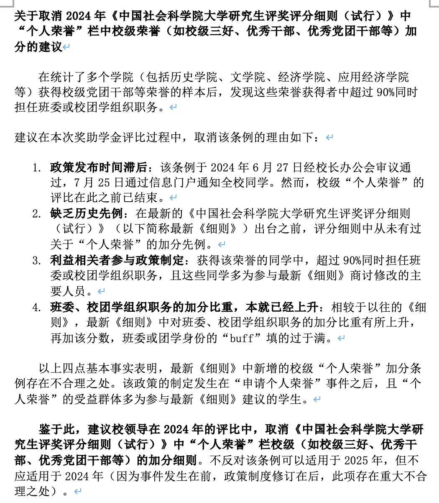
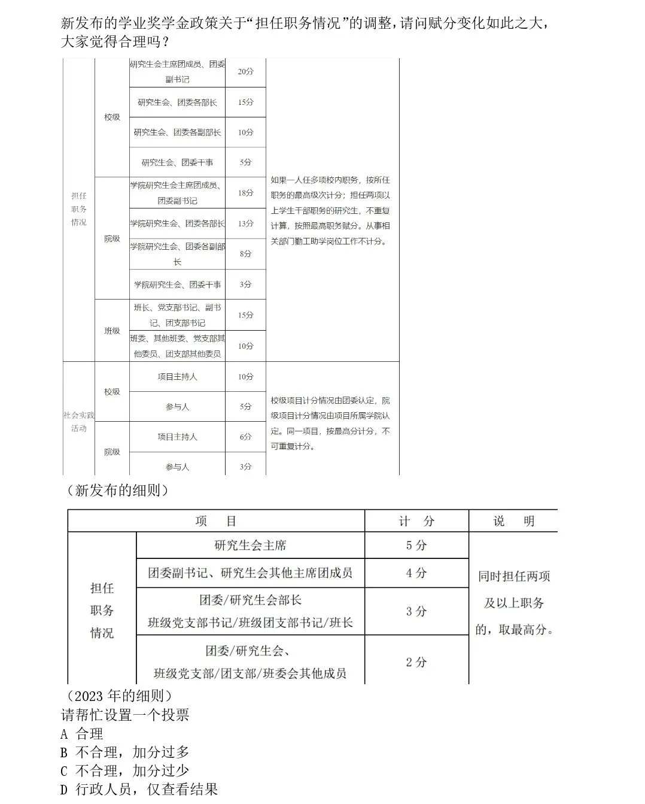

请相关部门及时关注并跟进问题。

## 1 学院问题

> “听说某经济学院出学院细则公然反对学校细则，在设置核心论文加分上限（例如导师参与分配），增加扩展论文和普刊加分，参与学校老师课题无限加分且不设置上限，增加"新苗"和学术论坛参与加分无上限后，学院办公室的学生"干部"无论是社会实践分还是科研成果分都遥遥领先！请大家最后看看究竟哪个学院的国奖是发表A扩论文同时碰巧是"执行院长"和"社科大老师"的学生！”

## 2 奖金问题&科研系统

“投稿：这个期刊分级太搞笑了。c扩和ami入库居然是一个等级，知道的说是鼓励同学发刊不论等级，不知道的还以为是牺牲学术品味给社科院评价中心抬旗呢。”

## “我不明白为什么我们的专业排名是和非全日制的合在一起排的。”

## “投稿：

## “投稿：

（见《[【读者投稿】处处为难](https://mp.weixin.qq.com/s?__biz=Mzg2MjcwNzQ1Mw==&mid=2247489652&idx=1&sn=6266cb7ae81b1976ae81a75b514637cd&chksm=ce0293e6f9751af09814321241d91180c0b9301cfe5de02f6fed878bfdb8b9c31201b5688f98&scene=21#wechat_redirect)》第1条）
