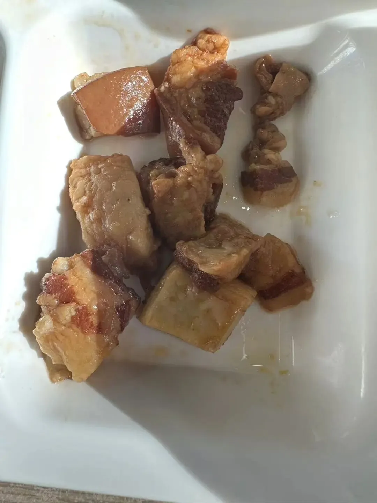
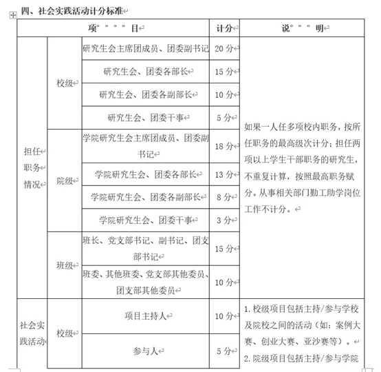
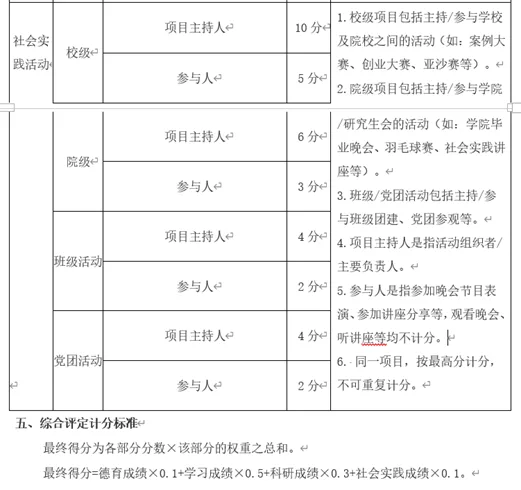
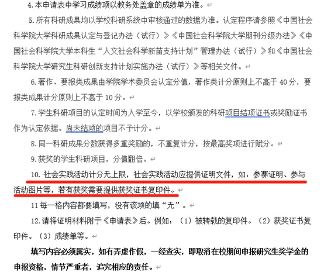
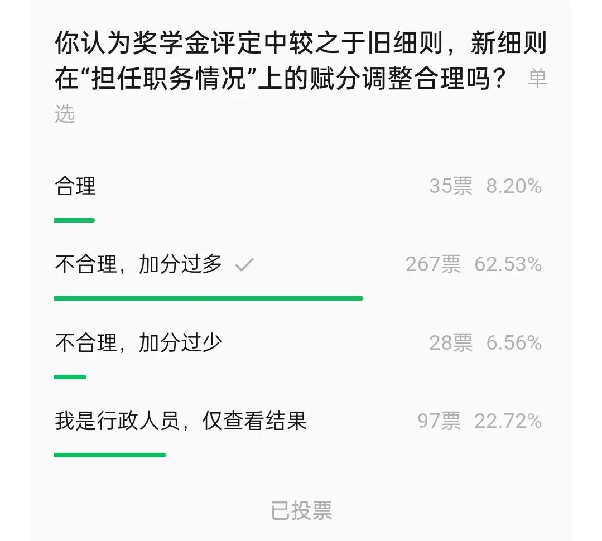

请相关部门及时关注并跟进问题。

## 1 食堂

“食堂的炒肉也太肥了，几乎没有瘦的，能不能均衡一点，炒的肉都没人吃，还不如不放，节约成本呢。”

“投稿。良乡一食堂一楼红烧肉炖粉条，基本没有瘦肉，应该改名叫猪油白菜炖粉条。全部的肉差不多9块，全是肥肉，难以下咽。”

## 2 学院问题

## “商学院研究生专业学位奖学金评分细则中：

班级活动及党团活动有额外加分项。项目主持人加分4分，参与人加分2分。

1、 在日常班级活动或班级党团活动中，项目主持人均为班委。这些活动主持本身就是班级委员的本质工作，且班委已经在担任职务情况中进行了加分，再进行班级内部活动主持的加分是否合理。在这种规则下，学生干部加分是不是太高了。毕竟评分标准中社会实践计分无上限。

2、如坚持这种评选规则，班级活动或党团活动的参与证明，是否应由班委会、党团支部，对本年度所有活动的参与人进行统计，并统一开具参与证明，标明哪些人是组织者，哪些人是参与者，并发到群里进行提前公示。一来可以方便同学为评奖提供证明，二来可以避免同学有遗漏。

3、 同理，校院两级学生会、团委的活动，是否也应由活动组织部门，统一开具参与证明，并发到班级群里进行提前公示。减少学生进行活动证明的工作量，也可以避免部分学生干部私自给自己增加活动。同时也可以为奖学金评选委员会的评选减少工作量和歧义。

4、商学院官网“申请学业奖学金的通知”及通知附件中，并没有同步公布本次“评选委员会”成员及答疑或投诉的渠道，建议补充通知。”

## 3 奖金问题&科研系统

“奖学金投稿：为什么去年研究生的研创项目立项就可以加分，今年立项就不可以？甚至去年立项的人今年还可以用结项证明再加分？请问呢？”

> “你好，我想说一下这个新版奖学金评选标准中学生干部的加分情况。校方声称新版标准已经听取了学生代表的意见，但是不知道此“学生代表”都代表了哪些学生群体？我们并不否认学生干部们对大家的服务和付出，也应当给予他们回报和奖励，但是有的班委班干部那是服务同学吗？一年下来在班级群里一句话都没说过的，也配得上这么夸张的回报吗？其他同学踏踏实实读书学习提高不了几个绩点，某些人划水划了一年，就凭借这个可有可无的班委头衔轻松稳赚1-1.5分。学校新出台的这个标准，对踏踏实实做学问读书的同学可以说是毫无公平性可言，不知道是不是在鼓励大家以后都去争这个班干部职位？还是说这种向“特权阶层”倾斜资源的风气已经到了这种明目张胆的程度？”

“关于奖学金，我来根据去年我作为国家奖学金和学业奖学金评判小组组员的身份说一下案例，具体讲讲，我遇到的，也将会是你们遇到的问题。

去年我们班有位同学，是校团委某部门的，他拿了一张a4纸，拉了一长列团委校学生会活动，然后写了一句证明某部门某同学参加了以上校团委校学生会活动，然后右下角趴盖了一个校团委的章。当时我们就这个讨论了一下，你说他符不符合要求？他有章有证明，但你要说符合要求，这本来就是他本职的工作，他的部门需要他去参与到这些其他学生会部门的各大活动当中去帮忙，或者说是组织人员。他是又加了校学生会工作人员的分，又加了这些各大活动的分，而且这些活动很多不对普通同学公开，我们丧失了信息优势，可以说等到最后你都不知道有这些活动的出现，他就把分给加上了。那么根据这个案例，请问你们今年碰到了这么一样一个人，利用校团委，拉了30个活动，放一张纸上盖一个校团委学生会的章，一个活动5分组织者10分，他至少也能加个150分200分吧，这都顶得上你发表一篇顶刊了。

至于其他的案例，在这个新规则下面略有改善，比如关于参与老师课题证明，有人甚至拿出了跟老师的聊天记录，非要承认他参与的其中工作，有的人拿的课题上面直接把自己的名字写进去，而那一页连盖章的没有，有的同学稍微正规一点，直接打印了一张证明，该同学参与了某老师的课题，盖上了学院的章。所以今年这个强制要求在学校系统上的认领，且不得超过两个的这个规则目前来看是好的，那些说这个规则不好的，我就问你们碰到了上面这些案例里面的人，他拿10个课题过来，你咋办？

然后，就是信息的公开化，要提倡班级小组讨论机制，针对讨论的问题，要进行一定程度的公开化，别的学校的国家奖学金都是要参与答辩的，而我们学校连他用什么东西评的奖都不敢公开，有的学院跟做贼一样，赶紧评完了赶紧上交，这里我说的就是某些学院不负责任的老师，甚至去年大部分学院的老师都抱着这种做法。国奖的同学嘛，拿出来遛遛，我们也好学习学习一下，干嘛藏着掖着呀？真的厉害，我们也想学习。我就问哪个学院评奖学金是敢全程公开透明的，面对一些有争议的讨论是敢去让同学们投票的，没有吧？有些老师不要觉得学生麻烦老是提东提西的，人文之光上面大部分对于奖学金提出来的确实是不合理，对新奖学金规则我个人觉得整体上是改善的，但是我并不觉得能够有效的实施下去，第一是学生不同意，第二是老师不作为！

总结来说，各种各样的规章制度，新实行的都会有不完善的地方，最大的完善方法就是公开透明，拿出来溜溜，那些用水文的，用外文里面的买的，不正规课题的，不正规活动乱加分的，偏心徇私的，都会收敛一点。”

“这几天大家一直热议评奖（国奖、学业奖）评优（优秀学生干部、三好学生）政策，讨论也越来越热烈。

同时，学院、班级的评奖程序正按原计划顺利推进。

分享一下昨天在“人文之光社论”发起的投票结果

到27日17：00

选项（不合理，加分过多）的支持率：81％

267/（35+28+267）

（注：不参与具体建议，仅查看结果的数据不涉及具体看法，所以暂时不列入投票总数）

（见《[【读者投稿】奖金相关疑问继续 科研问题争议依然](https://mp.weixin.qq.com/s?__biz=Mzg2MjcwNzQ1Mw==&mid=2247489677&idx=1&sn=755bc6bf751468a4a6a4df7efbc8f140&chksm=ce02931ff9751a092229411ea93e40c96cdd8c4ef3e8b07a4ebf2f74e324c621a6281b504d46&scene=21#wechat_redirect)》第2条）
