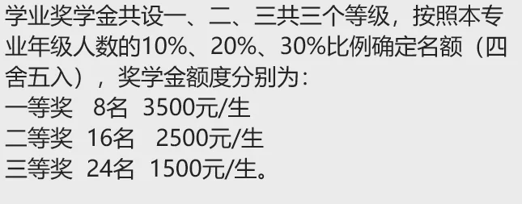

请相关部门及时关注并跟进问题。

## 1 接诉平台

“社论！我发现现在接诉即办，匿名提问完以后，如果想截屏转发给其他同学看，截屏是默认带水印的，水印有姓名和学号。”

## 2 学校工作

> “投稿：借人文之光说一句我对学校工作的一些看法。不管是这次奖学金评比，还是之前的中期考核，可以看出，学校为了防止某些舞弊现象，对某些项目进行了“一刀切”。但我想说，有些所谓的舞弊，真的值得“一刀切”吗，真的得“一刀切”吗？为了防止导师包庇学生，就得按照死板的笔试、学校负责出题的死教条方式来进行中期考核吗？为了防止一些学生用水会议的方式评奖，就得把整个会议的锅都砸掉吗？现在文章发表周期越来越长，学校拒绝以录用通知和网络首发的证明评奖，这又是在防什么呢，防止期刊突然变卦还是主编暴毙所以文章最终还是发表不了？这种把婴儿连同洗澡水一同倒掉的愚昧行政，体现的是学校行政能力之低下，体现的是懒政、惰政而不思进取，让全体师生失望且蒙羞。这几年科教融合，既看不出科学精神，又看不出教育树人的理想，反而融合出各种行政官僚主义的怪胎、死胎，这学校再这么办下去，恐怕只是每况愈下，最终把原先研究生院所剩无几的牌面、连同社科院自己的脸面都办丢了。”

## 3 学院问题

“很多学院都在学校颁布的基础上修改了评奖规则，为何经济学院补充的评奖学金说明只是微调已有项目分值，完全没有反应学生诉求啊!!”

（见《[【读者投稿】奖金相关疑问继续 科研问题争议依然](https://mp.weixin.qq.com/s?__biz=Mzg2MjcwNzQ1Mw==&mid=2247489677&idx=1&sn=755bc6bf751468a4a6a4df7efbc8f140&chksm=ce02931ff9751a092229411ea93e40c96cdd8c4ef3e8b07a4ebf2f74e324c621a6281b504d46&scene=21#wechat_redirect)》第1条）

## 4 奖助补费

“例4：三年级及以上博士研究生最终得分=德育成绩×0.1+学习成绩×\*+科研成绩×\*\*+社会实践成绩×0.1。\*=0.3÷（博一课程数+博二课程数）×博二课程数

评分细则这一条算法很离谱，博二课程数越多，加的分越高。

举个例子，比如【学习成绩都是95，博一、博二都是10门课】的情况下，博二两门课和博二三门课的区别，按照这个算法，就会错很多分。两门课算下来是5.7，三门课算下来就是8.55。

但是学生课程各所安排不一，有的所只有两门，有的所有三门，但这不是学生能决定的。是谁想出最后“×博二课程数”的骚操作？”

> “讲个笑话，几万块钱的学费，1500的奖学金。这么低的奖学金是打发要饭的吗？新生奖学金也取消，学业奖学金发不起建议不发，这么不喜欢专硕可以不招的。谁来skd读专硕我笑话谁”

## “投稿：

奖学金，后面是什么？

你好，看了这几天人文之光对于skd突如其来实行的研究生奖学金细则（以下简称细则）的讨论，我们本以为各位校领导已经认识到自己胡作非为带来的严重后果，但事实正如有句话所说的一样，你永远叫不醒一个装睡的人。以下是对近几天学校评奖风波的看法：

诚然细则的确去除或者限制了一些不合理的加分，但是从本质来看，不过是一个不合理的规则取代另一个不合理的规则而已。纵观连续4天同学们对于奖学金的争议，无非就是在学生任职加分和科研加分。

仔细阅读细则，我们不难发现这份细则制定者的居心叵测。表面上，细则将科研权重从过去的0.25提高至0.3，社会实践的权重从0.15降为0.1，看似重视科研，减少社会实践的占比，但实际上大大提高了学生任职的绝对分数，例如普通班委从过去的2分提高至10分。

这一点有多么夸张呢？如果在班里随便担任一个普通班委，无功无过偶尔转发几个通知，便可以提高2分的平均成绩。如果是一门3学分的课（一般来说3学分在研究生课程中是核心专业课，同时具备一定的难度），则需要多考(2\*n)/3分，其中n为研究生一学年的学分总数，才有可能提高2分的平均成绩。假设一名研二学生在研一修读21个学分，则需要一门三学分的课提高14分！在研究生分差都不是很大的情况下，足以将综合分数拉开，这对在学习上付出更大努力的同学显然是极大的不公平。

如果校领导觉得这还不算什么，我们再比较一个。如果你有幸担任了班级的主要班干部，如班长党支书团支书等，一般作为主要班干部，像优秀团员等荣誉也会基本颁给他们。其实这无可厚非，毕竟他们为班级做了很多的贡献。但是从加分上来看，相当于你担任班级主要班干部有25分（主要班干部的15分和优秀团员的10分）的加分！这已经足以超过二作发表一篇核心期刊（20\*0.4\*0.3=2.4）！在如今发表困难的时期，试问这个难度也是可比的吗？在本科阶段，班级的概念便已经不再重要，研究生阶段请问班级的意义又有多大呢？诚然这些班干部的确为班级付出，加分理所应当，但是加到超过一个研究生本职（学习和科研）工作所应得的情况，实属罕见。

如果以上说法仍然令部分人感觉无所谓甚至有所不适，那我们想再问校领导，新细则这样急匆匆上马，是否出于一些特殊目的，比如是不是有领导在学校担任班干部的子女今年急需评奖丰富简历等。有同学对于新细则的实行曾经问过学工处某领导，在谈到关于细则实施前是否应当告知学生，他大言不惭地反问道，难道国家政策在颁布前还需要提前告诉你吗？

当时听同学的转述，我真的觉得又辛酸又好笑。首先请问一个学校的奖学金政策何以与国家政策比肩，其次国家政策的实行也不是一经颁布立刻实行，而一般都是在第二年实行。而skd的政策往往是一场会，几个领导一商量，可以说改就改的，把学生当作满足自己官僚心态的实验品。

然后在关于新细则制定过程方面，学工处某领导说，是经过学生座谈通过的。我想再问这位领导，座谈是否告知普通的同学们时间、人员构成、地点、座谈内容等。且不说请去座谈的人是否经过班级选举，在人员构成中是否既有班干部也有普通同学，单纯看细则中将班干部的加分大大提高就足以表明，这场座谈不过是某些怀有私心的学生代表与某些校领导的分赃大会。

我们再回到他说的经过了学生座谈，假设前期一切流程都符合规范，那么请问一项政策制定到这里就可以结束了吗？公示完立刻强制执行就可以？需不需要广泛征集群众意见，接受同学们的监督，再进行调整？难道是在夜深人静的时候把这项规则藏在一个不起眼的角落，等大家都发现的时候引发各种质疑与愤怒？

纵观国内各大高校，单纯讲评奖工作，几乎没有引发过什么争议，反观只有skd可以将简单的工作复杂化，将透明的工作隐蔽化，这还真可以看作一种本事。在skd这么久，真的已经完全对这所学校祛魅了。每天抬头看着这四方天，吃饭的时候还要想着如何应对随时都有可能变化的规则，在skd只能靠运气生活和学习，因为你永远不知道明年甚至明天会发生什么！还有冷眼旁观的人，不要看热闹了，今天是评奖政策随意更改，下次还会是什么？是不是就要轮到自己？也希望贵校领导不要再装睡了，睁眼看看你们所引以为傲的学校的学生正在经历着怎样的煎熬与痛苦！世上最可怕的不是眼前的刑罚，而是那无爱的未来！”

（见《[【读者投稿】默默前行计划下摸索难行的人](https://mp.weixin.qq.com/s?__biz=Mzg2MjcwNzQ1Mw==&mid=2247489684&idx=1&sn=a0e2dc0b8fb97ca89d56b07e6af3e483&chksm=ce029306f9751a10fe682197edbff10a42c140bc674a7c0149fff976a04c9ffcbba0ac907ca5&scene=21#wechat_redirect)》第3条）
