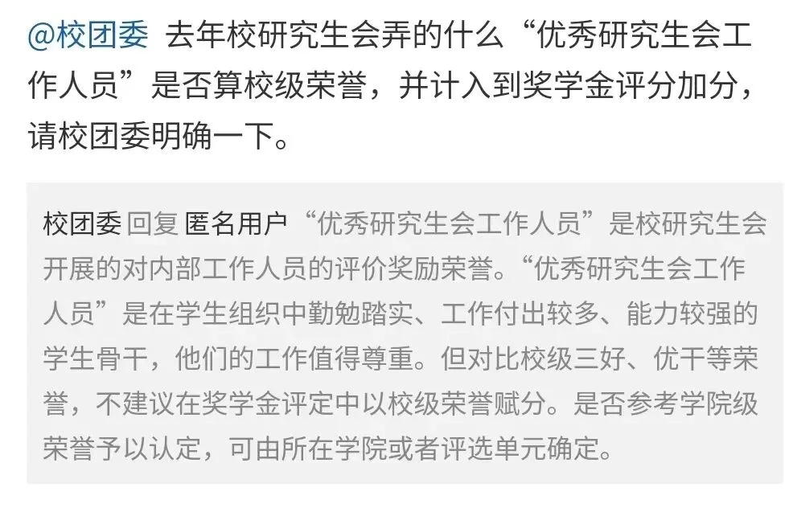
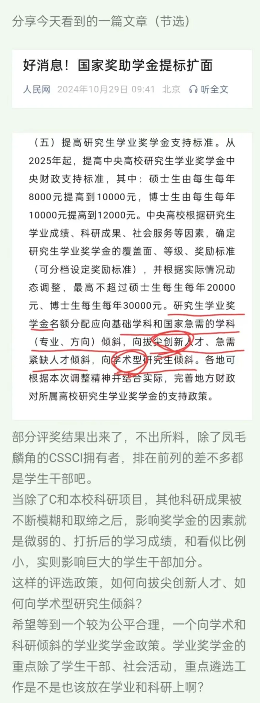
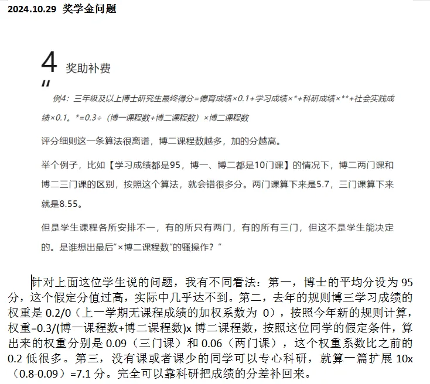
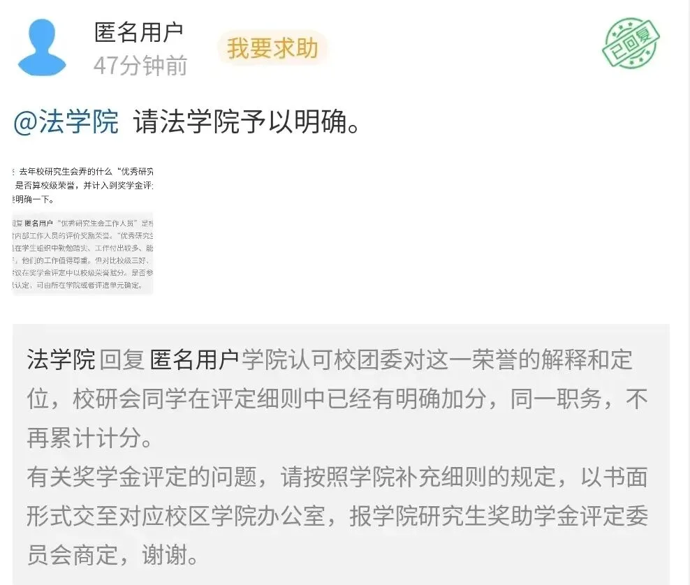
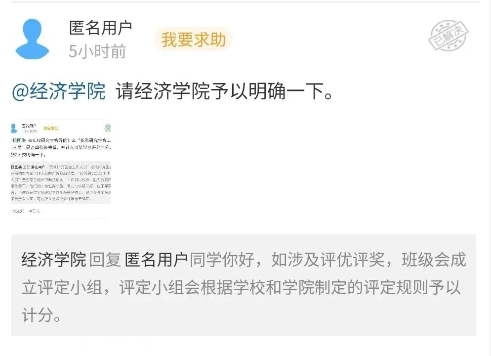

请相关部门及时关注并跟进问题。

## 1 校园网问题

> “投稿：感觉这个月校园网走得出奇地快，半个月就用掉了这个月的免费流量，10天充了3次网费（累计15元），而且每次充完流量两天就用完了。我国庆期间和每个周末都不在学校，也没有下载游戏/超大文件/看高清视频，以前校园网的免费流量对我来说很够用，但是这个学期开始每个月至少都要充网费。学校为了圈钱吃相也太难看了吧，刚上大一的时候每个月还能剩下三分之一的流量，调速之后基本够用，现在直接强制充费了？连校园网都要克扣的学校也是太小众了哈，据我所知有些高校校园网流量都是免费提供的。”

## 2 食堂

“投稿：求二食堂的各个面和粉窗口出小份定价。份量实在太大了，每次都倒掉一大半，很有罪恶感…”

## 3 接诉平台

## “投稿：

“社论！我发现现在接诉即办，匿名提问完以后，如果想截屏转发给其他同学看，截屏是默认带水印的，水印有姓名和学号。”

比这个更现实的是，接诉即办后接到相关部门电话，电话那边直接叫出了自己的名字。所谓的匿名，不过是一种名义上的匿名。

补一条，如果能在基层解决的问题在基层解决当然效率很高，但问题有时成为问题需要上级的“关注”，没有关注的问题是“个别学生问题”，关注了的问题就转变成了“工作/行政问题”，基层才有“动力”去解决。有问题也不是不给解决，可能是“拖”，直到结束（比如过了奖学金评比的时间）的时候，问题自然就消失了。

题外话，过去半年了，大家提交的提案进度如何有人知道吗？提交提案的时候需要评估提案的各个维度，那提案落实的情况有没有相应的评估体系呢？”

（见《[【读者投稿】十月，在社科大遇见行政](https://mp.weixin.qq.com/s?__biz=Mzg2MjcwNzQ1Mw==&mid=2247489696&idx=1&sn=fbcc80dc4e8f9b48eeba62c0437143a4&chksm=ce029332f9751a240b34bfd3a2e0969b942b2eca633493d61a28bc7d14d554cb9e946eda2e62&scene=21#wechat_redirect)》第1条）

## 4 奖助补费

“学校别评奖学金了，这么点钱大家平分算了，徒增大家负担的电子化，无脑的规则，你不会搞也可以抄啊。科研导向变成当官导向，弄得是个啥呀。

从开学非要定位报道，到上次自习室不合理规定搞的大家群起反抗，再到这次奖学金，这学期咋回事啊，怎么整的幺蛾子比以前还多，人改革不都往好了改吗~”

> “奖学金真的挺可笑的，今天听了我们学院的国奖评选，学校规则搞不清楚，学院也出不了明确的细则，最后就是班委和评奖的同学自己讨论决定，于是各位大显神通，排除异己，尽全力给自己拉分，最后导致老老实实做科研的人没分，积极参加活动的人一堆分。各位评学业奖学金就知道了，到时候肯定是按国奖的标准来”

## “社论，投个稿，可能涉及大家评奖，这种东西有信息差，各个学院都是模糊不清的。”

## “投稿：

## “投稿：

“投稿，看到上期学工处所谓“难道国家政策在颁布前还需要提前告诉你吗？”至情至性的回复，不由齿冷。首先就像那个同学质疑的一样，一个学工处的细则有何德何能比附国家政策？我们学校有些行政人员官没有多大，官瘾倒是不小啊，怀着都不是“响应”而是“制定”国家政策的“英雄气概”来制定一个学校的细则，真当自己在行“政”了啊，还真以为自己能影响多少人，管多大事？我只能说让您这些人屈就于我们社科大这个小庙自我耽误太屈才了。没能让学工处某些大人尽兴，真是抱歉，建议您这些人还是换个能充分发挥能力的地方高就吧。

再者就算把问题置换成“难道奖金细则在施行前还需要提前告诉你吗”，也非常不妥，因为其潜台词是“没必要告诉你”。这不仅正应了之前大家吐槽的有人作风缺乏科学性与民主性，更反映出他们对学生居高临下的命令思维。不需多虑便可知，一个细则既然对大家有影响，那么大家对此事当然具有得知详情、表达见解、修改细则、使之公平公正的权利与责任，否则便完全可以抵制其对自身造成影响，或曰不同意。相信这合乎上级部门做出“学生对学校与学生权益相关事务享有知情权、参与权、表达权和监督权”相关规定之精神。

出现这样的问题，也让我们不由得细想，纵观奖学金争议与补助问题中所展现出来的学校种种回应与举措，那位分管学工的、在学工宣传中大出过风头的校领导又发挥了什么样的作用，扮演什么样的角色呢？奖学金争议、补助呼声这些锅很沉，全让学工这个部门背了，那也算是“贪天之锅”了吧。无论如何，相信学校应该还是有行政管理者在管理的，部门也不是无法无天的，希望有些人负起应负之责，给大家一份切实的答卷。

不过，这不是和你说他们不清楚这一点，或者祈求某种恩惠。毕竟前些时日学工还做出了“新的奖学金制度在去年评奖过程中就已经开始重新制定了，期间经过多轮学生座谈及论证……”的回复。如果学工处有些人不是前后矛盾、精神分裂、语无伦次、说话没有逻辑性之病人的话，那只能说这次“至情至性”的回复更能说明问题。为什么“没必要告诉你”？因为你作为细则的被影响者就不具有主体性能动性，而只是一个接受摆置的玩偶而已。出台什么细则，你就服服贴贴受着；做出什么命令，你就不需细想接受，即使它们和你自身息息相关，这就是有些行政人员对于学生教职工在心底里的刻画。也无怪乎他们总是感觉良好，毕竟“手握大权”嘛。所以，接诉是可以敷衍的，回应是可以遗忘的，细则是没必要告知的，做出部署之余是视而不见大家问题与呼声的。于是乎，颜面尽失的人在自我感觉良好，不需被告知的人在凭运气生存。”

（见《[【读者投稿】十月，在社科大遇见行政](https://mp.weixin.qq.com/s?__biz=Mzg2MjcwNzQ1Mw==&mid=2247489696&idx=1&sn=fbcc80dc4e8f9b48eeba62c0437143a4&chksm=ce029332f9751a240b34bfd3a2e0969b942b2eca633493d61a28bc7d14d554cb9e946eda2e62&scene=21#wechat_redirect)》第4条）

## 5 学院问题

“商学院某专业国家奖学金候选人和评议小组竟然有人员重叠，这算不算企业出纳兼任核算呢，合着会计合规都学忘了是吧。”

> “请问经济学院在博士国家奖学金评审中，为什么不认定AMI扩展的论文成果？学院提出“唯核心期刊”的评审标准，这使得国家奖学金申请变成了一种对期刊标签的简单筛选，而非对学术价值的全面评估。事实上，独立投递非核心期刊，对学生的要求更高，既需要专业知识，也需要独立的学术思维和写作能力，这些期刊的论文审核同样严格。同时，一些学生在导师的支持下，可以更容易地发表核心期刊论文，因为导师拥有学术资源、人脉和发表经验。而一些没有导师支持的学生，投递AMI扩展期刊却因为非核心期刊的“标签”而不被认定，使得这些付出更大努力的学生得不到应有的认可。此外，AMI扩展期刊的论文质量并不一定就低于C刊，部分C刊的审稿流程可能会受资源或审稿人素质的影响。这种奖学金评审方式不仅在资源和机会上对学生有失公允，也对学生的独立科研能力培养和学术多样性的发展带来了负面影响。”

## “社论，投稿，不同学院的态度。只能说某学院和稀泥的能力太强了。”

（见《[【读者投稿】十月，在社科大遇见行政](https://mp.weixin.qq.com/s?__biz=Mzg2MjcwNzQ1Mw==&mid=2247489696&idx=1&sn=fbcc80dc4e8f9b48eeba62c0437143a4&chksm=ce029332f9751a240b34bfd3a2e0969b942b2eca633493d61a28bc7d14d554cb9e946eda2e62&scene=21#wechat_redirect)》第3条）
