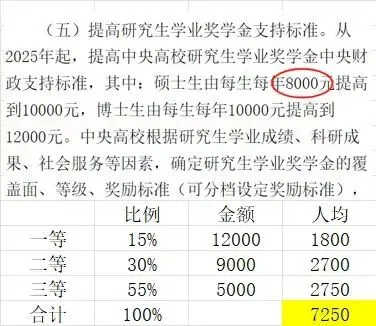

请相关部门及时关注并跟进问题。

## 1 校园网问题

“这个月网络是什么情况啊，充了10块钱，白天甚至都不在学校，只是晚上回来用网络，结果两天就提示余额不足了？我的流量甚至不需要人在学校，不需要连接网络就消失了？”

“良乡校区最近的校园网有点奇怪了，不太稳定，网速可能也不太好。今天凌晨一点左右突然网络就没了，然后等五分钟又来了，之后又很快断了，然后过了一会才恢复。网费没有问题，同寝其他人都中招了，所以感觉应该是校园网的问题吧。如果是网络中心因故断网，请提前发个公告通知一下。

此外今天的校情通报会，用校园媒体平台观看，中途突然就卡死了，等好长时间也没有恢复，刷新页面看一会又卡死了，不知何故，希望增强一下视频播放的稳定性，尤其是网络中心还在场，更加幽默。”

## 2 教务问题

“投稿关于课纲的相关问题。最近因为需要证明自己所修课程，所以去翻了课纲，感觉课纲使用起来不太方便。一方面新学期的课纲基本取消了原本就不算多的英文内容，使用起来更加不便，建议教务处以后的课纲都起码有中英两个版本，这样方便大家取用，也更公正。

另一方面理解学校作为新建学校培养方案、课程开设等变动较多，而这样的话学生会有查看老课纲的需求。有可能某年一同学选了课程课纲为A，明年课程就更换上课老师、授课内容等变成课纲A’，抑或该课就停开了，这样该同学有需要用课纲A（而非现在的课纲A’）来证明自己选过课程的时候，目前在系统中是无法找到之前的课纲A的，这影响学生所选课程的公信力。希望教务处以后能改进一下，方便大家公开公正查阅过往以及本学期所有课纲。”

## 3 食堂

“本来不想因为一些小事占用公共空间，但实在不吐不快。此条吐槽二食堂养生粥饼窗口。本人六点点了一份炒饭，档口说要等，问要等久，答曰十分钟吧。本人等待的时候周围人越来越多，然后发现员工一直在登记别的餐以及收费，师傅只做盖浇饭，很多来得晚的同学在本人之前取餐，这时约六点十几分，遂开口询问该员工什么时候能做炒饭，等了蛮久了。该员工开口没有任何抱歉，上来就是不耐烦地:谁说你等久了，明明刚刚才来。..炒饭很慢，你换个别的吧。….最后在本人坚持和催促下终于拿到炒饭--炒焦的。

不满的有几点:

第一，态度问题。在食堂吃过那么多次从来没遇到过如此不耐烦的态度。

第二，出餐制度。如果做不了或者等待时间长为什么不点餐时明确说明，而是已经付出等待成本再建议换餐?另外炒饭似乎不是很困难的菜式，从我催促开始做到出餐不过两分钟，为什么此前只做盖浇饭和卷饼，这还分什么优先级?建议好好学习隔壁的态度以及出餐方式。做不了干脆别做了。

第三，卫生问题。据我等待时观察，该档口员工在收费，做卷饼，记录盖浇饭期间一直带着接触食物的手套，拿笔记录也不摘下，随后又直接抓取食物。请问食品手套是这么使用的吗?食品卫生问题如何保障?如果形式主义还不如不戴。

最后，品质问题。如上，拿到手炒焦的炒饭。事实上之前点盖浇饭，发现师傅也并不洗锅，导致点了不辣的浇头实际辣得难以下咽，里面还有上一锅残留的辣椒籽……”

## “一食堂刚取出来的勺子。”

## 4 奖助补费

## “财政部、教育部、人社部刚发的意见通知，浅算了一下，不知道哪里出了问题？”

（见《[【读者投稿】难被解决的问题与被解决的人](https://mp.weixin.qq.com/s?__biz=Mzg2MjcwNzQ1Mw==&mid=2247489748&idx=1&sn=358e9e789bf2351b50e3a44d6f35dda2&chksm=ce029346f9751a505d2bf0e36b1969e66b28bd98be70245380a3336144dcc4c5aaecede6ea3e&scene=21#wechat_redirect)》第4条）
