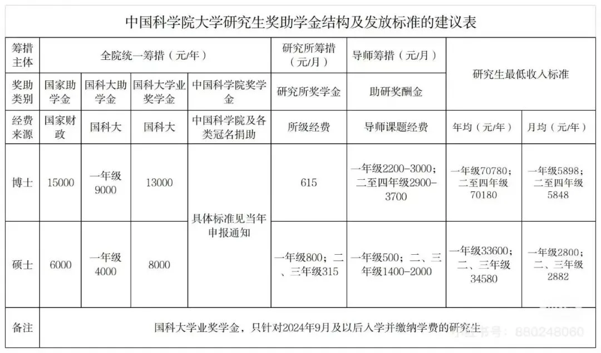

请相关部门及时关注并跟进问题。

## 1 图书馆

> “投稿：图书馆中午清东西问题！ 中午大家都是去吃饭睡一小觉，这么短的时间一般也不会有人订座，建议学校图书馆预约系统改进一下，正常高校图书馆中午的暂离时间都很长的，建议增加时长，至少两小时吧。另，图书馆书柜可以设置一个暂时存取的程序吗，每次拿都要把东西全部拿出来，太麻烦了。”

## 2 教学楼

## “望京校区教学楼管理

现在面试答辩用教室都不提前报备、提示吗？麻烦管理人员，如果教学楼1楼有面试需要占用的话，提前告知下大家吧，让大家提前安排自习的地方。”

## 3 科研

> “同样质疑新苗和研创已发表的论文为什么要查重？如果学校对刊物有异议，不应该谁主张谁举证吗？以前也没有过这一条规定，现在所有项目一视同仁都让查重，这是在给知网查重拉kpi呢？”

（见《[【读者投稿】舍本而事末则不令](https://mp.weixin.qq.com/s?__biz=Mzg2MjcwNzQ1Mw==&mid=2247489786&idx=1&sn=cf105d7f1b9942a2e7a0423c745cd5d7&chksm=ce029368f9751a7e447493a5e4059b095b18f0773c89ec3b2e146a329d3eba1c4af1105bc38f&scene=21#wechat_redirect)》第2条）

## 4 奖助学金

## “小红书上看到的 不知道来源是否真实

”

> “投稿：文学院奖学金评比：1.C扩不给加分，拿着一个科研奖励方法的文件，公然与学校评奖学金加分细则（C扩➕10分）背道而驰，这合理吗？学校不管管吗？ 2.合着班干部啥也不用做直接➕1或1.5分呗，我们认真做学术的就活该吃哑巴亏呗？”

（见《[【读者投稿】舍本而事末则不令](https://mp.weixin.qq.com/s?__biz=Mzg2MjcwNzQ1Mw==&mid=2247489786&idx=1&sn=cf105d7f1b9942a2e7a0423c745cd5d7&chksm=ce029368f9751a7e447493a5e4059b095b18f0773c89ec3b2e146a329d3eba1c4af1105bc38f&scene=21#wechat_redirect)》第4条）
