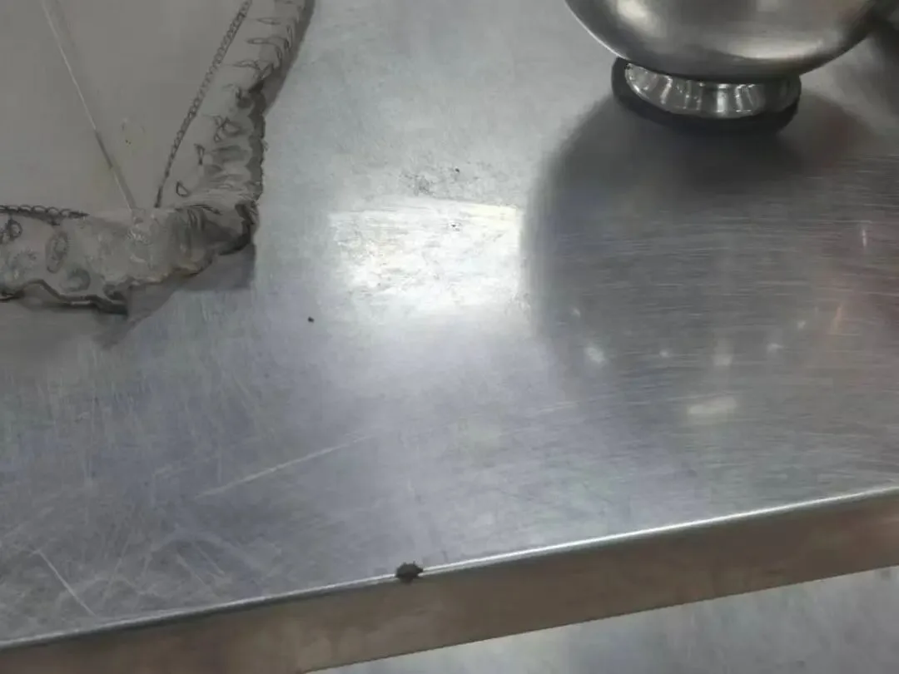

请相关部门及时关注并跟进问题。

## 1 食堂

> “在夜宵时间食堂的调料桌上发现的可爱小生命捏希望你校继续保持这样的卫生水平捏——这就是社科大吗？平时在宿舍楼里就没少见这种臭虫，现在更是直接在食堂骑脸。希望它下次出现的地方不是调料桌，是餐桌，是窗口捏。”

## 2 科研

“学校的开题报告，文献综述字数线是12000字，对于想陈述清楚事情，这个字数有点少。希望学校在开题报告文献综述方面不设字数线。”

## 3 奖学金评选

“我真的是忍不住要说一下23级政某院某班评奖学金这件事，真是让人感慨，你们真是严于律人，宽以待己啊。你们审核同学们提交的评选材料，那真是严苛到极点，简直像是在鸡蛋里挑骨头，这个不符合程序，那个对同学又不公平，这个程序到底是谁定的，我请问呢？这里边谁才是心无旁骛真正为大家服务的，想必明眼人都看的出来吧。

还有德育打分的问题，据我了解，你们班有不少同学甚至连辅导员长什么样都不知道，那这些德育成绩到底是怎么评的？老师是通过何种渠道何种方式了解班级情况的？老师是否是在了解每一个同学为人的前提下给出的分数？如果仅仅是根据是否担任班委来评定差异化的成绩，那班委后面的社会实践加分又算什么？

另外这个奖学金评选了，三好学生、优秀学生干部也都选出来了，那班干部是不是也该换届了？毕竟这个奖学金加分挺高的，至少也应该给其他同学一点机会吧。基本的民主和公平还是要有的吧？老师躺平了不组织选举也就算了，但为什么这时候班委就没人提程序正义了呢？没人说这件事就要一直这么占着位置。如果想继续做，起码也应该走个投票程序吧。”

> “政府管理学院硕士奖学金评选，班主任在从没露面的前提下，在德育成绩一栏给全班同学打出了差异化的分数。问题来了，很多同学甚至连老师名字都没听说过，这位老师是怎么在道德上给班里同学分出三六九等的？这位老师懂不懂实地调研的重要性？我们是不是可以合理怀疑这位老师的工作能力尚不达标，还是说仅仅根据班里的少部分人意见对大部分人的道德水平做出评价？作为一个学院的党团负责人，这样的工作作风，会不会伤害向党组织靠拢的积极性？ 而且班级到现在这个时候还没有组织新的班干部换届选举，学校新的奖学金评选标准可是让很多同学为班级做贡献的积极性高涨，再说政府管理学院向来都是倡导民主、公平、正义的，为何到现在辅导员不出面不组织？班干部也没人提这事？昨天奖学金排名公示了，在绩点拉不开零点几分的前提下，班干部们社会实践人均二三十的加分带来了巨大优势，是不是还想利用新的奖学金评选标准在明年的评选中再大捞一笔？”
