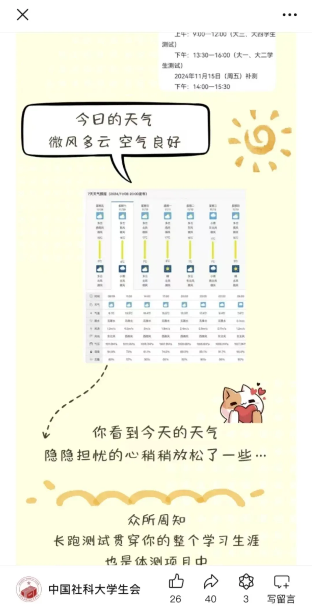
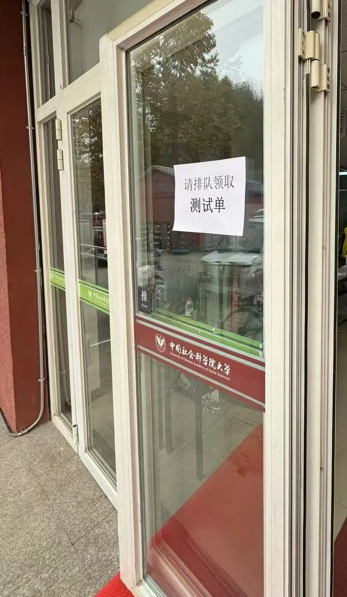
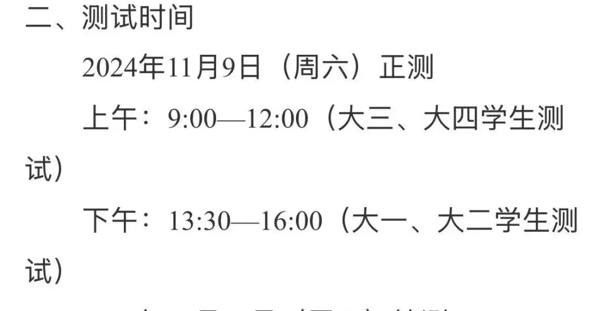

请相关部门及时关注并跟进问题。

## 1 食堂

## “投诉一食堂，一份蒜苔炒肉百分之八十都是肥肉，根本没法吃。”

## 2 体测

> “请问学生会真正做到实事求是了吗？明明是个中度污染雾霾天，凭什么要美化成空气质量良好误导学生，撰稿人居心何在？学生会已经失去了公信力，我们还能相信学生会什么？学生会现在看来是一个高高在上的官僚集体，请问你们还记得自己的初衷吗？”

“批评体育组及本次体测部分志愿者，工作不到位。通知说16:00结束。结果15:50就想着要提前下班，不发条、不允许同学测试。这样的作风和态度是不正确的。（心平气和地说，希望体育组好好改进。最令人感到不满意的点就在于，体育组未发通知说明“想要提前下班”，在现场宣布提前下班！ 当然，也知道他们都很不容易哦，向他们道一声辛苦了！姜丝可乐也很好喝。

同时表扬体育组关于暂缓测试的通知，考虑到了学生健康！”

