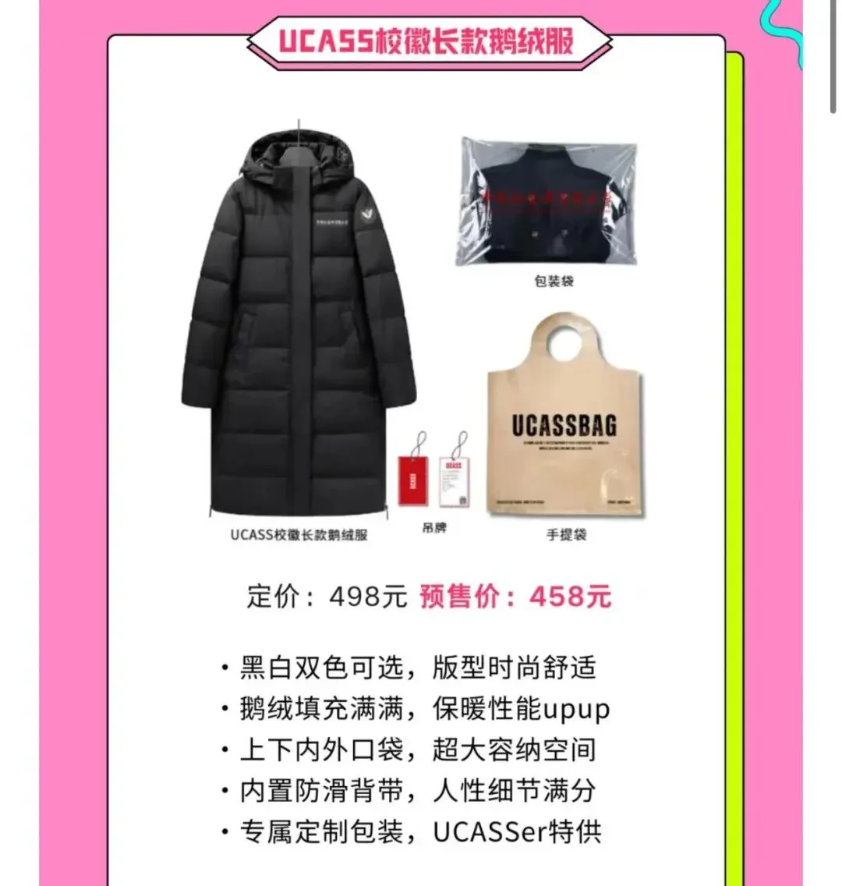
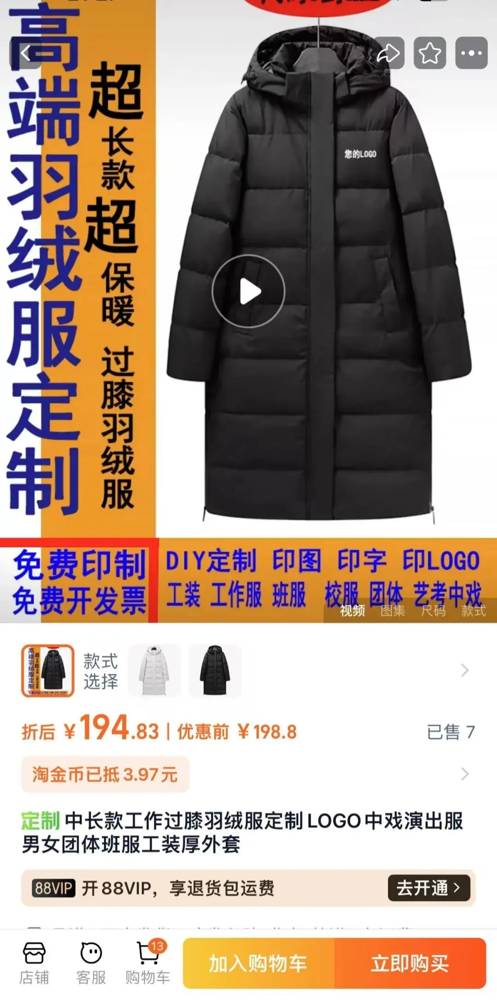
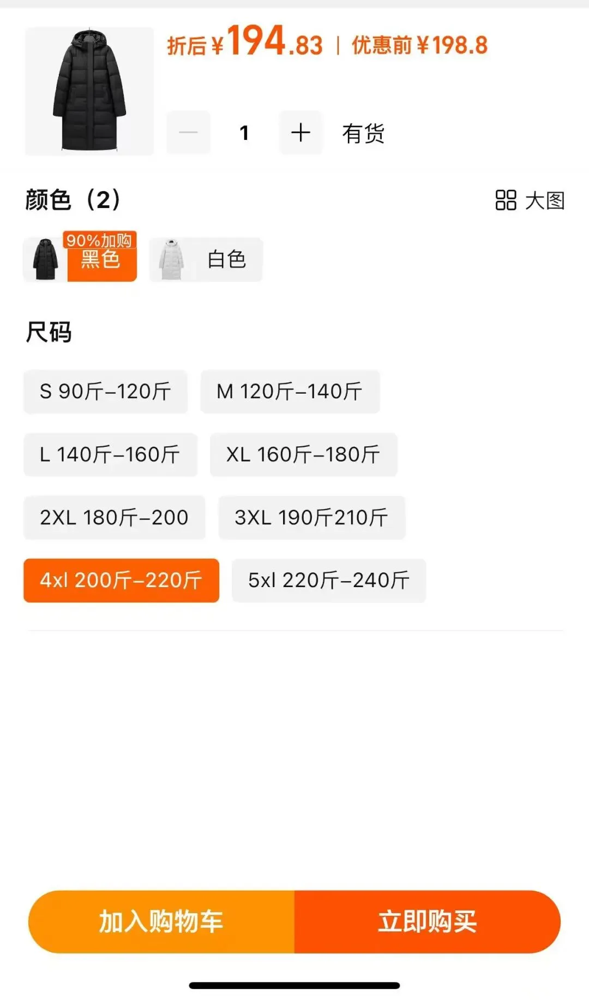
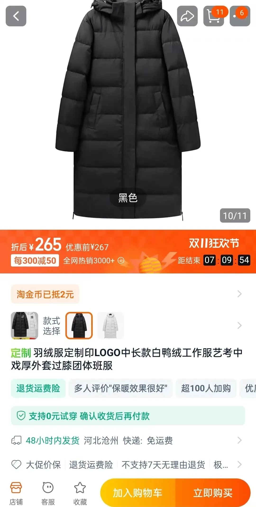
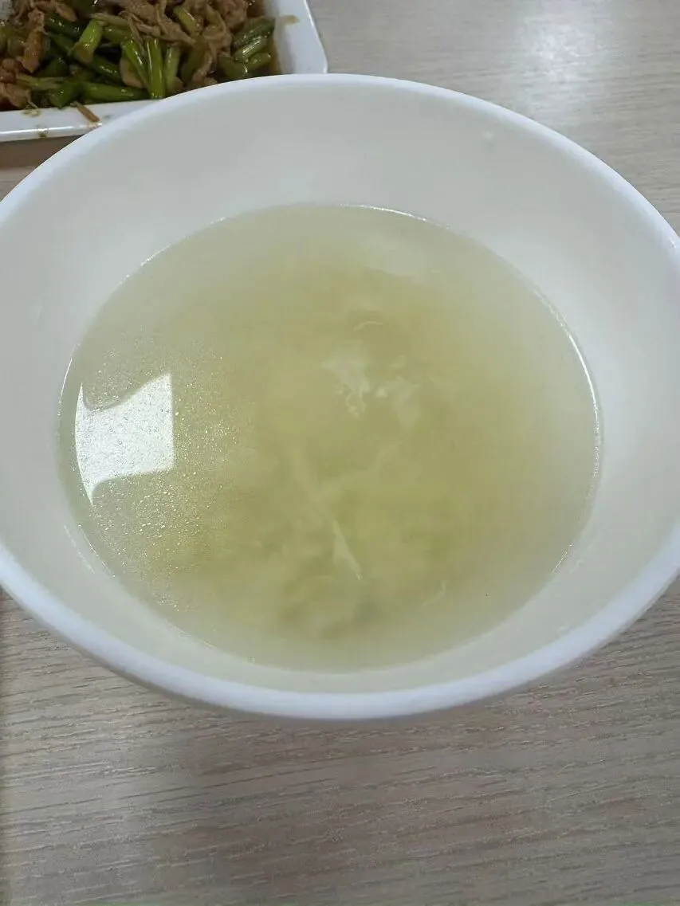

请相关部门及时关注并跟进问题。

## 1 宿舍

“良乡校区5号楼2F到6F没有公用吹风机，大冬天的洗完澡从6F去1F吹头发，极其不方便，主要是冷呵！

望后勤处在5号楼2F到6F各层加装吹风机！”

## 2 文创售价

> “图一为印象社科双十一活动售卖的羽绒服，其余为淘宝图片搜索后发现的羽绒服。可以看到，图片完全一致，价格从淘宝的一百多二百多变成了四百多，感觉有点贵了。觉得这个贵的朋友，或许可以直接去淘宝商家给一模一样的衣服印logo。”

## 3 食堂

## “良乡校区一食堂，汤腥了。”

## 4 奖学金评议

> “经济学院评奖学金多少有点黑了。某个合同工同学一门专业必修都没修，却能评一等奖学金。奖学金评议成员集体反对的情况下，班主任却连连包庇，还问“你们评议小组能代表全班同学吗”。评议小组集体意见不能代表全班同学，班主任一个人的意见却能代表，乐。”

> “就11月10日经济学院奖学金一事，想对今年修改后的评选政策提出疑问：为何经济学院社会实践一栏只允许阳泉和丹凤活动（去山西和陕西的两个调研活动）加分，其余活动比如经济学论坛之类一律不加分，而某同学恰巧为两项活动的负责人？”

（见《[【读者投稿】寡而不均](https://mp.weixin.qq.com/s?__biz=Mzg2MjcwNzQ1Mw==&mid=2247489825&idx=1&sn=eb757d11246a680225679319e94d81b8&chksm=ce0292b3f9751ba571d1b349307666b1c48f6d0a5bf5de8b5169d6b6da91faeefbcaeeadcf72&scene=21#wechat_redirect)》第1条）
