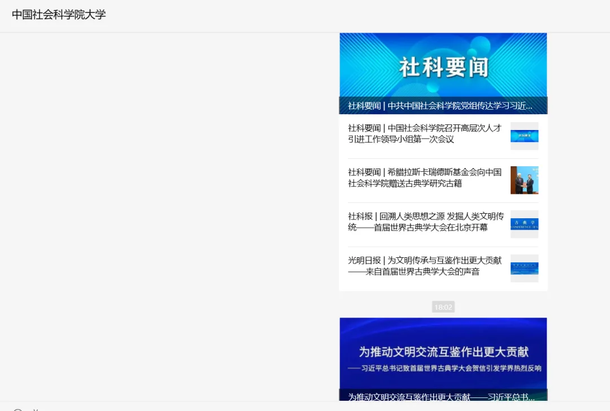
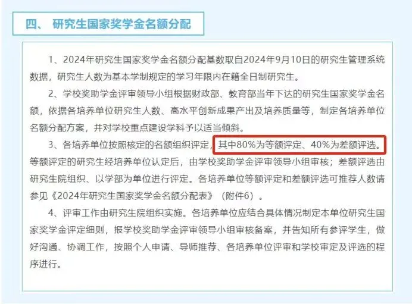

请相关部门及时关注并跟进问题。

## 1 科教融合&教务问题

“学校官方公众号连续转了一大堆关于古典学大会的讯息。但是令人遗憾的是，作为号称是古典学研究重镇的社科院以及把古典学纳入“冷门绝学”的社科大，却连一门古典学的介绍性课程也没开给本科生。

成立了古典学研究室，建了冷门绝学的研究院，但我们仍然是墙里开花墙外香，没能体现在本科生、研究生的培养上。就古典学学科而言，无论是体系化水平还是课程开设的数量、质量都相比于真正的一流大学有较大差距。这一学科其实是具有长久生命力的，而并非一时流行之物。推进科教融合、加强学科建设不能只存在于新闻通稿里，而是要表现在人才培养的具体细节上……

希望校方重视这个事情，办法他们自己有，只是压根没想管这事而已，无论如何，再补几句吧：

希望学校可以考虑

（1）本校的古典学资源分散在外国语学院、历史学院、国际政治经济学院、哲学院等多个学院、系，希望能够对这些资源有所整合，开的课程在彼此之间最好可以共享。以及，有些古典学的老师尚未在本校开课，其实是件挺遗憾的事情。

（2）目前零零散散在各个系开了一些与古典学有关的课程，但是缺乏统一的规划和梳理，数量和质量也颇为参差不齐，更缺乏“古典学概论”这样的系统性课程，建议可以作为本硕博一体化考虑的一个方向。

谢谢！”

## 2 食堂

## “近日网上刷视频发现，原来几年前的望京食堂还有现做刀削面、拉面和烧麦。

现在的望京食堂，满满的预制菜，不是锅包肉就是酸汤肥牛，要不就是蒜香排骨，预制菜翻来翻去的卖。

甚至连米粉都是预制的，上次眼睁睁看着他们拆开一包米粉倒在盆里……

为什么食堂要用这么多预制菜啊？连面条都懒得弄吗？请了这么多员工，最后搞了一大桌预制菜。”

## 3 校园安全&宿舍闸机

## “投稿：@校领导

https://mp.weixin.qq.com/s/HoAIy3hDDaQM\_QNV1C2VgA”

## 4 文创定价

“回应上条【2】朋友们૮ o̴̶̷᷄ ·̫ o̴̶̷̥᷅ ა抱歉占用公共资源，咱的羽绒服是白鹅绒，样式和北电中戏都是同款，但填充物不一样的。因为商家那边没有衣服相对平整的样图，所以为了方便设计、展示直观，小鸽的朋友找的同款同样式的网图，但填充物不一样的哇。

这边不建议大家随便找商家印logo，一是商家质量参差不齐，定制商品就算有质量问题也不可以退换，小鸽和朋友们也是选择了不同的店家，下单不同的样衣才筛选出来的；二是定制产品印logo的时候或多或少会出现大小和位置的问题，所以一般都需要提前打样，打样费甚至比正常下单要高，一旦打样效果不理想就需要反复和商家沟通再打样，对于个人来说成本花销太高，希望大家理解。”

（见《[【读者投稿】一人与多人](https://mp.weixin.qq.com/s?__biz=Mzg2MjcwNzQ1Mw==&mid=2247489844&idx=1&sn=ee299c3e2311c0c6912b263210d891d9&chksm=ce0292a6f9751bb0df04fe7703cd492c289f71bd63113884aa16d8d013facffc80a2cbe3de58&scene=21#wechat_redirect)》第2条）

## 5 奖助补费

> “投稿 : 就昨天“为何经济学院社会实践一栏只允许阳泉和丹凤活动（去山西和陕西的两个调研活动）加分”的情况，我也想提个疑问，经济所的重大国情调研课题无保调查暑假在学校招了大批志愿者做调查实践，经济学院先是拒绝对自己所的课题活动给学生开实践证明，又在经济所已经开具实践证明的情况下不予承认加分，不知是何原因。而其他学院不仅能作为实践项目认证，甚至有的还能作为科研项目，可能这就是经济学院科教融合的态度吧，乐。”

## “投稿：

研究生奖学金评审问题

1、学院的评审标准中，为何部分同学在未修任何专业必修课的情况下也能获得一等奖学金？而已经在第一年就完成培养方案学分的同学在参评时，学习成绩一栏却只能被计算为0？这种评分方式是否合理？在设计评分标准时是否考虑过这种情况的公平性？

2、学校和学院的评审导向是什么？虽然提出以科研为导向，但在社会实践活动的评分中却没有明确设定分数上限，既然普刊、著作和报告都有分数上线，那为什么社会实践活动不明确分数上限。有同学因参与活动加三四十分，而发表一篇核心才加20分。这样的权重设置是否符合“科研导向”的精神？研究生独立发表核心期刊难度不小，若与导师合作，二作核心的分数甚至会被稀释到4分，这是否过低？而且不同核心刊物之间的发表难度和影响范围也是有差异的，这种期刊分级的模式是否缺乏深入的考虑？

3、社会实践活动明明有校级和院级，很多同学参与的院系活动也有相应的证明，为何不被认可？希望以后举办活动时明确标注哪些活动可以作为评奖评优的证明材料，以便大家选择参加。

4、若院级活动不被学院自身承认，学院是否还需要组织这些活动？参与活动的同学辛苦半天，若最终不能得到任何参评证明和加分，那么参加这些活动的意义何在？若活动不能获得官方认可，同学之间的信任度、学院组织活动的初衷是否都被削弱了？

5、最后，想指出奖学金评审政策制定和责任承担之间的非对称性。学校和学院作为政策的制定者，却不是最终承担政策后果的主体。评审过程中一旦出现对学生不利的情况，后果往往由学生自己承担，而学院缺少有效的反馈和整改机制，只会想着将责任踢回给学校。这种不对称的风险分配是否合理？ ”

## “投稿：

吐槽一下马院研究生国奖评选，辅导员把国奖名额按年级划分，明确要求各年级按班级进行推荐，每班仅可推荐一名参加国奖评选，这不就是等额推荐吗？各班为啥不能按照自愿申请提交材料统一参评？如果有符合条件的但碍于年级、班级名额限制无法参评，此做法是否有失公平？评选结果出来以后，辅导员草草公示国奖获奖人选名单，而获奖人选的最终综合得分及学院排名情况一概不发，如何让大家心服口服？现实情况是，符合条件的同学，因为年级、班级名额限制，无法参评，丧失拿到国奖的机会。而有的同学因为有年级、班级名额之便，可以硬推，就算没有学术成果，甚至都可以加推到国奖推荐名单之列。

国家奖学金名额扩大一倍，但学生的参评权利却在极力缩小，符合条件的同学，甚至连提交国奖资料的参评资格都没有。如此背离国奖的初衷，真是万分悲哀。

看看兄弟院校北京理工大学发布的国家奖学金评定通知，里面明确要求“80%为等额评定、40%为差额评选”。不会评可以不评，但不要瞎评，希望某学院能学习借鉴一下，给符合条件参评的同学一个差额评选的机会，就算落选起码也是心服口服。”

（见《[【读者投稿】一人与多人](https://mp.weixin.qq.com/s?__biz=Mzg2MjcwNzQ1Mw==&mid=2247489844&idx=1&sn=ee299c3e2311c0c6912b263210d891d9&chksm=ce0292a6f9751bb0df04fe7703cd492c289f71bd63113884aa16d8d013facffc80a2cbe3de58&scene=21#wechat_redirect)》第4条）
