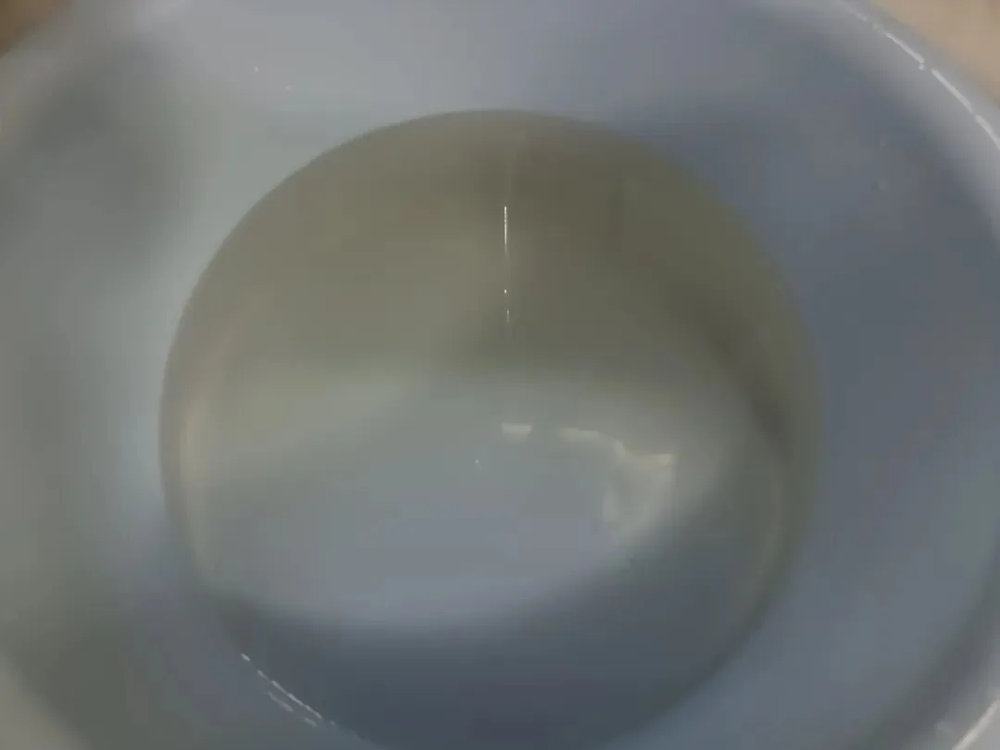

请相关部门及时关注并跟进问题。

## 1 校园卫生

## “为什么洗手台放出的热水这么脏？（良乡校区一号楼）

还有，一号楼洗衣房的洗衣机洗完羽绒服，羽绒服上吸附了很多机桶久不清洗的脏垢？每周一洗衣机的统一清洗都是做样子的吗？？？到底有没有用洗衣机清洗剂进行去垢杀菌的清洗？”

## 2 奖金问题

“有的学校评国奖规则是：学业奖学金排名确定之后，学业成绩和综合排名均位于前x%有资格申请国奖。符合申请资格的同学上交材料，进行现场公开答辩。评委（各专业教师代表，因为各专业老师们熟悉同学成果的含金量）根据某一规则选定获得者。（不知我校能否借鉴）

另，希望在公示期内即公示候选人的材料情况（标注具体加分项）。包括：

学业成绩（平均学分绩点，学业成绩班级、专业排名）

科研活动、

社会活动等，

以及综合成绩总分和班级排名。

仅供参考，谢谢！”

## “为什么商学院的奖学金把全日制和非全日制一起排，难道不应该分开来排吗？”

（见《[【读者投稿】算计](https://mp.weixin.qq.com/s?__biz=Mzg2MjcwNzQ1Mw==&mid=2247489907&idx=1&sn=5ccf4965cea7e84ae0835c6518a67927&scene=21#wechat_redirect)》第2条）

## 3 图书馆

## “投稿：

图书馆占座清理问题

强烈吐槽图书馆管理员每天在大家吃饭时间（特别是中午12点到2点左右）清理占座的行为。

大家都知道近期图书馆预约非常困难（这是在之前几个学期都不曾出现的现象），12点之后进入第二天的预约界面，发现已经座无虚席，因此图书馆工作人员们为了缓解资源紧张，会在每天的吃饭时间带着小推车进行检查，并带走占座位置上的所有物品。首先对工作人员们的辛苦付出表示感谢！但事实上，如此处理非但起不到缓解资源匮乏的效果，反而会导致大家的时间规划更加紧张、行动更加疲惫，具体原因如下：

首先，一食堂特别是二楼的排队问题非常严重，而系统规定的暂离时间只有1个小时，从图书馆走到一食堂二楼+排队+吃饭+返回图书馆，对于许多同学来讲时间非常紧张，很多人为了避免重复往返，会选择先释放座位，然后再预约下一时段。但是图书馆工作人员在检查时，只要看到座位处于“未预约状态”，就直接将座位上的全部东西收走。不但对于占座的同学容易造成物品遗失的风险，更重要的是，其他同学如果认为个人离去时间可能会超过1小时，则不得不所有收纳物品，再次预约座位，回来以后再重新归置物品，极大了浪费了时间和精力。

其次，工作人员们检查时间大多在中午12点，很多同学虽然占座，但也紧接着预约了下一时段，间隔时间并不长，即使清理了物品，中间的短暂时段之内，一般也不会有其他同学再次预约，导致事实上座位也是空置在此，并未给其他同学带来真正的方便。

最后，由于本学期图书馆整个系统的升级，大家暂离和签到基本完全依靠人脸识别，所以现在不慎违约的可能性已经大大降低，大部分人违约的情况基本都是预约不来。经常去图书馆的同学都会发现，虽然每日预约困难，但是图书馆特别是上午时段的空置率非常高，究其原因，还是因为目前图书馆对于违约问题的处罚力度过低（三次违约之后仅三日之内禁止预约），大家及时违约也毫不在意，但未曾想到这是对公共资源的浪费。

面对本身紧张的公共资源，图书馆的工作人员们要想真正解决问题，建议不要仅仅简单粗暴的从表面工作入手，而是深入调查问题的实质，然后想出更深层次的解决办法，比如：

1.适当延长暂离的时间，如允许每次暂离1.5小时至2小时，或者是给出当天在馆期间允许暂离的总时长，由大家自由分配时间。

2.加大违约处罚的期限，比如由3天不能预约变为当月均不能预约，这样让真正不需要第二天来图书馆的人在盲目抢座前会慎重考虑。

烦请工作人员们根据以上的观察描述，认真参考！”

（见《[【读者投稿】算计](https://mp.weixin.qq.com/s?__biz=Mzg2MjcwNzQ1Mw==&mid=2247489907&idx=1&sn=5ccf4965cea7e84ae0835c6518a67927&scene=21#wechat_redirect)》第1条）
