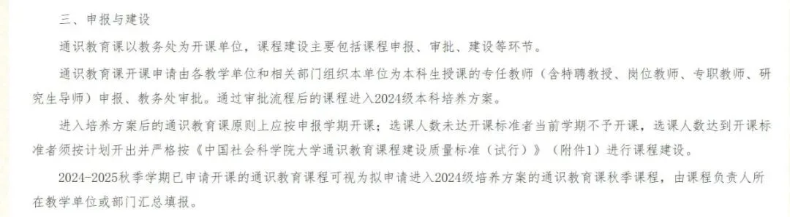
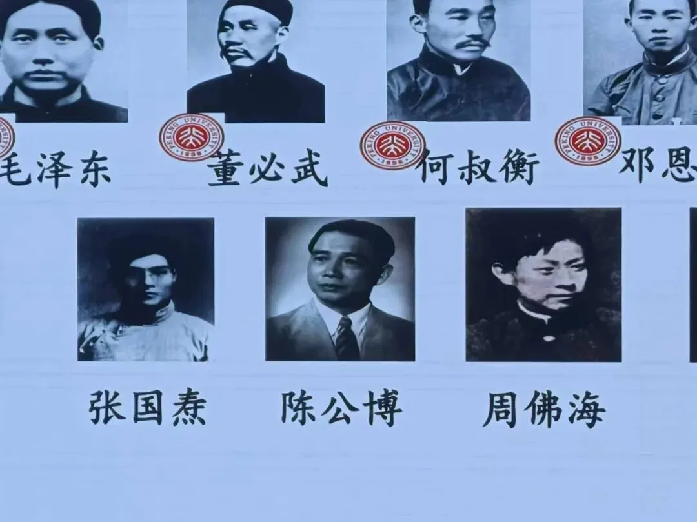

请相关部门及时关注并跟进问题。

## 1 财务报销

“社科大财务处养着一群尸位素餐的口口！人都毕业半年了、快12月了，还要再填报一遍3月预答辩、5月答辩的酬金发放单及附件、报销明细表、答辩费汇总表！”

（注：该稿中有一些用语过于激烈，故以口代替，请各位读者朋友自行体会当事人的愤怒）

## 2 食堂

> “投稿，良乡校区一食堂二楼，今晚上在食堂吃饭碰到一女生菜里吃出了绿豆虫，还挺崩溃的，经理也叫过去了，太可怕了，更恶心的是我晚上也吃了炒菜心，已经快吐了，食堂都出了食品安全问题，不知道学校咋解决。。。。。。”

“热烈呼吁一食堂一楼菜卖半份！实在是一份太多了！可以缓解二楼排队。很想知道这个一楼不卖半份是出于什么考虑的分工和传统。”

## 3 教务问题

## “投稿：

通识教育与科教融合

通识课建设是整个大学培养的重要过程，如此，科教融合也应该在这个里面予以体现。但事实情况实在是不尽如人意。本学期13个科教融合学院开设的选修课中，开起来的共45门课，所有岗位教师、研究生导师与特聘教授只开了11门，比例还不到25%。如果加上那些没开起来的课，这个比例更低。这样的比例我相信远远不是科教融合的理想境界——更遑论这11门课还集中于某几个学院之中。我们有这么多的老师，理应开设更为丰富的通识选修课/公选课。

教务处发的这个通知说各教学单位组织专任教师申报。但是，从实际效果来看，大量的岗位教师并不知道、不清楚要申报或者如何申报的事情。从开设的课程来看，新的、前沿的课程寡少，倒是有些质量欠佳的课一次一次排在开课单中。甚至于，授课内容大体一样的课程，在专业拓展课中开一次，又在通识选修课中排一次，挤占了正常的开课空间，扰乱了这样一个秩序。

希望在下个学期的课程中，能看到更多的岗位教师开设的通识选修课，而且既然是科教融合，那么这些课程更应该体现出基础性和前沿性，特别是作为社科院办的大学，也应该瞄准一些前沿的、国家需要的话题。比如针对人口问题，可以请应用经济学院/人口与劳动经济研究所开设人口学的介绍性课程；再比如针对古典学的研究热点，可以请外国语学院/外国文学研究所开设古典学的介绍性课程；又比如针对语言的基础性学习需要，可以再继续请拉丁美洲研究所开设西班牙语和葡萄牙语课程等等。只要去找，去联系和建设，这些事情都不难办。怕的就是不去做，吃亏的那就只能是学生。”

## “投稿：

需要多干正事的教务处

教务处这学期新上线了好多教学规定，其中条文不可谓不繁密。特别是以雨课堂为代表的软件。在这些事情上，教务处办事向来颇有效率。但每学期都要提的教学大纲/全部课程安排表的建设问题，教务处的表现还是令人难以满意。

首先，上学期不少同学多次催促课程大纲的问题，但最后解决的极其的差。第15周按理说要全部上线，但据一些老师说，15周才接到要填课程大纲的信息。更有甚者，同学在接诉即办上提出了，学院才跟老师联系。可见教务处组织的混乱和学院行政的敷衍了事。

而且，教务处既然撤掉了旧版的全课程大纲，建了一个新系统。那就应该及时、尽早上线课程大纲。

据我所知，本科课程现在基本上被固定在培养方案中，老师们自由开课的情况实际上非常少。那么请这些老师更新一下大纲并不困难。教务处或者学院也不要拿排课表来拖延，这两个事情之间并不冲突。下学期周几上课和下学期上什么内容并无关联。

笔者希望，这个工作可以分成几步来完成。前几周，下学期要开的课已经可以基本确定了。那么这两周就是最后确定教师的情况。之后：

（1）在12周的时候可以在“全部课程安排表”中公示课程名、授课教师、开课院系等信息。

（2）至迟13周末完成所有本科课程课程大纲的填写（从本周到13周末大致也有两周时间，如果学院、教务通知到位，也足够了）

（3）在给予同学们一周多时间研究课程大纲的基础上，第15周开放预选。”

罕见课程问题

> “大一军理课实在是太不应该了，竟然用汪精卫的照片下面标的陈公博，如果连这点常识都没有的话还来上军理课岂不是误人子弟？这种低级的错误只会让大家觉得军理课更加的水。老师的课件的如此不认真，那学生还有必要在这听课吗？”

（见《[【读者投稿】表面工作与实质问题](https://mp.weixin.qq.com/s?__biz=Mzg2MjcwNzQ1Mw==&mid=2247489919&idx=1&sn=d9834feb77fe7a598d959e5d82cf670e&scene=21#wechat_redirect)》第3条）

## 4 图书馆

“这几天良乡校区图书馆选座堪比春运、演唱会抢票！！不到一分钟秒没！！每次选的时候就网卡，等再进去大家都选完了！！！这几天到底发生了什么！！！”

> “强烈反对对图书馆投稿的那条，本人因为这学期大多上午有课，不得不中午十二点左右去预约，发现大多只能约到三点，而实际到座位上一看，人走了却把东西大剌剌地留在座位上，俨然视座位为自己的私产。既然离开就应该把座位留给新的在即刻就有需要的人，下午大把人预约不到座位只能离开图书馆，他凭什么觉得自己理所当然地就能私占座位？此外，这类人每天十二点就蹲守在界面入口虎视眈眈，却又大多懒得早起，从十点半开始预约，他们才是造成座位空置的根本原因。”

（见《[【读者投稿】表面工作与实质问题](https://mp.weixin.qq.com/s?__biz=Mzg2MjcwNzQ1Mw==&mid=2247489919&idx=1&sn=d9834feb77fe7a598d959e5d82cf670e&scene=21#wechat_redirect)》第3条）

## 5 宿舍

“望京校区马蜂的问题学校能不能解决一下？这个月我们宿舍进来第四只了，舍友还被蛰了。”

> “良乡校区，能否规定一下在热水提供时间内，入楼温度至少要达到多少，且保证热水清澈可使用？洗锅炉和水管的污水完全可以中间接口放掉。校园热水并不便宜，60度的热水和38度的温水，为什么要学生付一样的钱呢？完全不可用的污水为什么成本要一部分先开水龙头的“小倒霉蛋”承担呢？”

（见《[【读者投稿】表面工作与实质问题](https://mp.weixin.qq.com/s?__biz=Mzg2MjcwNzQ1Mw==&mid=2247489919&idx=1&sn=d9834feb77fe7a598d959e5d82cf670e&scene=21#wechat_redirect)》第1条）
