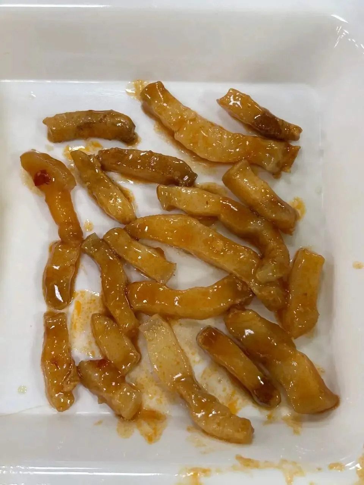

请相关部门及时关注并跟进问题。

## 1 宿舍

“最近换宿舍的风刮的挺大的吧，学校真的不打算下场处理一下吗？作息安排，卫生习惯安排，哪一样是按照开学收集信息做的了？行政层下场给个说法吧”

## 2 教务问题

“最近现在培养方案制定出来以后，教务处理应对开课情况有所监督。不说添加新课的问题，就只说列入培养方案的课程能否按时开足的问题。既然这个培养方案每年都修订，而且请了不少专家来论证。那就应该按照时间开齐、开好。

即使这学期，授课教师有临时安排无法正常开设，那也应该在下一学期及时补开。须知，这门选修课一般是面向固定年级开设的，为了确保可以选修，在排课的时候老师一定会将其和这一年级的必修课错开。但如果间隔一年再开，那么这个课面向的就是下一届的同学。那上一届一般就错过了这样一个机遇（和必修课冲突等因素）。须知，社科大的一大优势是在于相对丰富的专业拓展课。如果这些东西不能保证开设，那么就使得培养的质量难以保证。有些时候可能一门课就会在同学心里种下种子，从而为以后的工作和研究提供基础，这是不应该忽视的。

我们希望，教务处能够对本学期（2024-2025年秋季学期）未开设的专业拓展课进行统计并督促开课单位在2024-2025年春季学期进行补开。如果这些课程已经没有开设条件，那也应该从培养方案中进行删除，以免造成误导，也不要让人感觉培养方案是如此的随意和空头支票。

我们统计了这学期按培养方案未开设的课程（经我们查阅，这些课程在此后几届培养方案都有所保留，说明相关开课单位是准备长期开设的），也请教务处核对。以下按培养方案上的学院顺序排序：

（1）经济学院：当代中国经济、国有经济问题前沿、收入分配与再分配

（2）应用经济学院：经济史、经济思想史

（3）法学院：婚姻家庭法、国际模拟法庭（公法类）

（4）社会与民族学院：社会问题与社会治理

（5）文学院：民俗学

（6）外国语学院：当代国际热点问题、美国研究专题、法语中国文化工作坊

（7）历史学院：《春秋》导读、中国国家治理史专题、中华人民共和国史专题、法国史专题”

## 3 校园文化

> “看到我校与天津耀华中学、第七中学的签约了，感觉学校也在各方面做着努力，非常欣慰也非常期待，希望学校能发展的更好。但是，当我在对学校的未来满怀憧憬的时候，突然发现学校的校徽上成立时间还是2017？2017？2017？有段时间接触的校徽都是1978，这怎么还有2017呢？还是与别的学校签约这种正式场合？？？”

## 4 食堂

“投稿：良乡校区二食堂也太过分了吧 今晚的鱼香肉丝几乎全是肥肉 这让人怎么吃啊？不至于连采买瘦肉的成本都要节省出来吧 食堂工作人员自己会吃这样的东西吗？二食堂这学期开学的时候不是做得还可以吗 怎么现在又成这个鬼样子了。

补充：这个鱼香肉丝吃进嘴就能感受到肥油的油耗味 真的太恶心了 完全就是肥肉太多被炒出来的油脂味道”

## 5 奖金问题

“奖学金风波基本过了，不管咋样，希望学校赶紧发钱吧，求求了，社科大学生真穷的吃土。”

（见《[【读者投稿】表面工作与实质问题](https://mp.weixin.qq.com/s?__biz=Mzg2MjcwNzQ1Mw==&mid=2247489919&idx=1&sn=d9834feb77fe7a598d959e5d82cf670e&chksm=ce0292edf9751bfb2edd736d83a0dc74e30e55b659d1350fc21b9a01b3143f2a24d4e29b48f1&scene=21#wechat_redirect)》第2条）
