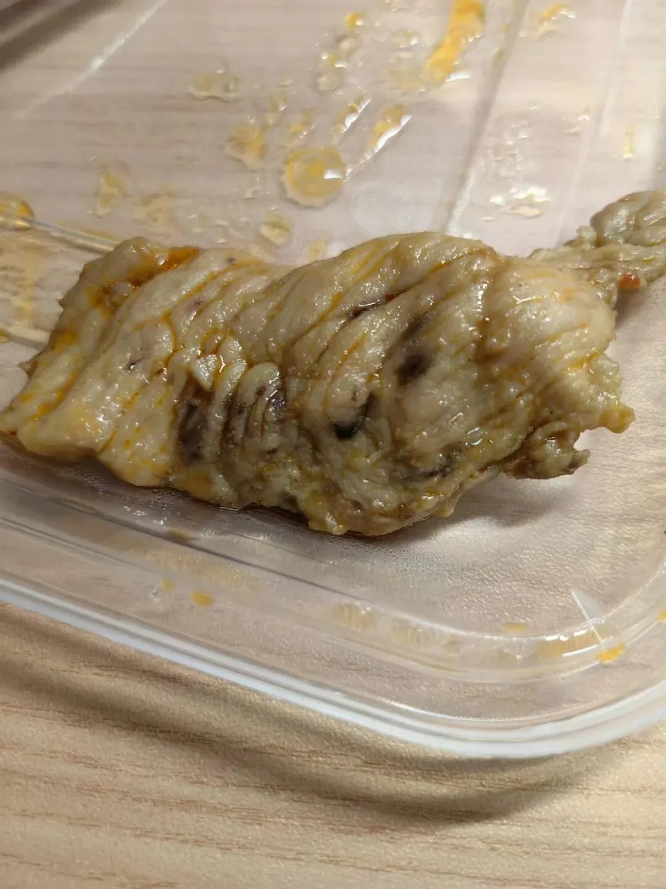
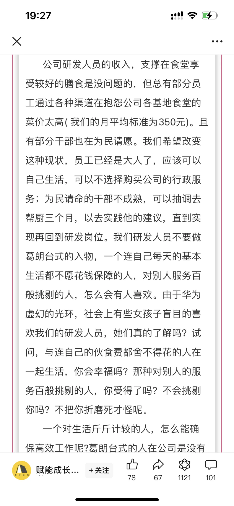

请相关部门及时关注并跟进问题。

## 1 教务问题

“求赞同昨天第二条，教务处理应对培养方案的课有一个基本的监督，本来课程丰富性就和一流高校有差距，还弄出来一大堆开不了的课。离选课还有几周，建议教务处能督促相关学院，把已纳入多届培养方案、这学期没开的课及时补开。不应该每门课的老师都恰好有事，如果真的没有一门能补开，那只能理解为教务人员犯懒，不愿意联系。课开得了开不了是一回事，放着不开，不联系老师的行为，既是对学生的不负责，也是对相关老师的不尊重。请教务处维护来之不易的教学成果，请相关开课部门尽快补开所缺课程。

如果教务处不具有增开新课的能力，那请至少保证现有课程的开设。不能新的优质课程开不了，已经开的课也无法正常开设，这是哪种道理？”

（见《[【读者投稿】土地的馈赠](https://mp.weixin.qq.com/s?__biz=Mzg2MjcwNzQ1Mw==&mid=2247489953&idx=1&sn=cf7c46b6c471a47215d8e346fb16b05f&scene=21#wechat_redirect)》第2条）

## 2 奖金问题

> “旱的旱死，涝的涝死，国家奖学金能不能设置一个底线（一作 C 核或者独作 c 核），调剂一下名额，有的学院竞争太激烈，发权威都拿不到国奖，有的学院没有论文还能捡漏评上。从国奖名单上，搜知网论文，有些人就没有。”

> “学校能不能搞一个学业锦标赛，根据各个学院的学生一作或独作 C 核数量，分配国家奖学金名额，没有论文的直接淘汰出局，有论文的按比例分配名额。以此形成良性竞争，也符合研究型大学的气质。”

（见《[【读者投稿】土地的馈赠](https://mp.weixin.qq.com/s?__biz=Mzg2MjcwNzQ1Mw==&mid=2247489953&idx=1&sn=cf7c46b6c471a47215d8e346fb16b05f&scene=21#wechat_redirect)》第5条）

## 3 食品安全

“望京食堂最近菜品也糊弄，来来回回那几样菜，食材也糊弄，水煮肉片这是没熟还是变质了呢？”

“投稿，不知道是不是自己口味原因，每次吃良乡二食堂重庆小面那里的肉总感觉很不新鲜，肉很硬还有股奇怪的味道。单纯说含肉的面和饭，不知道大家是否有同感。”

“良乡校区二食堂经理是什么态度？最近二食堂自选越来越差，其他窗口也经常有问题，学生们在群里抱怨，食堂经理反而发了这么一个文，居心何在？

第一，我们不是员工，我们是学生，我们交了学费，付了饭钱，我认为我们有理由吃到好的食品；

第二，二食堂有能力做得更好，比如能不能不让我们吃淋巴肉？比如能不能别在酸菜白肉里放泡椒？你放眼全中国有在酸菜里面放泡椒的吗？这都是很简单的事情，但是奈何不听劝。

第三，我们是学生，我们目前的能力不能支持我们拥有自己的厨房，我们也不能顿顿出去吃。你们身为食堂，你们出了问题第一时间不是道歉，而是让我们消费者反思自己？说你是资本主义都抬举你，奴隶制还差不多吧。是不是你们觉得自己垄断了skd餐饮你们就能对学生趾高气昂地提出不合理要求？这件事情，必须要求二食堂公开道歉！”

（见《[【读者投稿】土地的馈赠](https://mp.weixin.qq.com/s?__biz=Mzg2MjcwNzQ1Mw==&mid=2247489953&idx=1&sn=cf7c46b6c471a47215d8e346fb16b05f&scene=21#wechat_redirect)》第4条）
