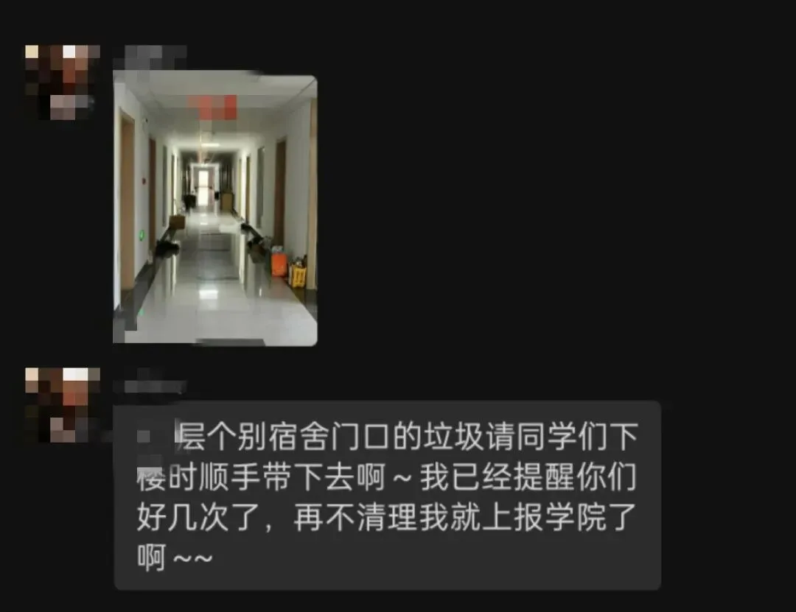

请相关部门及时关注并跟进问题。

## 1 学校宣传

“投稿：有一点不太明白，别的学校本科评估都会在公众号发学院巡礼、动员大会等推文。咱们学校安安静静的，搞得跟个保密工作一样，如果没弄完另说。”

## 2 宿舍

> “学校宿管有能力上报楼道不丢垃圾的宿舍，没有能力对同学一直投诉的大声宿舍上报给学院吗？一定要学生自己通过敲门甚至更极端的砸门来解决，再就是声音大了就上去看一眼，最后人家该吵继续吵？”

## 3 教务问题

“关于古典学课程问题：24级历史学本科培养方案是第四学期有古典学概论的专业拓展课的，不过古典学确实不应该仅在单一学院开设。”

## “投稿：

我们缘何“墙里开花墙外香”？

支持上次关于古典学的那条投稿。据了解这位老师也在社科大讲课，可惜只讲一次。这位老师曾多次表达过对拼盘课的反对，认为这样排课不妥。但相关方面对此并无反应。这再次坐实了那条投稿中的判断，我们的老师不是不想来给本科生上课，而是这套机制破坏了老师本来有的积极性。否则你很难理解，我们的老师去了别的高校之后立马开了好几门课。而在社科大这边，就变成了教务和某些学院领导嘴里的，“老师们不愿意来上课”。从而进一步加深了学生和老师们之间的隔阂。

没有人请老师来，老师们又不是上赶着要给你撑场面。人家愿意给本科生研究生上课是一回事，人家求着来上课又是另外一回事，这是个非常简单的道理。某些领导不会不懂。到底是谁不想让社科大变好？到底是谁在跟一流高校的建设唱反调？到底是谁在阴奉阳违“科教融合”的战略？答案不言自明。

话说回来，这次古典学的建设或许是一次机会，也是对社科大现有机制的一种检验。往大了说，无论是前面外国文学研究所搞得古典学研究室，还是最近社科院在雅典设立的研究院，充分说明这个研究领域既是国家所需，也是社科院的特长。作为社科院主管的大学，学校相关领导应该要有这个意识。今年秋季开的大会，明年春季开设相关的课程也是理所应当的。这样一来，既能造福学生，也从政治上可以交出一份漂亮的答卷。问题在于，教务处和相关学院愿不愿意去做？

看之前的相关投稿，我感觉大家的意见其实是中肯而可行的。不说长远规划，努力在下学期让古典学研究的老师开出一门古典学的入门通识课。再配合相关院系开的语言课和前沿专题课，我们就有了初步的规模。以后再说进一步细化发展的问题。这既是造福学生，也可以助力“双一流”评选之类的事情。这并不难，如果教务处都协调不好，那确实挺让人质疑工作能力的。”

（见《[【读者投稿】如此耽误](https://mp.weixin.qq.com/s?__biz=Mzg2MjcwNzQ1Mw==&mid=2247489988&idx=1&sn=4fb91b0077647ffe509a77160a65db5c&scene=21#wechat_redirect)》第3条）
