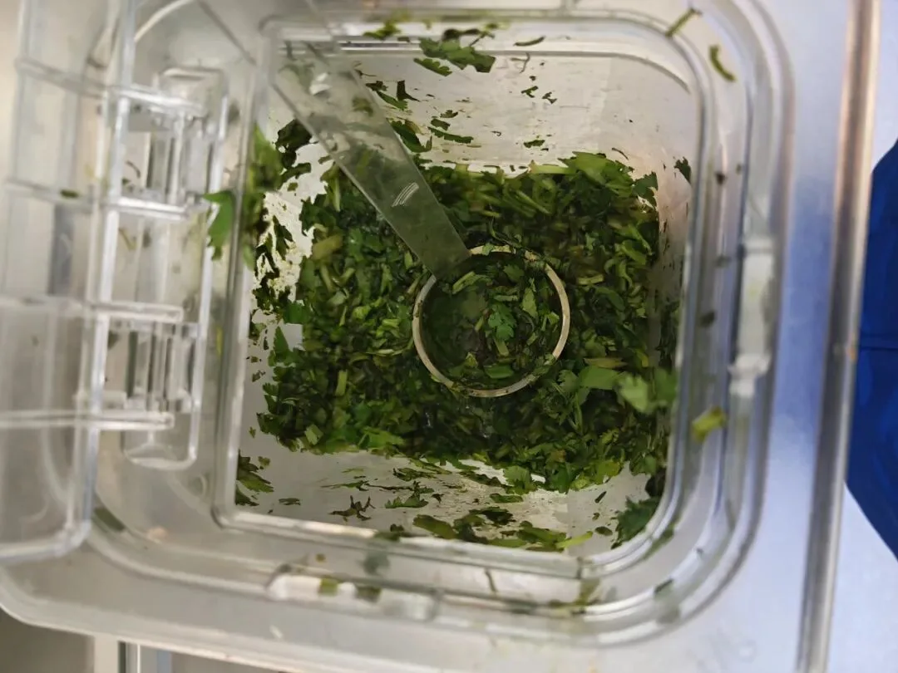

请相关部门及时关注并跟进问题。

## 1 食堂

> “这是二食堂河南烩面那家的香菜罐子，里面的香菜都烂了，摄于上周日（12月1日）。那天我还作死闻了一下，小味挠的一下就上来了，差点没给我当场带走......食品安全无小事，学校还是上点心吧。”

“饥寒交迫的一食堂：一、一食堂18:08清淡窗口关灯收档，其他主要窗口也只有零零星星的菜品。二、一食堂的温度是不是有点太低了。上桌五分钟菜就凉了。”

## 2 《脑死亡》

> “可悲，可怜，可叹，可惜，可怖。 可悲的人啊，就算你有着外科手术的双手， 但你的大脑，那发号施令的指挥中枢， 却不可避免地走向死亡与空虚。 可怜的人啊，哪怕你曾经是辉煌而伟大的， 但那也只不过是消逝的光芒， 自嘲自讽，徒留蓝色丝绸般的悲伤。 可叹的人啊，虽然你许下了坚定的誓言， 但是一万年太久，双一流太早， 我功成身退，不留一地鸡毛。 可惜的是你庇护下的牛鬼蛇神， 树倒猢狲散，碾压一切害人虫， 就连食腐的乌鸦也如此叹息。 可怖啊，高高在上的人！ 大笑着，有恃无恐， 瓦釜雷鸣，某氏高张亦无名。 大叫着，颐指气使， 鸡毛令箭，一纸可斩上军将。 多舛我身，劳役神形。洋洋自得，高楼之上。 多感我心，劳使民力。啧啧自满，长阶之边。 多笑我痴，劳用精华。惺惺自作，方寸之间。 多嗔我邪，劳动天庭。轩轩自赏，人心之衡！ 哀之而不鉴之，甚者不哀而乐之！ 悲夫！”

## 3 教务问题

> “教务处当然可以对学生和教师的要求越来越多，但是不是也可以把自己本该做的事情做的更好？大家提了N次的课程大纲系统为何一定要15周才能显现。咱们这个又没开多少课，排课工作怎么需要如此长的时间？既然早就布置了相关工作，那么可以看看是不是如教务处说的那样能够都按时显示课程大纲。不看别的，本学期还有几门课看不见大纲呢。认知和实践的割裂才是现在的突出问题。 通识课的内容更是，似乎从22年底那一次的大调整之后高质量的新开课就寥寥。说到底，“科教融合”不是一种口号，不能处处标榜融合，但实际上无所作为。古典学的相关问题提了这么久，不知道有没有真正地有点作为，不能总是糊弄过去就拉倒。培养学生不是割韭菜，一茬完了还有一茬。再这么搞下去，看看每年跳水的分数线就知道了。为啥分数线跳水，核心还是教学有问题。但每次不能总是抽象地检讨，得落实在每一门课上。一门课一门课来，先开一点前沿的通识课，包括古典学等等。而不是光开会、不行动。一日复一日，一日能几何？请有关部门能早办不要晚办，拖到最后一刻手忙脚乱又是何必呢？教务和这些学院，不应该一拨一转、不拨不转，真正把很多事情当个事情才行。”

（见《[【读者投稿】压根没有公心](https://mp.weixin.qq.com/s?__biz=Mzg2MjcwNzQ1Mw==&mid=2247490011&idx=1&sn=841cb763400449c008d14e59eff777c9&scene=21#wechat_redirect)》第2条）
