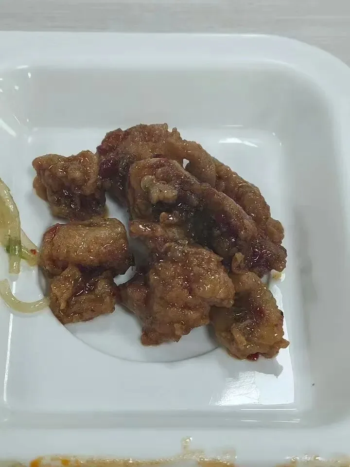

请相关部门及时关注并跟进问题。

## 1 公共设施

> “本教楼2层的开放平台上面写了开放的时间，但是锁门的时候经常出现的状况是晚上过了开放时间不锁门。白天呢，在开放时间内门又锁上了，这种行为真是令人感到可笑和可鄙。”

## 2 食堂

“投稿:一食堂肉类菜品，可以适当减少肥肉吗？一盘里面大多数是肥肉，好好的食材全被糟蹋了”

## 3 就业

> “今年雄安新区面向2025年优秀应届毕业生选聘急需紧缺人才公告一大堆学校里，那么多学校甚至双非都能报，国科大也赫然在列，然而并没有社科大的名字，我终于释怀的死了，学校就业工作给点力吧，好多机会学生想考都不能报名啊”

## 4 社科大考研人的一天

## “ 投稿：

社科大考研人的一天

闹钟响了，又是充满期望的一天。

关闭七点钟的闹钟，睡眼惺忪。明晃晃的15天倒计时让我心生惶恐，未来多歧路。

横竖是睡不着了，明晃晃的15天倒计时让我心生惶恐，近来焦虑的厉害，大抵是等不到小院评上双一流了。

罢了，洗漱吧。

一晚的尿意倾泻而下，马桶冲出像是下水道回流的污水，黯然失色，大抵在预示我的未来。

头发洗过，是要吹干的。拿起水房的吹风机，好家伙，一边是坏的，另一边也是坏的。看着水房的镜子，这张脸没有了生气。凑近，标示吹风机辰时四刻才供电。心想，早八人是用不上吹风机了，怕是吹风机扰了些通宵达旦不能早起的学生。小院的书桌上是不刻早字的。

天是冷的紧了，没有吹干的头发让人精神抖擞。我裹紧了破烂衣衫，加紧了步伐朝外走去。垃圾桶经不得北平的风，忽地倒了。垃圾到处都是，我疾向前去扶立，罢了，谁会在乎一个躺平的垃圾桶呢？这悲悯是没由来的。

走进了板房，空气变得异常的奇怪，打开了每一扇门，歪歪斜斜的每桌上都放着几本书，大抵都被占了去了。摇了摇头，读书人的事，能叫“占”吗？

罢了，此心安处是吾乡。图书馆，吾往矣！

风冽冽的吹，树叶沙沙作响，不过二十斤的书包罢了，吾往矣！

图书馆是有座位的，约的人多了，便没有了座位。零零散散换了几个座位，算是上午有着落了。座位是有了，而我却坐立不安，谁会在意片刻的安稳呢？看来座位是要抢的，不抢是没有安稳座位的。我摇了摇头，若有所思，读书人的事，能叫“抢”吗？

我翻开了肖八，字里行间写着“切忌脱离实际”“高效务实”几个字。学校领导大抵是可以得个八九成分数的。

起身吃顿午饭，黯然地排起长队。我端详起一食堂的饭单，指指点点，这个卖完了，那个也卖完了。零零星星几道饭菜，食欲全无。

我走进了二食堂，叫店家做了爱吃的预制麻辣水煮肉片，加了一勺发酵口味的香菜，肚子总算是填饱了。

许是有些困乏，肚子有些不适，路总归要走的。我忍住了不适感，大步往图书去。

书大抵是没收去了，横竖找不见，坐凳子上什么都不想，趴桌子上玩手机，抖腿。恍惚间被撵了去，座位已经是别人的了。

发觉午觉是睡不得的，长队也排不得。片刻暂离剥夺了学习安稳，没有三头六臂是不能在读书馆学习的。

书到底是要读的。

走进教室的角落，便有了自习的归宿。课热闹的紧，可人的悲欢并不相通，我只觉得他们吵，又甚觉叨扰。

书总是要背的。

考试要来了，寒风也来了，这风冷的紧，左腿冷，右腿也冷。在屋里背书是要扰人的，只好在屋外背，我背一句，风背一句。好在没有雪，有雪是要点三根火柴的，第一根许愿人文之光，第二根第三根也许愿人文之光，树人文之辉光，普照人文殿堂！

不知怎的，我愈发地无力，大抵学到这地步，再也没有学下去的信念了。

大抵是累了，这字字句句模糊了起来。

书到底是要读好的，路终归是走完的，人也是要自勉的。

志向金辉，乘风破浪，高飞远翔！

道阻且长，催己奋进，一苇以航！”
