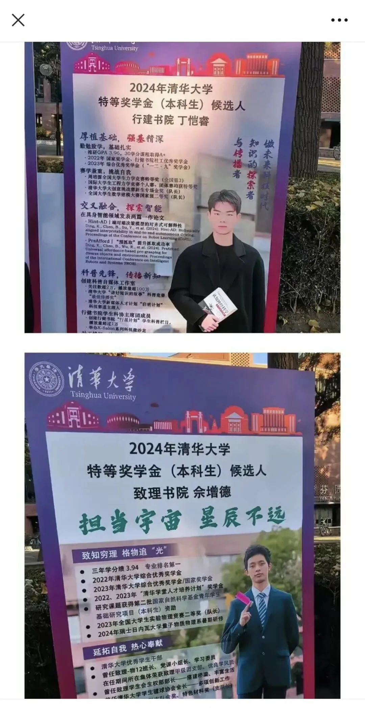
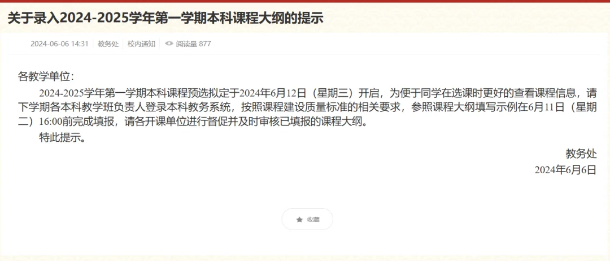

请相关部门及时关注并跟进问题。

## 1 供暖问题

> “您好，我是中国社会科学院大学良乡校区的同学，今天去买饭的时候听到有餐饮工作人员交流住宿暖气不热问题。我想知道我们学校教职工宿舍和学生宿舍烧得火热，为什么食堂员工宿舍一直热不起来，难道他们不算是学校的一员吗？真的很难理解人文社科类学校会出现这种事情，北京的冬天本来就寒冷，请别寒了为学校辛勤工作默默付出者的心！希望校方尽快核实情况，保障在校工作人员的基本权利。”

## 2 宿舍

## “比较好奇望京校区的维修速度，多大的故障啊，两天都修不好个洗澡设备？

## 3 奖助补费

## “【社科大，国奖啥的，可以亮一亮吗？】

社科大是高对标，科教融合大特色，那各类奖学金啥的，尤其是这个关乎所有学生的国奖，可以对标下（如图所示），给所有学生亮一亮获奖风采吗？”

## 4 教务问题

“感觉教务处每学期到期末有拖延症，除了考表依旧排的乱七八糟以外，课表也迟迟不出。这个工作感觉每学期教务处都不能做得很好。且看上学期教务处这个通知，说的很好是6.11之前完成填报。实际上，6.11当天大部分课程大纲完全无法打开，到第二天也还是有很多根本不能显示，这个工作一直到6月底才基本告一段落，但仍有部分课程看不见，这种工作进度令人费解。新系统的审批流程似乎颇为繁琐，每个环节都拖延甚久，本来这个系统上线的就很晚，还拖拖拉拉的。

这学期看这架势又是如此，说是尽快完成录入工作，但到13周结束了还是看不见。这到底是什么问题？“教学大纲陆续完成上传”，陆续是怎么个进度？完成了1%和99%都是陆续。教务处能不能拿出一个路线图、时间表？约束别人也约束自己。

而且既然现在还没发布，教务处能不能挨个挨个看一看，哪个大纲还没交，催一催。不要到最后又让同学们催，半天看不见，中间损耗彼此的时间。即使现在还安排不好教室，那是不是也可以先发布了，反正教室到开学还有变化。天下事，怕的是，不肯去做。现在到底卡在哪个环节了？加快点进度吧。”

“教务处是不是非得要每学期都被催一催、挨点骂才能干事？你看看一个课表、课程大纲，大家催了多久了，还是要拖到现在。这工作效率未免太低了点。你说连这个基本的事情都干不好，真让人怀疑其组织能力和基本的工作效率。每次说起来课程大纲，教务处只说是正在弄，但为何没有效果。24级新生课程的大纲用了一个暑假还弄得不怎么好，老生的课程录入也频频有问题。不是看不见课程大纲就是信息显示不全。再说那个排课，我们就这点课，比人家那些综合大学课程数量少多了，那为何拖了好几周没有成效呢？

教务处的一些人颇喜欢援引北大的例子来给自己背书，可问题是北大也把课排出来了，甚至于外校都能看到他们上了什么课。请教务处真正做实事，不要总是找借口，更不要把拖延当成一个习惯。如果这套系统实在太烂，麻烦找人修一修或者另请高明。已经拖到这个时候了，能否教学周第14周一上班就能显示课程信息呢？别再拖拖拉拉了。”

（见《[【读者投稿】脑死亡](https://mp.weixin.qq.com/s?__biz=Mzg2MjcwNzQ1Mw==&mid=2247490020&idx=1&sn=34bdb1adaaa70d1a9c72b0db3304ec42&scene=21#wechat_redirect)》第3条）
