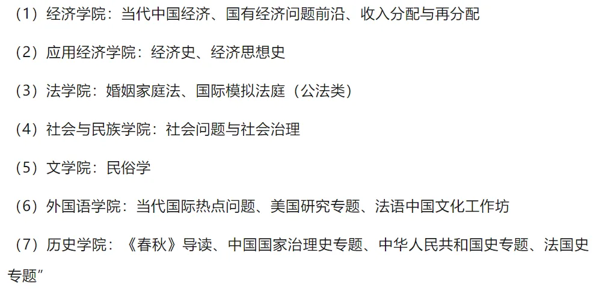

请相关部门及时关注并跟进问题。

## 1 教务问题

“今天开了校情通报会，好消息还是有一些的。比如说终于开了古典学的导论课，再比如进一步规范了课程开设的问题。但在好事情之外，我们仍有一些疑问需要跟教务处进行“对话”：

1.今天教务处处长反复强调对于开课工作的认真和规范问题，但我们不难发现一些现象：

（1）一些通识课程每学期都开不起来，连续三四个学期了，但还是排上了下学期的课表。这似乎已经超过了“严肃论证”的范围。教务处可以组织人员整体核对一下下学期的开课计划，看看哪些通识课、公选课之前曾经停开过、停开了几次，如果连续三次没开成，是否要按照规定暂缓开设。下学期的课程里面就有这样的，请有关部门核查并认真执行有关规定。

（2）在现有课程体系保持稳定的情况下，个别学院的个别老师一个人就开了五六门课，而且这些课程基本都是单独上课的。这就带来很大的问题，就是说一个老师的精力是有限的，开的课过多容易影响质量。而且课就这么多了，如果都把资源集中在某几个老师身上，那必然导致其他老师无课可上，科教融合工作也就很难推行下去。

（3）专业拓展课和通识教育课理应分开，一些课程既被开成是专业拓展课，也被开成是通识选修课，从课程大纲来看变化不大，甚至于一模一样，只是略微修改一下课程名称。这难道是教务处所说的“规范”吗？

2.教务处处长今天讲，有些培养方案中的课没开是因为培养方案有一个调整周期。这个讲的是有道理的，但仔细推敲，这里面颇有牵强弥缝的地方。笔者找到了11月25日社论投稿中投稿人统计的未开设的课程名单。在这个里面除经济史、经济思想史、法语中国文化工作坊之前并未明确授课教师以外，在剩下的13门课中，只有2门课是专职教师开设的，其余的均是研究所岗位教师、特聘教授或研究生导师开设的。这个现象并非只是这学期的个例。实际的现象是，研究所老师的课不能按时开设，这个里面问题在哪里？专职教师当然要承担教学工作，但科教融合的目的之一就是请更多的研究所的人员来参与课程教学。但现在很多课开不起来，这个比例和现象恐怕需要教务处好好研究。”

## 2 供暖问题

> “投稿：同样反映供暖问题。坐标六号楼，暖气一点也不热，可以说仅仅只是温温的，距离火热可以说相差甚远。问了其他不在同楼层的宿舍，也是同样的问题。希望学校能好好烧烧暖气吧，大冷天又降温的。”

（见《[【读者投稿】久拖未办之事与不被保障的人](https://mp.weixin.qq.com/s?__biz=Mzg2MjcwNzQ1Mw==&mid=2247490060&idx=1&sn=6fdc65a92f7610f274b018ce5040a879&scene=21#wechat_redirect)》第1条）
