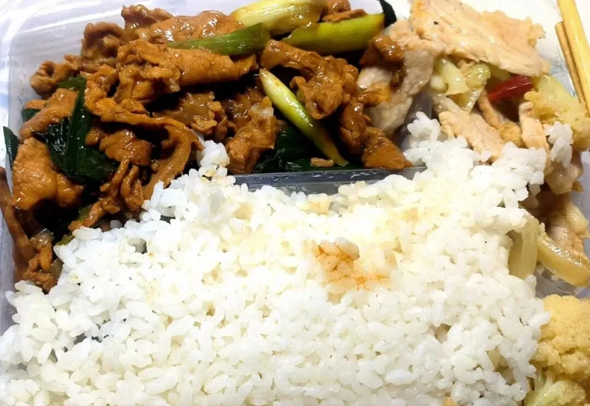
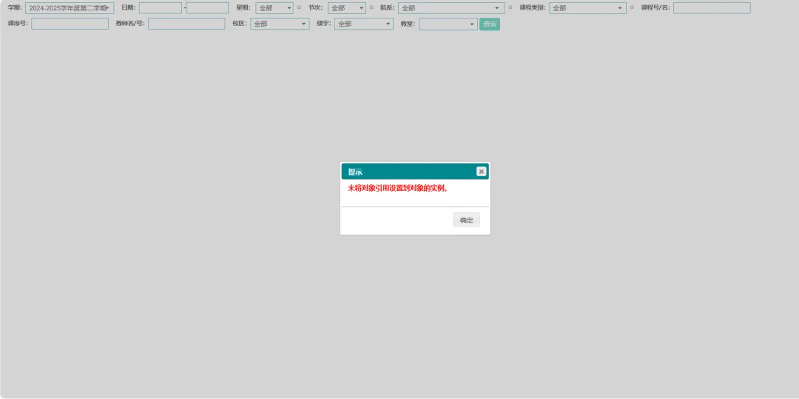

请相关部门及时关注并跟进问题。

## 1 食堂

“今天中午我去吃饭，望京校区食堂，小炒牛肉一股子腥味，而且还咬不动。这种情况真的不是一次两次了，虽然分量很大，但咬不动吃不下，浪费又可耻，左右为难啊。还有肉沫茄子油特别多，望京食堂菜的味道真的要改善改善了。

我建议再引进一家食堂，这样两家有竞争才会努力做好饭菜，各自一半窗口。像这样一家，就算平时学生有反馈，也很难有改进的动力。”

## 2 教务问题

“ 针对于咱们学校的转专业方面的相关政策，在24届以前是允许在大一下学期退掉不喜欢的专业课的，之后选择想转入专业的专业课。

24届之后今年就不允许了，这个前后政策的差异或许会让很多学生感到沮丧和困惑，因为不喜欢很难学习下去，没有动力就可能没有积极。政策要么一以贯之，要么别临时更改。

之后教务处的说法是，怕转不成功会有不良后果承担，延毕之类的。确实如此，我也理解。

但我想说的是，这个首先是个人的选择，其次学了一个学期的想转入的专业课也没转成功，从某种意义上来讲可能也是他们不进步。不能一概而论。

那我也考虑到这其实是有一定道理的。我想要问的是，可否向教务处反映一下，可以退部分的课，比如六门专业课退三门或者两门这样的。我觉得这样的话，既可以让学生想学到自己转入的专业课，也能让不良后果最小，因为两三门课很容易补过来的，即使没转成功，问题也不大。

这是我想向教务处反应的问题，也是基于自身的情况，为了学生的学业考虑。希望教务处可以考虑并接纳相关建议。”

> “这个课程大纲的系统就仿佛老牛拉破车一样，天天缝缝补补，完了还打不开。下学期的新大纲不见踪影，但现在是直接打不开了。咱们学校是有计算机教研部的，这么多老师，修一修吧。到底啥时候才能看到呢？真的气笑了，无法理解……”

（见《[【读者投稿】生存战略](https://mp.weixin.qq.com/s?__biz=Mzg2MjcwNzQ1Mw==&mid=2247490081&idx=1&sn=3399a550dfdc6c8e520e276131f33fcd&scene=21#wechat_redirect)》第1条）
