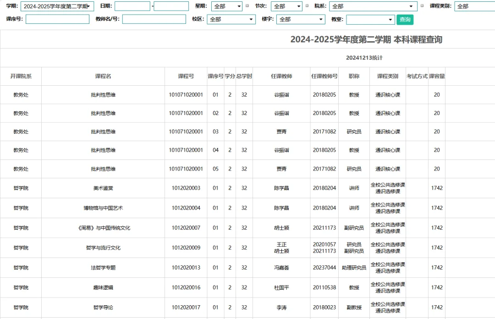

请相关部门及时关注并跟进问题。

## 1 宿舍

> “您好想投稿反映望京校区晒衣服真的很困难…本来就只有三栋楼中间那一抠抠的空地能晒衣服，冬天日照时间变短，真正能晒到衣服的时间只有大约一两个小时，楼间的风还大衣服特别容易掉，衣服洗完根本无法晒干，只能在宿舍里阴干。学校就不能考虑买几个烘干机吗？北京很多学校都配备了烘干机，考虑到学生实际情况，这也不是什么很过分的要求吧。希望看到的后勤老师考虑一下，谢谢！”

> “我好无奈啊，我在一号楼。上周还是上上周，一号楼楼底下水管裂开，开始维修，上周某一天晚上一点左右，宿舍里改热水水龙头的管道突然裂开，宿舍发大水了又修。听闻这周八号楼下的水管又裂开了？今天昨天两天一号楼六层一直有工人进出修东西！社科大是立校百年了还是怎么？校园里宿舍里基础设施这么经不得用”

（【见《[【读者投稿】通往明天的门](https://mp.weixin.qq.com/s?__biz=Mzg2MjcwNzQ1Mw==&mid=2247490093&idx=1&sn=e22daae7b46efd1310176e7d2360a469&scene=21#wechat_redirect)》第1条】）

## 2 食堂

## “投稿：

望京食堂能不能出个小份的半份，价钱减半？或者你出个一天三餐都卖早餐的摊？这俩哪个实施了都行。

菜油咸不好吃我都忍了……

但是一个菜加饭就饱了。想吃两三个菜的时候最后就要扔一堆菜饭。扔了心疼，钱还花的多，你们食堂还浪费。外面摆着光盘行动易拉宝，里面扔着食物……说句什么好”

（【见《[【读者投稿】通往明天的门](https://mp.weixin.qq.com/s?__biz=Mzg2MjcwNzQ1Mw==&mid=2247490093&idx=1&sn=e22daae7b46efd1310176e7d2360a469&scene=21#wechat_redirect)》第2条】）

## 3 教务问题

“全部课程安排表已经开放了一天多了，但大部分课程大纲是没有的。那为啥一定要拖到最后一刻才能填上去呢？看了半天，就没几个能打开的，极其不便使用。而这种糟糕的情况也和上学期实际上差不多。记得上学期说的是某周周二前填写完毕，但最后发现完全不是，根本不靠谱。教务处现在也应该能看到填写情况，这种效率是难以服众的。以下是各开课部门尚未上传大纲的数量，看起来是很震撼的。特别是一些部门一门课都没搞定，这生活属实安逸：

教务处全部（16门），哲学院31门，经济学院2门，商学院10门，应用经济学院17门，法学院22门，马克思主义学院13门，政府管理学院14门，国际政治经济学院6门，社会与民族学院全部（29门），文学院28门，外国语学院全部（85门），新闻传播学院28门，历史学院47门，计算机教研部全部（12门）。

百思不得其解，为啥是这种效率呢？”

> “教务处曾经说这周五，也就是今天，12.13日，完成教学大纲的填写。可是，教务处都快下班放假了，课程大纲打开之后仍然非常感人。一点开，电脑上第一面就一门课也提交不上，这到底是为什么？再一看，甚至于只有经济学院一个学院全部完成的教学计划的填写，有些学院竟然一门课也打不开。这个工作从期中就开始酝酿，结果到现在进度连50%都没有，更侈谈全部完成。合着其他学院是没接到通知还是压根就没当回事？为什么每一年都要这样，做出的承诺跟废纸一样。教学管理部门一方面要求学生规范，要学生理解，问题是自己有没有做到？一方面看起来听取了意见，一方面实际上又乏于作为。一分钱难倒英雄汉，一份大纲难倒教务处，听起来还是挺滑稽的。能否按照要求今天完成填写、审核和开放，考验的是学校职能部门的公信力问题。谁都不希望自己掉入塔西佗陷阱，希望教务也是。”

（【见《[【读者投稿】通往明天的门](https://mp.weixin.qq.com/s?__biz=Mzg2MjcwNzQ1Mw==&mid=2247490093&idx=1&sn=e22daae7b46efd1310176e7d2360a469&scene=21#wechat_redirect)》第3条】）
