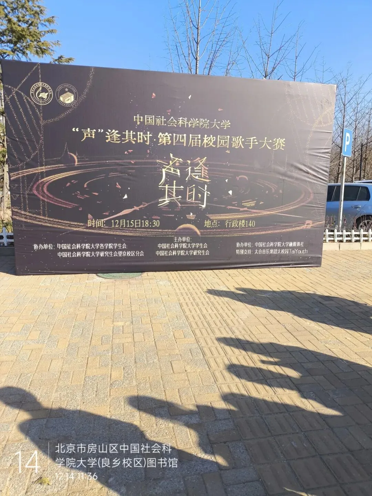
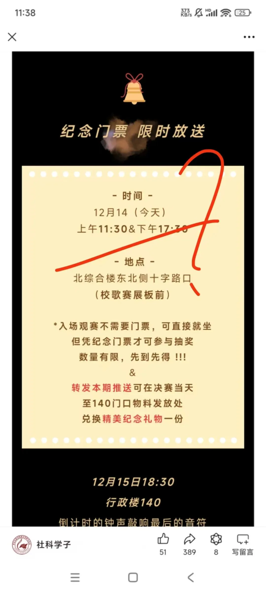
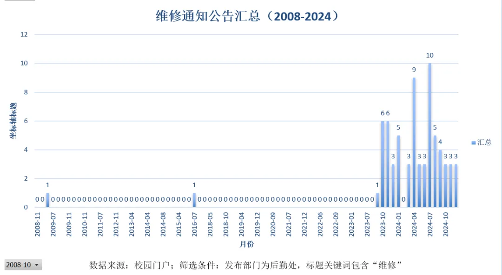

请相关部门及时关注并跟进问题。

## 1 校歌赛

## “投稿：草台班子也不完全是行政人员搭起来的。”

## 2 后勤问题

## “回今天第1.2“校内维修”：

根据校园门户的通知公告，统计以往后勤处发布的包含“维修”关键词的公告数量，图中为按月统计，起始于2008年11月，至2024年12月，共计242条。

由图可知：在2023年10月之前，通告中包含“维修”的数量较少，数量最高点位于2024年7月，共有10条。

可能的原因：1. 维修公告的发布越来越完善，信息化水平逐步提高；2. 基础设施自然老化，批量进入维修期。

以上结果可能的问题：历史数据缺失，历史发布的公告未汇总通知公告栏目中或是有维修情况但并未公示。后者包含寝室内日常维护等，由此造成数据结果中2023-2024年维修数量的激增；以“维修”作为检索关键词，遗漏2023年前的维修事件。”

“同感！7—8号楼刚投入使用还不到3年吧，我的天各种各样的问题啊，甚至刚入住的时候都有很多宿舍出现损坏，有些事真是想问又不敢问。”

“在社科大学习、生活，时常感觉自己置身工地现场，不知道其他同学有没有这样的感受。我们这个校区还不到15年吧，仿佛每天都在对一百年前的工程进行修缮。除了这里以外，还没听说过哪个学校三天两头要把学生宿舍刨开铺防水层，19世纪的建筑也不过如此了吧？七八号楼才投入使用多久，楼下周围那一圈水泥地，已经反复挖填多少次了，给有些人的“良心”打了多少块补丁。

临近毕业，很多企事业单位都要求线上二机位考试，与考试过程陪伴更多的却是电钻声。从这里走出去的毕业生将来会如何感激学校？每年修缮的费用可想而知，必然是一个天文数字，又有谁会承担这个责任……”

（【见《[【读者投稿】事到如今，终于来到社科大](https://mp.weixin.qq.com/s?__biz=Mzg2MjcwNzQ1Mw==&mid=2247490101&idx=1&sn=773c93eadde935bbb762430b9904d1d1&scene=21#wechat_redirect)》第1条】）

## 3 食堂

“食堂一楼浪费问题非常严重，不知道为啥不能和二楼一样卖小份菜？我自认为饭量比较大，但是每次在一楼点两个菜，总是吃不完，需要倒掉至少三分之一。我看有些同学为了不浪费就干脆点一个菜。虽然学校食堂有财政补贴，但也搁不住这样被动浪费啊？

二楼有时候就是排队特别长，一楼也卖小份菜，能否分担一下二楼的压力，况且，一楼二楼都是属于学校，也不存在内部竞争。不懂，为啥一直这样，建议相关人员去看看一楼二楼倒掉的饭就清楚了。而且小份菜能多点几个菜，一方面均衡饮食，另一方面万一哪个菜不好吃了还能分担风险。希望学校的一切都以方便学生为导向，一起让学校变得更好！”

（【见《[【读者投稿】事到如今，终于来到社科大](https://mp.weixin.qq.com/s?__biz=Mzg2MjcwNzQ1Mw==&mid=2247490101&idx=1&sn=773c93eadde935bbb762430b9904d1d1&scene=21#wechat_redirect)》第2条】）
