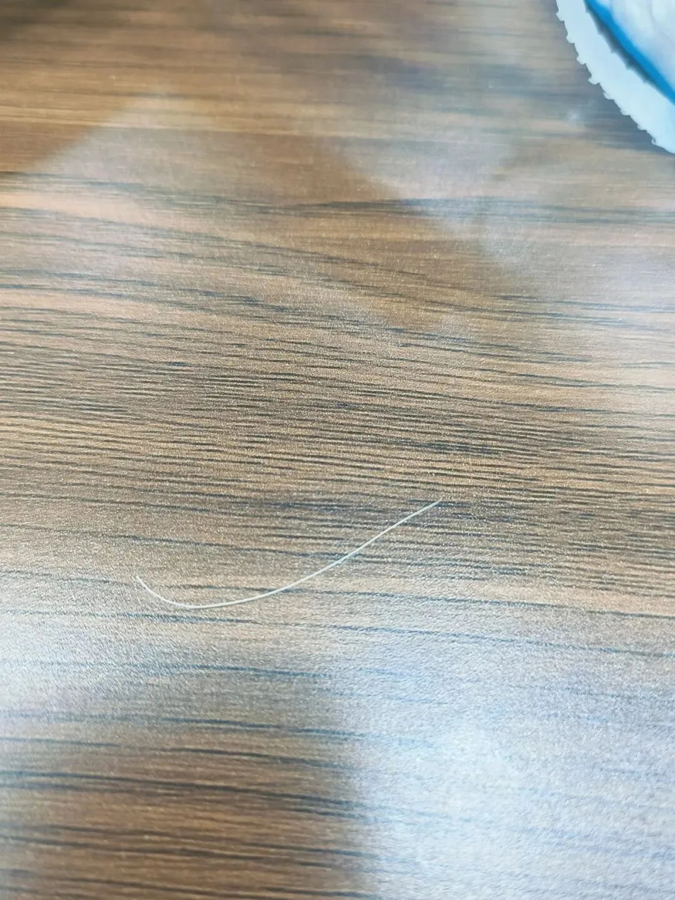
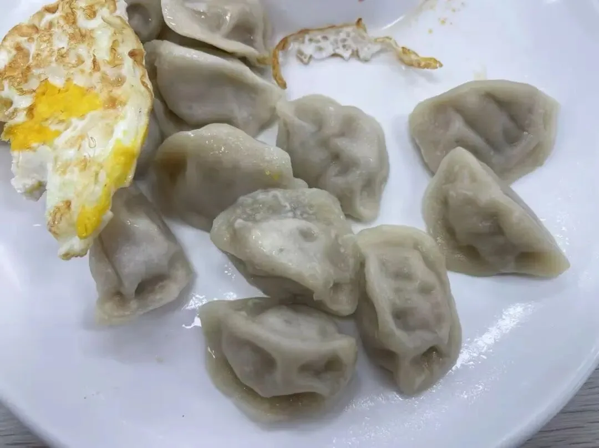
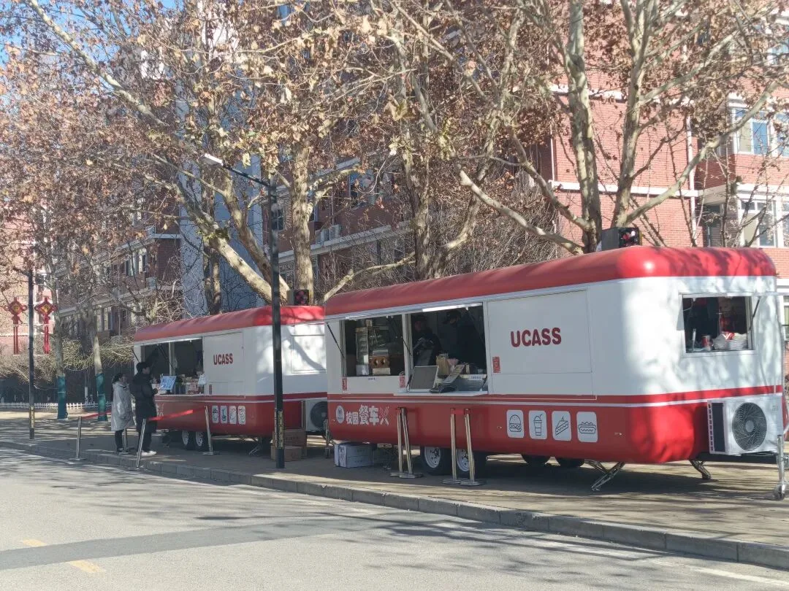
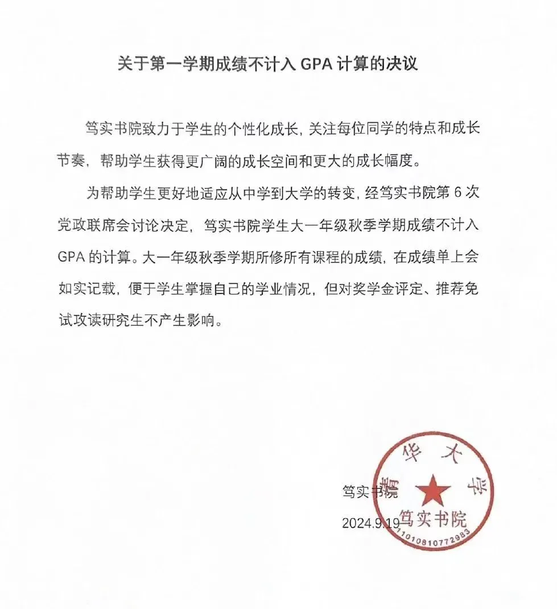

### 请相关部门及时关注并跟进问题

## 1 食堂

“投稿良乡校区二食堂肠粉窗口，吃出一个塑料丝，不知道有没有洗菜。本来校内可选择的食物就不多，希望能注意食品安全”

## “社论君，投稿。

望京食堂越来越敷衍了，这一阵儿的菜让人完全没有食欲，基本天天都要点外卖或出去吃。今天中午点了一份饺子，一看就是速冻的，猪头大葱馅儿里面全是大葱，还有速冻饺子好意思卖那么些钱吗？真是服了，为学生好好考虑考虑吧！”

“该餐车入驻校园后，满校园成日弥漫着浓烈的油烟味，学校的食堂也只在饭点才漂出些许的味道，并没这么浓烈且成日弥漫。

如今，呼吸新鲜空气都变得很难。该餐车做得难吃不说，成日呼吸如此浓的油烟，伤肺致癌，有常识的都知道吧？建议餐车能否改造加装环保设备，或者更换摆放位置，减少校园空气污染？”

## 2 教务问题

> “偶然看到了这份文件，我觉得这种行为同样也可供我们参考。不是说他们这样做是对的，也不是说这样做既然适合他们也就一定适合我们。但我觉得我们应当看到清华这个书院为了帮助新生尽早适应大学生活、缓解低效内卷、减小试错成本、探询学习之目标意义的尝试显然是有其积极意义的。我想学校也可以由此获得启发，分析当下的问题与改进空间，结合我们的实际情况，针对这一目的做出我们自己的尝试。”

“教务处某些时候改的规定属实不太合理。退课，明明是学生的一项权利，但现在学生却丧失了这项权利。有些课程学生分明不喜欢学还要逼着他学完，学完之后还会被安排到项目外课程，这完全没有用……

而且大一这一年学的什么导论概论的知识，多是完全为了考试而应付，能学到的知识相对有限。既然如此，为什么就不能允许学生拥有退课的权利？他转不成功，那是他的事。怎么能一概而论呢？

禁止退课这项规定明显就是一定程度上阻碍了一些平转的人，其目的在何？仔细考察了其他的985211双一流及普通一本院校，他们的教务处在作此规定的时候，也无此要求。为什么社科大要独树一帜？这岂不是给学生未来的发展造成一定的困难。

若是拿出本科教学评估甚至双一流的评估来做挡箭牌，大可不必。想搞好评估，离不开对学生的心理以及发展等考虑。要想做好这一点，与其不断增叠什么心理课、思政课、教育课，不如平时多在行政规则上面体现一些人文关怀来的更好。

现在倒好，课是连一节都不让退，真心让24级新生头大。学校良好的名声，良好的声望是靠师生共建的，这样才能越来越好。”

（【见《[【读者投稿】通往明天的门](https://mp.weixin.qq.com/s?__biz=Mzg2MjcwNzQ1Mw==&mid=2247490093&idx=1&sn=e22daae7b46efd1310176e7d2360a469&chksm=ce0291bff97518a908cbaccc0d0bbc7c36c7fe5e125ab44786b90cdb24ee382bf02bf19bb363&cur_album_id=2132825091435528197&scene=21#wechat_redirect)》第3条】）
