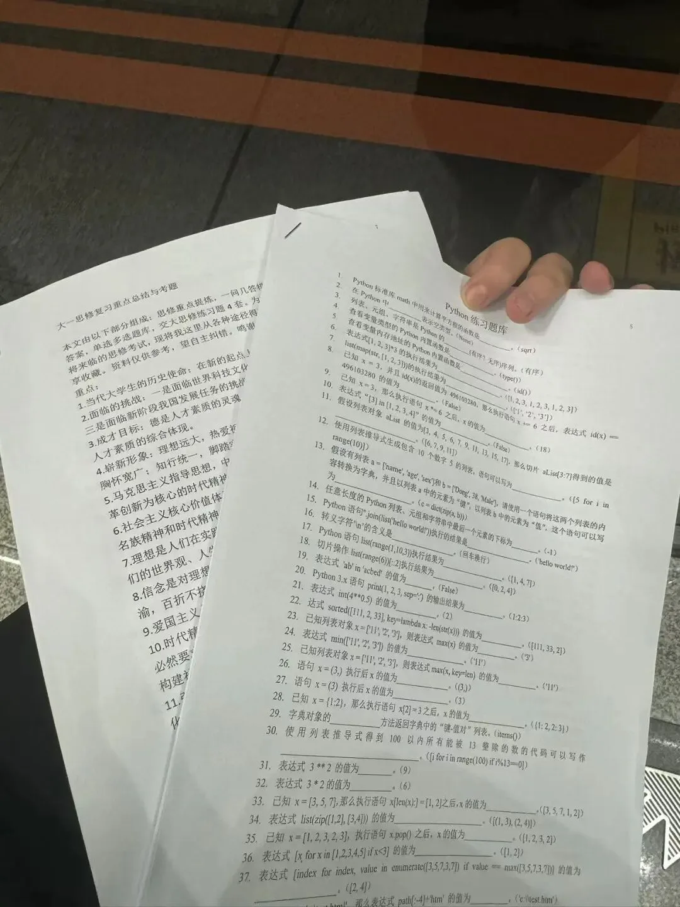
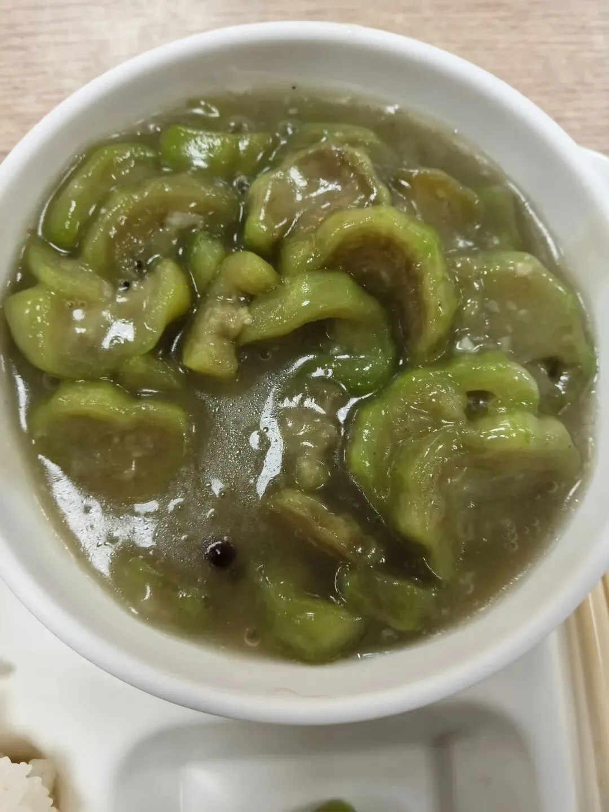

请相关部门及时关注并跟进问题。

## 1 工具书书店

“社论君好，今天去了趟中央财经大学，发现中央财经大学打印店开了一家书店，专门售卖课本和笔记，笔记有些由个人提供，有些由官方提供，主要是思修、军理等背诵记忆的资料，一份售价也不贵，还有考研和考公题库，大学计算机题库。我们学校是否考虑由打印店增开这么样的一个资料工具书店方便学生学习生活？

图为中央财经大学书店（财子书屋）售卖的笔记与题库：

## 2 食堂

## “投稿夜宵的胡辣汤！太好喝了！啊啊啊”

“丝瓜炒成这样，不得不怀疑一食堂师傅的水平了，又黑又苦，有时候还是老得都成丝瓜瓤了，这样坑学生的钱不心痛吗？？？”

## 3 晚会

> “投稿：迎新年晚会这个节目很好很感人，但为何身后工作人员全部是男性代表？节目单上我看有保卫处、学报编辑部和后勤处，难道三个部门一位女性都没有吗？（如果真的没有，希望能增加女性工作人员的任用）可能为了迎合歌词“雪”主要挑选了在外面服务的工作人员，但也不至于一位女性代表也没有吧，希望下次编排节目的可以增添更多女性比例”

## 4 医务室

> “投稿：近期去良乡校区医务室填报销单，感觉有些地方不是很人性化。其一报销单填报台没有座椅，填起单子不太方便。建议医务室补两个高度合适的座椅。若觉放于此有堵塞通道之虑，可考虑换个方便的地方。其二是报销单与图示两种皆有出入，虽与图一相近，但无图示中规定填写学号的地方。诚然找地写一学号仅是举手之劳，不算什么大的劳动，但难免让人生些嘀咕，首次报销的同学更不免稍有疑惑。建议医务室以后印单据的时候把这个弄出来，这样也显得正规。”
