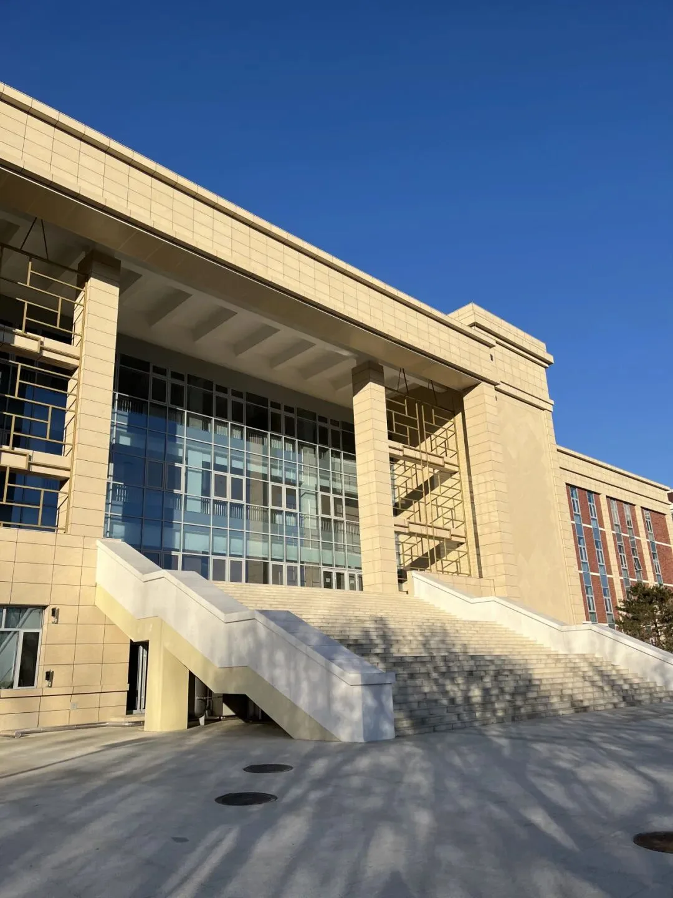
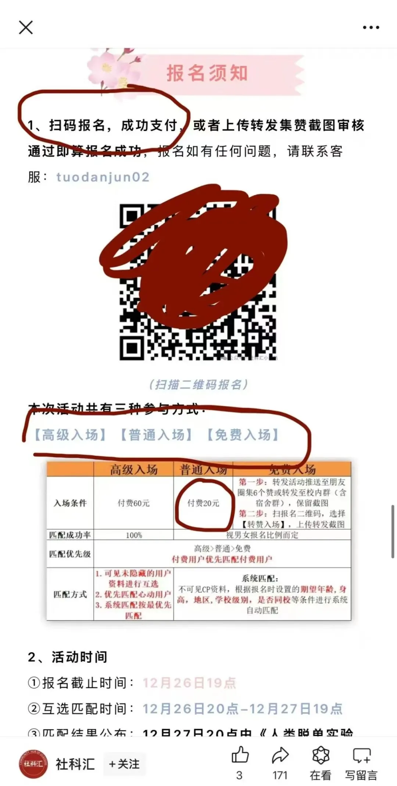

请相关部门及时关注并跟进问题。

## 1 教务问题

> “咱们教务处出台了自修的政策，但是学生在申请自修的时候被相关开课方给拒绝了，请问这个政策还有什么用？那他的目的何在？能不能教务处和学院相互协调好再出台一些政策，就这样盲目的去弄，最后坑的是学生”

## 2 校园基建

“一个小观察，新的教学综合楼的楼梯是纯白色的，感觉和建筑主体外墙的乳白色还是米色不是很协调，看起来稍稍觉得有点突兀”

## 3 社科汇

## “投稿，社科汇开始搞抽象了，花钱‘找对象’。”

## 4 宿舍

## “投稿

想说下学校这个消杀工作是不是有点太走形式了。坐标良乡六号楼，今天有学校延请的工作人员入宿消杀。这当然非常好，但碍于当时卫生间有人情况尴尬、工作人员没进来。可后来一直没等到工作人员再上门，这不太对吧……工作人员肯定也是照章办事，那学校这个消杀制度有点形式主义了，毕竟这种尴尬的情况谁都可能遇上，难道都不回头看下了嘛。也没有见到有消杀的相关通知，不清楚能不能补登、还会不会有消杀公司的工作人员再过来了。”
