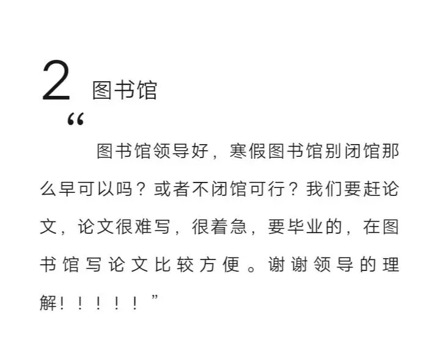

请相关部门及时关注并跟进问题。

## 1 宿舍

“各位校领导，尤其是管后勤的校领导，自今年冬天以来8号楼供水经常出现各种问题，一开始是洗澡水，没有热水，经常是温水见同学反应后开始老一段时的修理。此后又出现了8号楼上层供水出现问题，后联系锅炉房管理人员解释说是太阳能的闸不知道怎么跳了，当天发现很多同学不得不用冷水洗了头。

今天再次出现饮水机和洗衣机的供水问题，并且这三次情况中后两次都没有出现官方的通报、通知和提醒，学生只能是一脸懵。请问这到底是修建宿舍楼时过于着急，工程质量不达标，以至于经常出现这个水管被冻爆那个水管被冻爆的问题？还是说是因为人工维护有问题，该维护的没有做到，所以总是出现冻爆问题？”

## 2 图书馆

> “希望学校寒假尽可能维持图书馆正常开馆，教室、自习室尽可能多的开放，不要一天天的能锁尽锁（保安在就行，真不需要留守几个老师），毕业生压力真的很大，跪求学校给个正常学习环境”

> “投稿:非常赞成上期第2.1条这位同学所提的观点。我们一部分同学真的都在赶论文，而且图书馆是最佳选择地儿，如果学校觉得浪费过多人力，只开一间自习室也行，只要一个老师看管整个图书馆就行了！或者不开自习室让我们在公开空间写作业。”

（见《[【读者投稿】卷](https://mp.weixin.qq.com/s?__biz=Mzg2MjcwNzQ1Mw==&mid=2247490268&idx=1&sn=71152990e61c1bdd555a12f5ea9d8b6a&scene=21#wechat_redirect)》第2.1）
