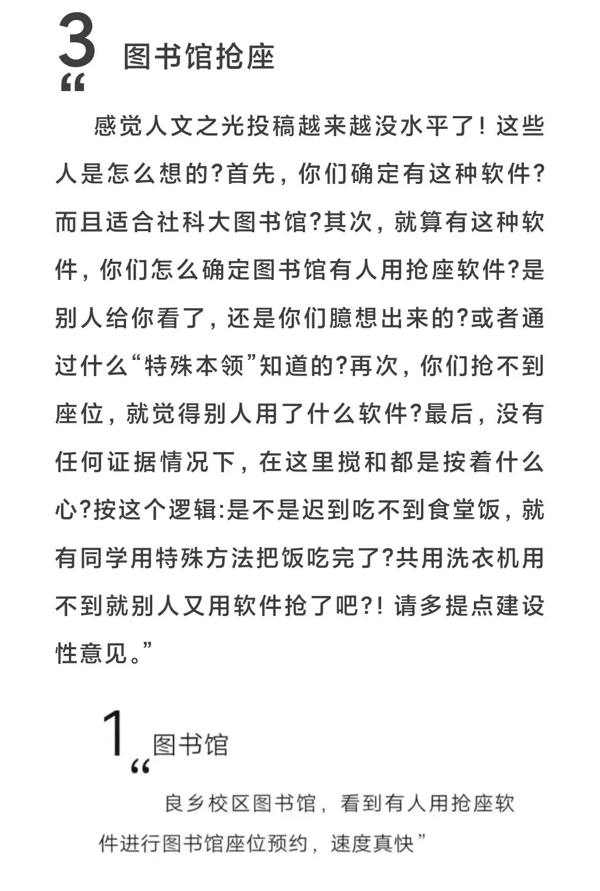
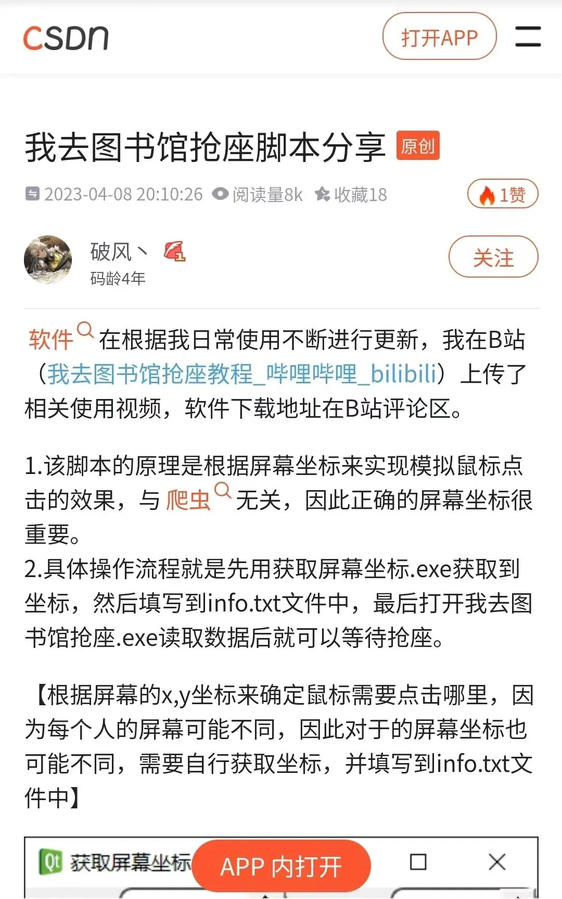

请相关部门及时关注并跟进问题。

## 1 食堂

## “良乡校区一食堂最近的肉不新鲜，吃着有股怪味”

## 2 学校超市

> “我（1月5日）5点多在板房超市买了两瓶酸奶，喝完后3小时内拉了四次肚子，整个人昏昏沉沉的，这个酸奶虽然还在保质期里面，但是我怀疑超市的保存手段有问题。在喝酸奶之前，我就去一食堂吃了口饭，没有别的刺激的东西了。”

## 3 自习室

## “投稿

今天下午在南综自习，来了一些老师好像是要改建自习室。学校新建了综合楼，为什么总在假期时间对南综的几个自习室来回折腾？公约改了又改，好不容易安定下来，又开始了。改成档案室和办公室，学校空着那么多的房间，为什么偏偏要按着已有用途的自习室改造？实在是无法理解。请学校有关部门体谅一下自习的同学吧！”

## 4 图书馆

> “请改一下图书馆静音仓预约时间，晚上12点这个时间太不合理了，难道要大家熬夜抢座吗？虽说可以提前三天预约，但是就算是早上七点起来看，三天之后的全被预约完了，而且看预约人每次都是那一些，不熬夜的同学根本就约不到。所以请求将预约时间改到一个阳间时间，不要以学生的健康和身体为代价。谢谢。”

> “说图书馆没有用软件占座的真有点绷不住了，大家就说有这种行为，难道不应该向学校反应一下看有没有吗？难不成学生都得化成侦探去提交证据给学校啊？没有的话就算了，有的话直接惩罚处理就好了，这对你这辛苦预约的不也是好事吗？你急什么”

“

回复一下之前社论1月3号第三条，给大家科普一下占座软件运行原理，没有多么的高深，其实很简单，无非就是c语言或者Java编辑好脚本，然后注入到微信程序，这些脚本会模拟手机或者鼠标确认占座的信号，在放座的一瞬间通过大量的点击确认完成抢座，普通的同学是完全抢不过这些用软件“人”。（以上只是一种）同学在辛苦预约的时候，软件人早就抢走了。

而抢座软件小程序获取也很简单，某宝一搜就是一大堆，价格一个月也就两杯奶茶钱而已，更便宜的9.9一个月。（把原理图和某宝的搜索图放在下面了）还有更便宜的，去b站一搜教程会有一大堆的免费脚本。当然，这些完全是违背基本的公众道德，此前有不少高校已经发现这种行为，并且做出处罚。而且这些行为查证不难，后台一抓一个准。有些人奥，我说的是有些人，耍小聪明，长期用占座软件把公共座位当成自己私产，被大家指出来还在这偷换概念、胡搅蛮缠，那就别怪把这种行为开盒了。

最后希望尽快反应到图书馆管理人员进行系统完善升级，并对这种行为做出处罚，比如查出来后三天或者五天不允许在预约图书馆座位，否则最后会劣币驱逐良币，逼的辛苦预约的同学也去买占座软件，直接魔法对轰。

（见《[【读者投稿】形式主义工程](https://mp.weixin.qq.com/s?__biz=Mzg2MjcwNzQ1Mw==&mid=2247490339&idx=1&sn=6d1829701fec5e1e9529c20fc6b3b997&scene=21#wechat_redirect)》第1条）
