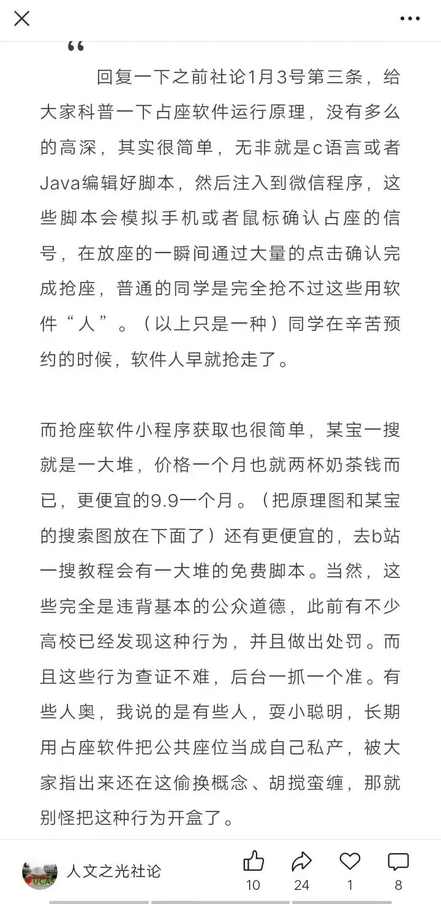
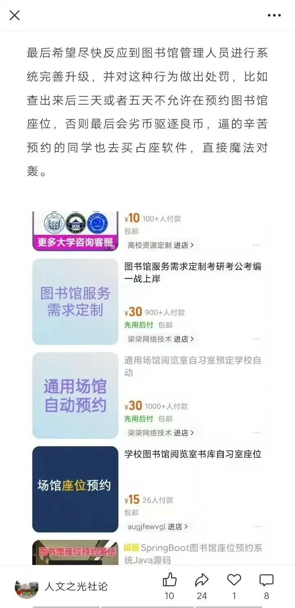

请相关部门及时关注并跟进问题。

## 1 教务问题

> “所谓的必修课只能闭卷的规定，到底意义在哪里?一些公共必修课程让学生花费大量的时间背诵这些经文，以求得闭卷考试中的平安，这对于所谓“科教融合”真的有什么帮助吗?”

## 2 校友会排名

“作为社科大的一名校友，听闻母校在校友排名中荣登第九名的宝座，内心的激动与自豪如汹涌潮水，奔涌不息。那一刻，往昔在社科大的点点滴滴如电影般在脑海中闪回，满心都是对这片培育之地的感恩与眷恋。

还记得初入社科大，便被那浓厚的学术氛围所包裹。校园的林荫道下，常能邂逅捧着书籍热烈探讨学术问题的师生，他们眼中闪烁的求知光芒，点燃了我对知识殿堂的向往之火。课堂上，教授们旁征博引，将晦涩的理论知识深入浅出地剖析，带领我们穿梭于古今中外的思想海洋，让每一次学习都如同一场酣畅淋漓的知识盛宴。在他们的熏陶下，我们学会了质疑、探索与思辨，为日后的人生旅程筑牢了根基。

回首往昔，丰富多彩的校园生活更是为青春画卷添上了浓墨重彩。社团招新时，各个摊位前人声鼎沸，怀揣着不同兴趣爱好的同学在此汇聚，共同开启梦想之旅。我加入了心仪的社团，和伙伴们一起为举办活动熬夜策划、四处奔走拉赞助，在挫折与欢笑中，收获了珍贵的友谊，锻炼了沟通协作的能力。那些在图书馆为考试、为论文奋笔疾书的日子，虽疲惫却充实，周围同学专注的神情仿佛有一种无形的力量，催促着彼此奋进，向着更高的目标攀爬。

如今，走出校园，踏入社会，才更加深刻地体会到社科大赋予我的财富是如此厚重。校友圈里，大家分布在各行各业，却都秉持着母校 “笃学、慎思、明辨、笃行” 的校训，发光发热。科研领域，校友们潜心钻研，用一项项突破性成果为国家科技发展助力；公益路上，他们心怀大爱，为弱势群体送去温暖与希望；商业浪潮中，以敏锐的洞察力和果敢的决策力开创新局。母校就像一棵枝繁叶茂的大树，校友们是她结出的累累硕果，无论身处何方，都带着社科大的印记，彰显着她的风采。

此次校友排名第九，是母校多年辛勤耕耘的见证，是全体师生校友携手奋进的硕果。它是一份荣耀，更是一份鞭策，激励着还在校园逐梦的学弟学妹们砥砺前行，也让已经毕业的我们深感与有荣焉。相信在未来，社科大将继续书写传奇，培育出更多栋梁之才，向着更高的巅峰稳步迈进，而我们校友也将永远以母校为荣，为她的每一步发展摇旗呐喊、添砖加瓦。”

## 3 图书馆

“本来大家都是为建设好学校，为维护好同学们利益，而建言献策来投的稿！感谢这位同学的科普，希望他能帮助图书馆，早日查处用软件抢座的人，也算是为大家去除祸害，洗刷冤屈了。但是，这位同学以什么逻辑得出“社论1月3号第三条”的“偷换概念”“胡搅蛮缠”者就是那个耍小聪明、长期用抢座软件霸占把公共座位当成私有财产的那个人?然后又怎么被大家指出来的?大家又怎么发现?就这么在这个平台上造谣发现的吗？

为澄清事实，你进行科普这是为大家好，为学校好，大家双手赞成！在没有任何证据情况下，仅凭你网上搜来的东西这样的带节奏，给正常占座同学和图书馆管理人员带来麻烦，还妄下定论投稿者就是用软件抢座的人，这种无凭无据的言论属于诽谤，是要承担责任的！“无中生有”行为给图书馆管理人员带来麻烦，也给那些安分守己正常占座的同学制造恐慌……

既然这个事情已经被你们炒作成这样，那就由图书馆技术人员或网络中心出来说明有无这些情况。避免过多造谣打扰正常占座学习的同学们。不造谣，不诽谤也是一种值得赞扬的人文精神！！！”

（见《[【读者投稿】每一刻都精彩绝伦](https://mp.weixin.qq.com/s?__biz=Mzg2MjcwNzQ1Mw==&mid=2247490356&idx=1&sn=7f03fbc9917a60bd0b4e726c80d27d6e&scene=21#wechat_redirect)》第4.3）

