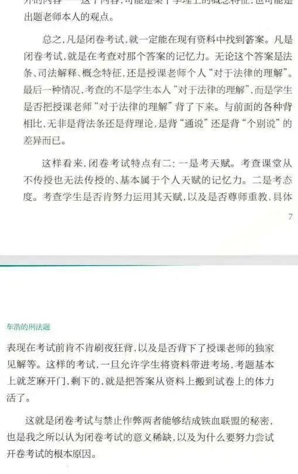

请相关部门及时关注并跟进问题。

## 1 宿舍

“宿舍一号楼东侧的热水最近喝着有一嘴铁锈味，不知道是怎么回事，其他同学有类似感觉吗？”

## 2 自习室

“真是好奇学校为什么天天折腾自习室，本身自习室就少，现在新楼盖好了，还要再缩减自习室，不折腾能死是吧。skd的空间怎么越用越少，办公室不够？能让学生去板房自习，你们为什么不去板房办公？

这学期自习室简直成了skd某些行政人员的眼中钉肉中刺，必欲取消而后快，能让学生好好写论文是你们的耻辱是吧。

趁着寒假人少，抓紧取消自习室，开学了就生米煮成熟饭，真是666啊。把对付学生的精力用来提升行政能力多好啊，学生为数不多的学习空间，你们想怎么捏吧怎么捏吧，觉得可有可无，能评上双一流才是离谱。”

> “南综合楼自习室，每年教务处都要惦记几次，不把学生赶走誓不罢休。用途一次一次换，这一次终于得偿所愿，美其名要改为办公室，再一次下达逐客令。这种小心思怎么不用在评双一流，提升高考录取分，优化培养方案，提高科教融合力度上？本职工作一塌糊涂，对于清理教室矢志不渝。从上一次强制锁门，早起排队取号，及面对同学们强烈抵制与反对时过程处理，让人心碎。想一出，是一出。学校应以学生为中心，尊重学生的意愿和诉求。”

## “关于南综合楼固定自习室改为办公室

良乡校区非宿舍用途的四栋楼+图书馆内，至少一半的空间都是办公室。在此背景下还要把学生自习室改为办公室，实在是闻所未闻。

新楼即将投入使用，为什么要进一步挤占学生的学习空间？学生可以在板房自习，为什么不能新建几个板房给行政办公呢？

最后，我们学校行政数量很庞大吗，为什么办公区域这么大，还要进一步挤占学生的学习空间？而学生只能每天卡点抢图书馆/蹲点抢固定自习室。”

> “挺好奇学校为啥要把南综自习室改为办公空间。的确假期里其他教室是可以暂用的，但假期结束了呢？学校是可以保证这回自习空间即刻则有合理安排且不再匮乏了吗。至少目前从教务处发的这几个通知及种种作为看不出未来学期的安排是什么样，这挺让人忧虑的。现在的情况，让人倍觉没有定准，担忧之后原本就不充裕的自习空间可能会因行政安排及磨合适应等原因进一步减少。教务处尚未给出什么好的解释，那只好发问了。”

## 3 教务问题

“看到有同学对必修课闭卷表达不满，我也深表赞同，帖一张复习过程中读到的北京大学车浩老师书中的一段话：

（见《[【读者投稿】我们的未来很光明](https://mp.weixin.qq.com/s?__biz=Mzg2MjcwNzQ1Mw==&mid=2247490372&idx=1&sn=b14ee8711452b3bc58a5833e7bb5e93b&scene=21#wechat_redirect)》第1条）

## 4 图书馆

“到底有没有人使用这种抢座软件，如果没有的话，这样没完没了的炒作，已经给正常占座同学造成了恐慌，也给那些通过正常途径获得座位的同学，是一种冤枉。解决途径:要不学校技术人员来澄清，要不无证据情况下不要再继续“造谣”了。

（见《[【读者投稿】我们的未来很光明](https://mp.weixin.qq.com/s?__biz=Mzg2MjcwNzQ1Mw==&mid=2247490372&idx=1&sn=b14ee8711452b3bc58a5833e7bb5e93b&scene=21#wechat_redirect)》第2条）

## 5 校友会排名

“昨天歌颂我校的那条是认真的还是阴阳？说社科大比武大，人大强，自己信吗？差不多得了。”

“投稿：昨天关于“校友排名”那条多少让人大跌眼镜了。首先人家那个榜叫“校友会2025中国大学排名（总榜）”，至少自称有十二项评价体系，杰出校友只是其中一项，不知是怎么讹传成校友排名的。而且其内容也很空洞廉价，你把里面关于社科大和校训的内容直接替换为别的哪所学校，都可以用作表彰，基本毫无违和感。无怪乎有不少人都觉得这是AI生产的、甚至像反讽或者像某种交差了事完成任务的敷衍。其诚像某种流水线产品。

对于这种在效果上起到低级红高级黑作用的“表彰”，也要予以警惕。可这条存在事实疏失且内容乏味的争议内容，得到少数人极大的宽容。宽容固然无可厚非，但双标令人遗憾。不能说从正面夸赞学校的内容即使再空洞也是情感可嘉、从反面鞭策学校的内容就不值一勉。大家的本意都是希望学校更好，有些人的选择性仗义执言好像不是很诚实、有点太聪明了吧。骄傲地挺起胸膛的同时，千万不能忘了自己身处东区什么处境之中，不然就是自欺欺人了。有事论事、以一贯的标尺认真对待每个朋友的每条言论，警惕一切问题，相信这是个人在面对公共讨论之公的应有之义。

回到榜单，为何这个榜单整体上让人倍感荒诞？其实很简单，落差感太大。假使我们就根据榜单推送中给出的综合评价体系或任何综合类评价标准而不是其中一两项标准扪心自问一下，社科大的现状真的可以“高过”人大中大、武大南开这些双一流综合类大学的现状吗？这好像是在欺负社科大人不知好大学为何物，是在嘲讽社科大人眼睛都有问题。看一看我校现在拉胯的行政管理，落后的基建水平，艰难地把本科合格性评估当做危险来抓，科教融合行且愈难，双一流评选依然存疑……

不过千万别误会，没有人希望学校不好，所有人都希望学校更好，学校的潜力是无穷的。不要把现状当潜能、也不要把现状认永远。不消说，社科大背靠社科院，拥有顶尖的师资力量与大量资源、拥有一批尽职尽责的职工，也有一批总体上可成优秀的生源。有这么多优秀的社科大人，不愁把学校建设成真正的一流高校，这所学校的潜能是无限的。只是，为何现状并不尽如人意？这个问题值得我们每个人去体悟。但无论如何有一点是可以感受出来的，要想办好学校，就是要把那些叫嚣“回归理性”让大家认命，安于现状、缺乏进取心得过且过，虚浮宣传却不办实事漠视问题的歪风邪气一扫而清；让积极进取，正视问题解决问题，热爱学校意欲建设世界一流文科大学的愿景正气落一落地。生态建设好了，培育优良教育才有开花结果。最后，希望并相信终有一天，我们不会因某个什么什么榜上学校排到第几喧哗心虚，而能够气定神闲地说出某个榜因为没有把社科大排至前列所以十分野鸡。相信我们每个社科大人，都有热爱与豪气，也都有能让气概不至虚浮的能力。”

（见《[【读者投稿】我们的未来很光明](https://mp.weixin.qq.com/s?__biz=Mzg2MjcwNzQ1Mw==&mid=2247490372&idx=1&sn=b14ee8711452b3bc58a5833e7bb5e93b&scene=21#wechat_redirect)》第2条）
