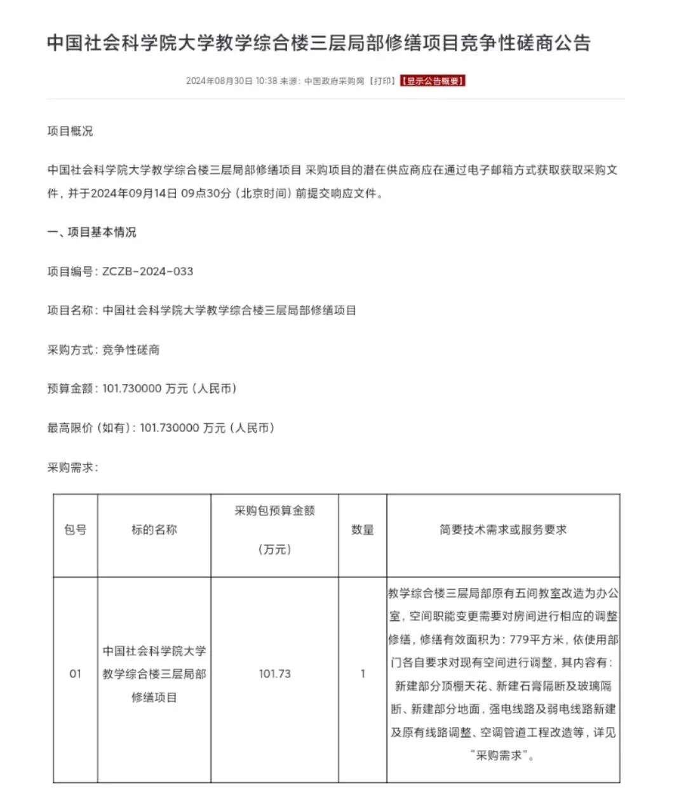
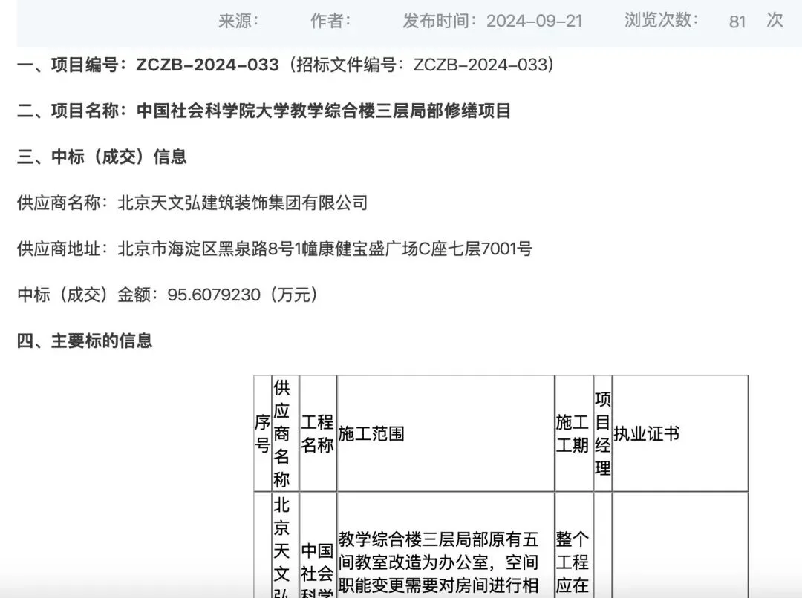
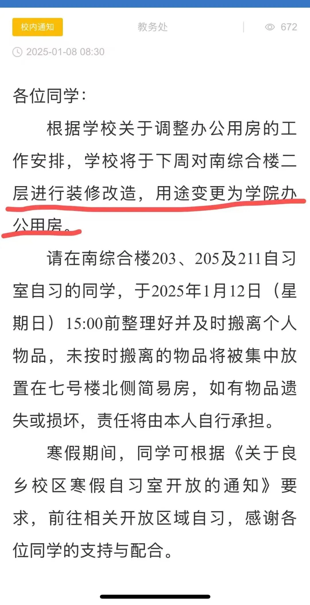

请相关部门及时关注并跟进问题。

## 1 宿舍

> “良乡校区7号楼，真给我干红温了，不是学校这点小事都要坑人的吗。本来考试就压力大，想洗个澡放松一下，全身沐浴露打好了你给我热水断了，你真是个...我硬是那凉水洗完了，那冰水，这跟我这天光着去宿舍楼外头跑一圈有什么区别？然后去吹个头发，说是到十一点，知道你会提前十分钟关电，四十八到了那然后发现电已经断了，不是这几分钟能耗多少电啊，这点电都要省吗？那水费，改成先用定期按用量收很难吗，就非得洗澡洗一半给我断水是吧，这学期已经三回了，只能说真是这个👍，好久没这么红温了。”

## 2 自习室

“南综合楼一共三间自习室也要把学生们遣散，开学时遣散未果，趁学生放假回家，抓紧改成办公室。这学校到底有多少老爷啊？不完全统计，贵校除宿舍楼和食堂外的六栋建筑，哪一栋老爷们没有占一半？既然那么缺办公室，就给老爷们安排点板房啊。

学校用房紧张，修新楼的时候先给老爷们安排上停车位。贵校永远以老爷们的诉求为先吗？”

## “投稿南综自习室改办公室：

教室改办公室不是头一回了，新综合楼楼启用之前就悄咪咪花95w把五个教室改办公室了。(附图)”

## “投稿：

南综自习室改建，是否新增教室安置原先自习的同学？假期期间开放教学楼教室，那么假期结束之后呢？是否还有另外的自习空间？说改建就改建，也没有另外安置自习同学的安排，一句话就让大家搬来搬去，天天的就这样折腾学生？？？南综的自习室没有一个假期是消停的，到底是为了什么啊！！！！在社科大自习就那么难吗！！能不能真正考虑一下学生的需要干点正事啊。”

“投稿：请问南综固定自习室为什么从今天就开始拆东西，搬桌子啊？真的好吵！！！不是12 号之前搬离吗？不是下周开始装修改造吗？

（本来想着正好 12 号复习完走，结果今天一整个被吵的学不下去\[Broken\]）

这周是期末周啊！能不能考虑一下学生”

（见《[【读者投稿】限缩空间中无定的人](https://mp.weixin.qq.com/s?__biz=Mzg2MjcwNzQ1Mw==&mid=2247490386&idx=1&sn=750a6bc6997a41350a4426efe8eddba3&scene=21#wechat_redirect)》第2条）
