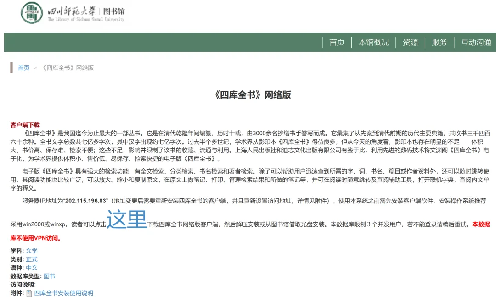

请相关部门及时关注并跟进问题。

## 1 图书馆

> “本来skd的数据库目前状态就是：要么直接没有，要么就是买了不买全，你问就是“同类型的已经有了”，完了还把一堆免费数据库放进来充数，诈一问数据库数量还挺吓人.一个地方师大都有，很难想象号称一流文科大学的社科大连“四库全书全文检索”的数据库都没有啊，你补助那么低也就算了，数据库还那么少，少改造一个办公室，少换一个闸机，少整一堆毛用没有的开销，这钱就有了吧，天天吵着穷，关键也没花对地方啊，还是说觉得钱花给学生是造孽啊~”

## 2 自习室

## “社科大为什么会把最差的地方丢给学生去学习呢，让学生去地下室和板房？

（见《[【读者投稿】愤怒不已](https://mp.weixin.qq.com/s?__biz=Mzg2MjcwNzQ1Mw==&mid=2247490391&idx=1&sn=4faf47139924cf5873a73479f5c89dec&scene=21#wechat_redirect)》第2条）

## 3 校园基建

> “社科大的钱真好赚！ 100 万改造 4 个教室？不知道又肥了谁的口袋？如果是南综合楼的4 个教室，不牵扯主体结构和铺地板。怎么可能用的了 100 万，10 万也用不了。学校的钱真不是钱，是纸。对学生扣扣嗖嗖，花钱大手大脚。无非是在墙上挖几个门，加几堵墙，顶多再粉刷一下，再加上人工费。平常见不到几个人，不知道哪来那么多行政？学生天天都在学校，把教室改为空空荡荡的每天 4 小时每周 20 小时的办公室，是极大的资源浪费。9 月份才花费巨大的人力物力财力安装的显示屏，投影仪，监控，才几个月又拆除。折腾吧，总会肥一些人的口袋。新楼那么多办公楼，直接搬进去不好吗？纯属是有钱没地方扔了。科教融合”真的有什么帮助吗?”

（见《[【读者投稿】愤怒不已](https://mp.weixin.qq.com/s?__biz=Mzg2MjcwNzQ1Mw==&mid=2247490391&idx=1&sn=4faf47139924cf5873a73479f5c89dec&scene=21#wechat_redirect)》第2.2）
