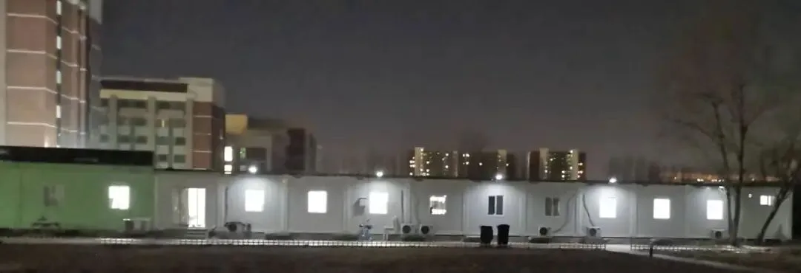

请相关部门及时关注并跟进问题。

## 1 校园网问题

“最近几个月这个校园网真是抽风！每天在学校干的最多的事，就是重连校园网密码！自动连接从来就没关过！今天在位置上坐着没动手机，只要解锁就是重新输，太折腾人了”

## 2 图书馆空调问题

> “良乡图书馆A204空调坏了一年多了，一到冬天就特别冷，光我自己就报修了很多次了，图书馆的老师们也说这个空调就是坏了，可是学校还是只修不换，可是修也没修好啊，冬天师傅来看了之后也没用，因为它坏了！在这里学习真的要冻死。本来图书馆位置就少，还一个屋的空调坏了这么久，趁寒假换个新的吧！那么多钱改造其他地方，就不能换个空调吗，学生的命也是命啊！”

## 3 自习室

## “《伟大：南综和板房》行政彪炳史册，可写入招生简章👍”

（【见《[【读者投稿】何以为校？第2条】](https://mp.weixin.qq.com/s?__biz=Mzg2MjcwNzQ1Mw==&mid=2247490398&idx=1&sn=3404577ebaf10f141f7385ba3f5de34b&scene=21#wechat_redirect)）
