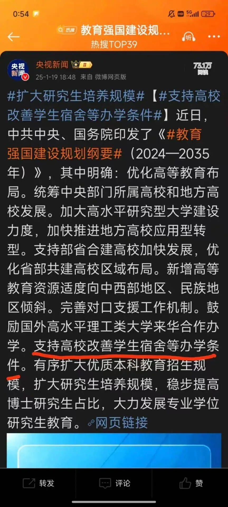
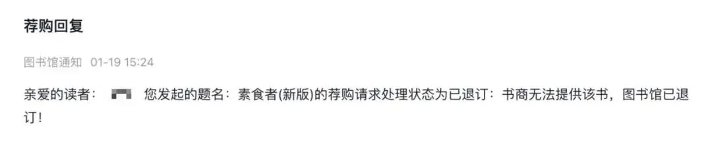

请相关部门及时关注并跟进问题。

## 1 宿舍

“投稿：之前18点25左右宿舍热水温度可以洗澡，为什么最近一两个月得7点了才行？改回和几年前一样了？”（良乡校区）

“社科大能不能响应一下国家号召，先把住地狱四人间的京籍大专生（俗称博士）的住宿问题解决一下？”

## 2 图书馆

## “投稿：有银子修楼，没钱买书？”

## 3 校园文化

## “回答（关于社科大有无专属拜年红包）这个问题，校友办有。”

（见《[【读者投稿】年关在望，成绩无期](https://mp.weixin.qq.com/s?__biz=Mzg2MjcwNzQ1Mw==&mid=2247490424&idx=1&sn=8096bb72aeaed2eeb72094970be1a1eb&scene=21#wechat_redirect)》第2条）
