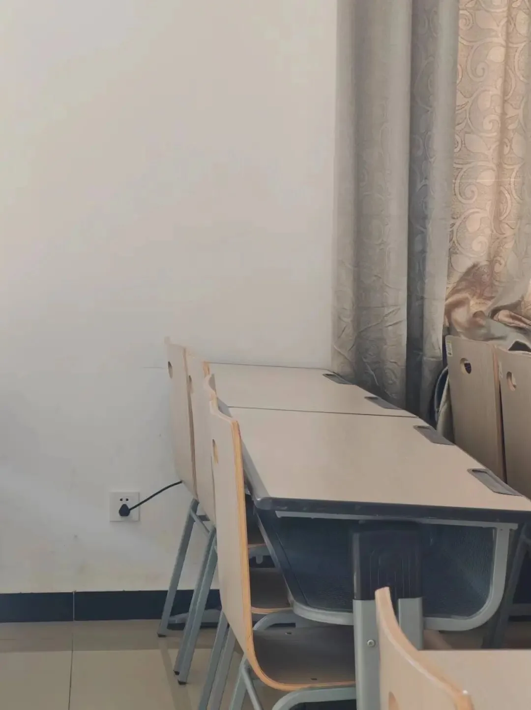

请相关部门及时关注并跟进问题。

## 1 科研处

“投稿：建议学校科研处的公众号推一些同学们发表的高质量论文吧！别的学校都在宣传学生成果，我们学校好像只宣传老师们的。”

## 2 校园基建

## “投稿：

建议议在校园里找地方安装按摩椅。

建议在图书馆的二三层楼的长走廊处，放一些低矮的坐垫，或者创造一些席地而坐的空间和区域。

建议静音仓在部分位置加遮挡膜，保护个人隐私的同时防止静音仓内学习被来回走动的人干扰。”

“晚上在良乡校区风味餐厅吃过饭，从北门出来看不见台阶，在室内强光对比下，外面更加显得一片黑，是没开灯还是没有灯。能否关照一下？”

## 3 食堂

## “投稿：

校园内西餐移动餐车的炸鸡的油请及时更换，别过度使用。而且注意油烟排放。

第一：关于高温油反复加热

食用油在高温反复加热过程中，会发生氧化反应，产生如丙烯醛、苯并芘、多环芳烃等有害物质。这些物质具有致癌性，尤其是苯并芘和多环芳烃，已被证实与多种癌症的发生有关。

反复使用的油还会生成反式脂肪酸，这种物质会增加心血管疾病的风险，如高血压、动脉硬化等。

第二：关于油烟排放排放

高温烹饪过程中，食用油会释放出含有致癌物质的油烟，这些油烟不仅会污染环境，还可能通过吸入进入人体，增加患肺癌的风险。

此外，建议将良乡校区一食堂的“饮料补给站” 改为卖沙拉或者自制果汁的地方。新鲜果蔬沙拉和果汁能提供丰富的维生素。建议食堂自制自治三明治作为早餐的一部分，目前早餐都是中餐。”

## 4 自习室

## “社论君你好，我要投稿：

望京校区教室

一位同学和保洁阿姨

昨天我在望京教室自习，一位同学进门发现自己前一天晚上放在教室的电脑不见了，然后拉过来保洁阿姨在教室训斥。表示阿姨为什么要偷拿她的贵重物品，阿姨解释桌子上的书、电脑、平板什么的，自己没有拿，觉得晚上放在明面上不安全，然后就用旁边的窗帘盖上了。同学发现后还在不依不饶，说这已经是好几次了，为什么要用窗帘盖上，并职责“你什么意思？”随即沉默开始收拾自己东西，阿姨离开。

投稿是想表示为什么现在学生素质堪忧，自己的物品放在教室占座不说，还要欺负保洁阿姨，作为学生只敢欺负服务人员么？在教室自习的同学不止一个，自己遇到问题就要大声打扰别人，这样做是否太自私了？年龄上已经成年，但是保管个人物品这个事情都做不到，算得上是成年人么？

PS：第二天来到同样教室位置，发现有人的电源插在插口上，但不知道是哪位同学的。对于假期内教室人少的情况，是否会形成火灾等安全隐患，应该麻烦保卫处的工作人员对这类同学进行批评教育？

这是今天同位置的情况图

## 5 学校系统吐槽

> “学校这个系统真的要搞那么麻烦吗？学生填完，导师点，导师点完，所里点，完了还要再交纸质版的……推进电子化难道不是为了更方便？这样反而更加复杂了，线下本来都走完的流程，线上再走一遍。要知道我们很多导师根本联系不上啊，他们那么忙，有时间跟你搁这点着玩？有的所甚至系秘也不管事…… 学生、导师、所里都陪你们玩是吧！流程简化一点不行吗？（导师甚至不知道自己的学工号，也不知道密码）”

请对稿件以及公众号有评论需求或者意见的朋友移步[社论读者频道](https://mp.weixin.qq.com/s?__biz=Mzg2MjcwNzQ1Mw==&mid=2247490418&idx=1&sn=1d8ef3e70740db089163bd8605db0f42&scene=21#wechat_redirect)!
