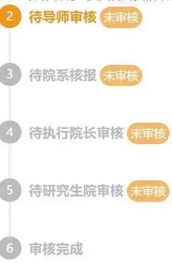

请相关部门及时关注并跟进问题。

## 1 感冒

> “投稿：又到开学季，能不能有请图书馆感冒的同学戴一下口罩啊，听着在那不停咳嗽擤鼻涕真是害怕。图书馆空气这么不流通，一个感冒的真的可以传染好多个。每次都是感冒的都不戴口罩，戴口罩的反而是不感冒的，实在不合常理。”

## 2 自习室

“支持今天这期投稿的关于望京校区保洁阿姨的问题。事实上，此类事件已经不止一次发生。早在投稿者刚入学的时候，那时候望京校区教室还没有实行定期清理制度，某些学生一个人占一排位置，将茶具、零食水果、毛毯、枕头等东西通通搬到教室，有些学生甚至会带几个箱子直接放在教室最后。如果当时常来教室的老生应对当时的“盛况”记忆犹新，教室俨然成为第二个宿舍。

其他学生多次向学校提出清理要求，学校也表示会开始定期清理，却迟迟不见效果。之后投稿者曾与清洁阿姨有过相关沟通。阿姨告诉投稿者，有些学生直接了当告诉她们“我东西就放在这，不准清，你动我的东西试试”，学校的行政往往又只给阿姨施压，于是阿姨们左右为难，情况迟迟不得缓解。后来经过一批又一批的其他学生们努力才最终有了今天的定期清理制度。

某些学生（姑且称之为学生吧），三分学生气尚难以寻见，七分高高在上的官威倒是从他那不算精深的申论反面材料中学得个活灵活现，羞也不羞？

今天的投稿让我想起这些旧事，如此看来，望京校区保洁阿姨们离职之频仍（尤其前两年），恐怕也有某些“知识分子”们盛气凌人的功劳吧？”

（【见《[【读者投稿】开学季前疑问多](https://mp.weixin.qq.com/s?__biz=Mzg2MjcwNzQ1Mw==&mid=2247490454&idx=1&sn=7c2010dd7ab31e1e1967a9580b1c911e&scene=21#wechat_redirect)》第4条）

## 3 食堂

## “投稿，餐车油烟味太大了篮球场都能闻到，堂堂研究院全是油烟味，建议主做轻食”

> “点赞后勤处近来早起供应热水和食堂一二楼大小份同时卖等方面的改变，切切实实方便了我们。再提一个小小的建议和愿望，就是一楼能不能有一个窗口6.30开始卖饭，花样少一点没关系，有啥卖啥就行，比如说只有包子和鸡蛋就可以，早起赶车有时候想买份饭再走，很多时候还没有开始卖，导致买不到，希望有一个窗口早开半个小时，6.30开始，然后晚关半个小时，9.30结束，这样让上课晚的同学，也能吃上饭，有啥吃啥就行。会极大地方便同学们。。餐车好是好，但是有的同学吃不习惯也，还是希望这个建议也可以试着试运行一下，谢谢。”

（【见《[【读者投稿】开学季前疑问多](https://mp.weixin.qq.com/s?__biz=Mzg2MjcwNzQ1Mw==&mid=2247490454&idx=1&sn=7c2010dd7ab31e1e1967a9580b1c911e&scene=21#wechat_redirect)》第3条）

## 4 学校系统吐槽

> “社科大这个系统让人想起“孙越买葱名场面”，估计比搁杭州办个企业流程都多，skd的行政到底是怎么了？搞得天怒人怨，导师、所、学院老师都天天啥也不干，搁这等着点你系统是不是，如果因为老师联系不上，过了时间，这算谁的责任？skd敢搞那么繁琐，但你敢问责吗？就看学生好欺负，最后后果全部学生承担呗”

（【见《[【读者投稿】开学季前疑问多](https://mp.weixin.qq.com/s?__biz=Mzg2MjcwNzQ1Mw==&mid=2247490454&idx=1&sn=7c2010dd7ab31e1e1967a9580b1c911e&scene=21#wechat_redirect)》第5条）

## 5 科研宣传

## “投稿：十分赞同昨天的建议“学校科研处的公众号推一些同学们发表的高质量论文吧”。

各学院可以看看应用经济学院公众号是怎么做的，定期推送师生成果，这是一种激励，也是一种监督。特别请经济学院和商学院好好认清差距。”

（【见《[【读者投稿】开学季前疑问多](https://mp.weixin.qq.com/s?__biz=Mzg2MjcwNzQ1Mw==&mid=2247490454&idx=1&sn=7c2010dd7ab31e1e1967a9580b1c911e&scene=21#wechat_redirect)》第1条

请想要讨论稿件有关内容的朋友移步社论读者频道！（后台发送关键词“读者群”）
