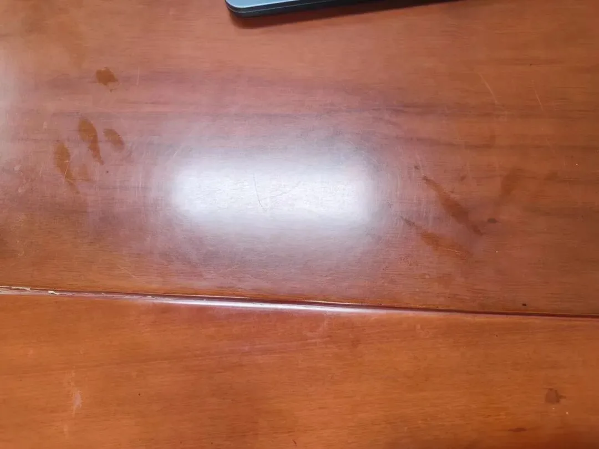
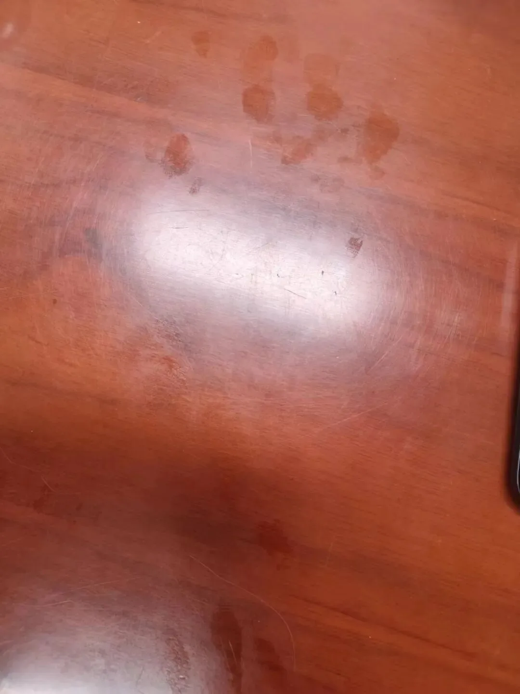
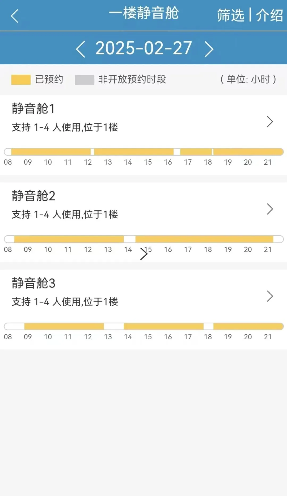
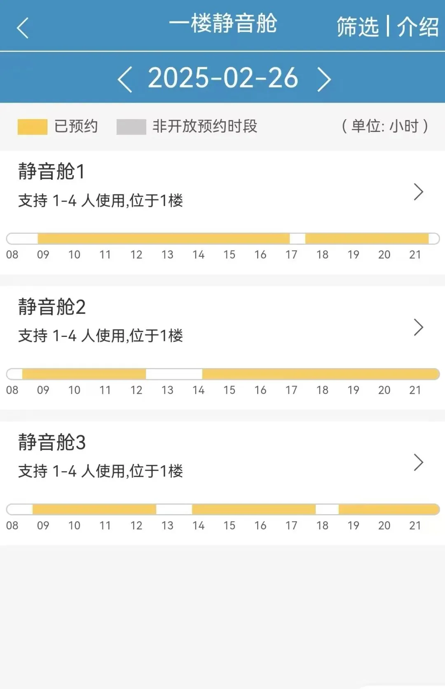
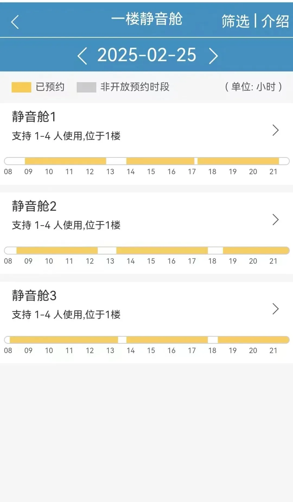

请相关部门及时关注并跟进问题。

## 1 图书馆与静音仓

## “投稿：图书馆座位使用完请不要留下油渍。”

## “无言（投稿人未发送任何文字）

“建议图书馆工具阅览室，上架最新版本的《马克思恩格斯主义全集》，以及一些其他经典马克思主义作家的选集、文集。现在很多期刊要求经典马克思主义作家必须要选取最新版本，但是第四书库A架根本满足不了，而且很多最新版都被借走了。所以希望在工具阅览室能保留一套最新的版本，供大家核对文献。（另外敦促一下借走马恩全集前十卷的，用完赶紧还！别人还要用呢！）

## 2 自习室

> “2月22日推送第二条关于自习室的一点看法，公共资源被某些人占为己有，这种现象已经存在很多年了。确实不好解决，一来是先用的同学心安理得，恬不知耻，二来是管理方不作为，放任自流。但是占了一片自留地，不代表能考上，更有趣的是，这类同学往往也考不上”

（【见《[【读者投稿】即便如此，社科依旧转动](https://mp.weixin.qq.com/s?__biz=Mzg2MjcwNzQ1Mw==&mid=2247490461&idx=1&sn=d8b6a0a01a5878dc7060b4621e40db88&scene=21#wechat_redirect)》第4条）

## 3 食堂

## “投稿，新学期第一天第一顿饭。一食堂滚”

## 4 望京校区

> “现在望京校区教室收东西越来越频繁，寒假期间学生没在校也把东西收了，前几天去找，东西堆了满满一大堆，根本找不到，并且这个月底就要清理掉。我想问问相关负责人，这样频繁的收东西是什么原因，学生的贵重物品丢了，又该谁负责。”

请想要讨论稿件有关内容的朋友移步社论读者频道！（后台发送关键词“读者群”）
