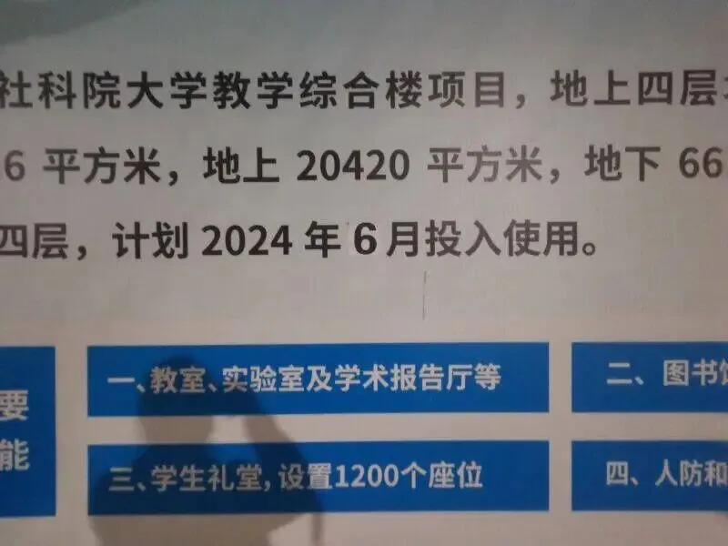
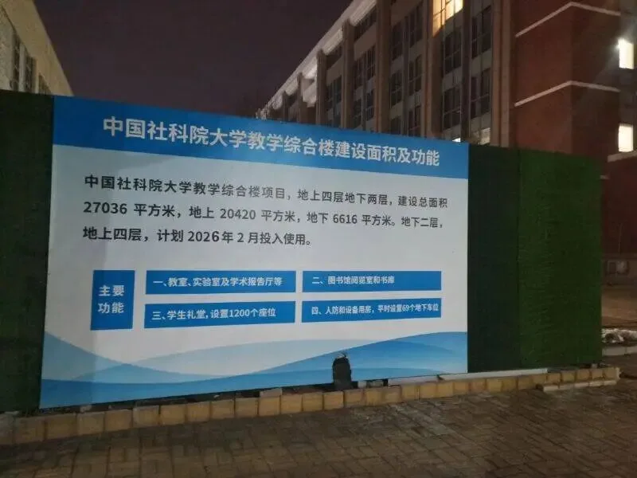
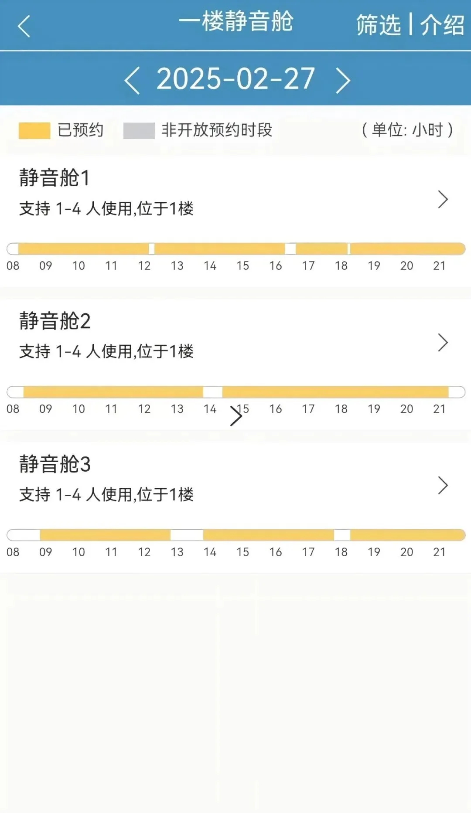

请相关部门及时关注并跟进问题。

## 1 校园网

## “就想问，当天晚上9：40充了20元的流量，11：15就跑完了，怎么回事？”

## 2 南门新楼

“南门新楼计划主要功能，没有实验室，也没有办公室。计划都是给学生使用，实际是安排办公室，学生自习也只能挤在狭小的板房里面。

ps：很难理解，新楼开辟了办公室，南综自习室改成了办公室。为什么没有腾出一些空间给学生用呢？空间消失大法在我社。”

## 3 食堂

## “投稿：请求学校开个淀粉肠摊位，简单好操作又美味，填补小吃需求”

## 4 自习室

“社论君你好，我想投稿支持上一期第2号关于望京教室自习的社论，也要反对第4号望京教室自习的社论。

望京教室自习上座率很低基本上是有目共睹的，笔者一周可能只去两次二楼教室自习，基本上一个教室一天算上笔者不会超过三个人。但是望京教室座位基本上没有空置率，已经被完完全全的占满了。所以现在望京教室处于一种座位的“主人”基本不会来，但是其他同学如果使用又会担心被座位“主人”指责的境地。教室不应当是个人的私产，你我都交了学费，你不用其他同学自然可以使用。所以请各位自诩为座位“主人”的同学偶尔去教室学习的时候看见自己的座位上有其他同学不要愤怒也不要惊讶，这个座位本身也没有写只归你使用。笔者也曾遭遇过这种尴尬的情况，曾经早上八点抵达教室，找了一个座位坐下来，把原主人的东西收入抽屉开始学习。下午六点原主人进入教室，警告笔者不要动她的东西，并说是固定座位，希望笔者在她需要使用的时候不要占用。此番言论着实稀奇，但是又见社论上还有座位“主人”警告清洁阿姨的情况，顿觉释然。原来堂堂社科大研究生还有这么不要脸的存在。在这里还是呼吁各位“主人”不要不臊皮的把座位当私产。

然后笔者要反对第4条社论。定期收拾清理教室，为全体同学营造良好的自习环境是物业公司的工作职责，也是全体望京同学的期盼。你自己一个寒假不回来，你的粉笔980已经落灰；你的杯子已经结了水垢；可能霉菌已经悄然爬上了你忘在教室的水果，这些东西诉说着你曾经考公的雄心壮志。这雄心壮志只有在阿姨清理你放在教室的一堆垃圾才会重新燃起，并像泼皮无赖一样威胁学校你的贵重物品丢了谁负责？答案是，同学你是成年人，你自己负责，怕丢请你每天收回寝室。你要是愿意每天收好自己的东西并带会寝室，无论是定期清理教室还是丢失风险，对你来说都不是事情。

最后也劝各位自诩为座位“主人”的同学多多使用你的座位。好歹上个岸拉高一下学校的就业率，虽然上岸对于占着座位不学习的“主人”们很困难就是了。但是希望还是要有的，毕竟有些人的水平异地乡镇也是上岸，各位占着座位不学习的“主人”说是不？”

（【见《[【读者投稿】同学不语，只是发送图片](https://mp.weixin.qq.com/s?__biz=Mzg2MjcwNzQ1Mw==&mid=2247490472&idx=1&sn=6175f214c449b5ef8d5176a678a41a91&scene=21#wechat_redirect)》第2条）

## 5 毕论安排

> “吐槽某学院办事效率极其低下。提交论文系统本就审批流程一个叠一个很繁琐，笨人按照要求再ddl前提交了申请，但是目前催促多次仍然卡在审批节点中，并且下面还有节点。马上都要关闭查重系统了，还没有审批，完全不管学生死活是吧。”

> “硕士的毕业论文为什么卡着京考国考的时间？？是让人要么考上了延毕要么没工作吗？？？而且教务为什么不在班级群里提前通知好期限，到截止前10天左右才通知要交论文？？？”

（【见《[【读者投稿】睁了眼看](https://mp.weixin.qq.com/s?__biz=Mzg2MjcwNzQ1Mw==&mid=2247490407&idx=1&sn=a0dd18ef174ef2b5c53d80042928b428&scene=21#wechat_redirect)》第1条）

## 6 静音仓

（重投）

“关于图书馆的静音仓，自从接近开学的这几天以来，屡次蹲守静音仓都预约不上，仔细思考之后认为有以下几点原因。 1.静音仓的预约时间为晚上12点，此时间过晚，对于不习惯熬夜的同学、第二天有早八的同学、熬夜几次之后就有将近猝死之感的同学十分不友好，此预约时间剥夺了极大一部分学生的使用权。况且凌晨预约违反学生作息规律，长期熬夜影响健康与学习效率。

2.静音仓个数较少，相对于图书馆的座位，三个静音仓实在势单力薄，对于我们一个人文社科院校而言，有极大的朗读背诵需求，这个数量实在太少了。

3.每次可预约的时长不是很合理，静音仓是为了读者进行朗读、背诵、学术研讨、学业讨论、笔试、面试之用，但是以上活动在通常情况下1—2小时就已足够，若是不够，学校还有5个座位更多的研讨室，更适合长时间的出声活动，因此建议缩短每人次可预约时长，提高利用率，减少将静音仓当图书馆自习室的可能，避免造成稀缺资源的浪费。 4.很长一段时间，在清晨刚起床想要预约的时候，最近四天的所有空档除了午饭和午休时间有空闲之外全都没有了，请领导和老师了解实际情况，如有必要可以出具调查问卷了解大多数同学的想法。 在此附上截图。

因此，对于静音仓有以下建议希望采纳：

1.将静音仓的预约时间改为8:00-22:00之间的时间点，给予更多同学使用的机会；

2.增加静音仓的个数；

3.缩减静音仓可预约时长，比如改至每天每人次2小时，增加人次使用率。

非常希望学校能考虑以上建议，减少学生熬夜所造成的健康风险，考虑学生学习的实际情况，共同打造更高效、人性化的学习环境。

（【见《[【读者投稿】同学不语，只是发送图片](https://mp.weixin.qq.com/s?__biz=Mzg2MjcwNzQ1Mw==&mid=2247490472&idx=1&sn=6175f214c449b5ef8d5176a678a41a91&scene=21#wechat_redirect)》第1条）

另注：请投稿的朋友关注投稿须知。另外读者群审核为人工进行，没有所谓的暗号或密码，如申请后长时间没有进入可向公众号后台反映，带来不便烦请谅解。
