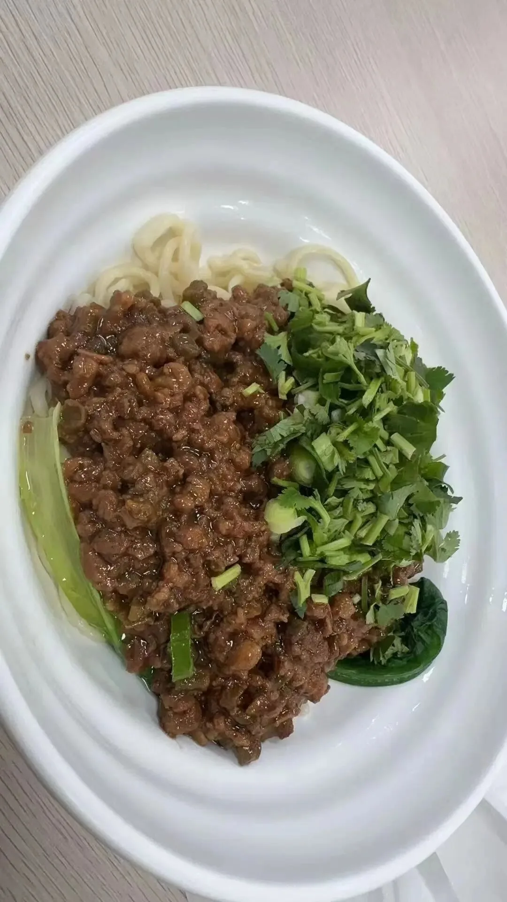
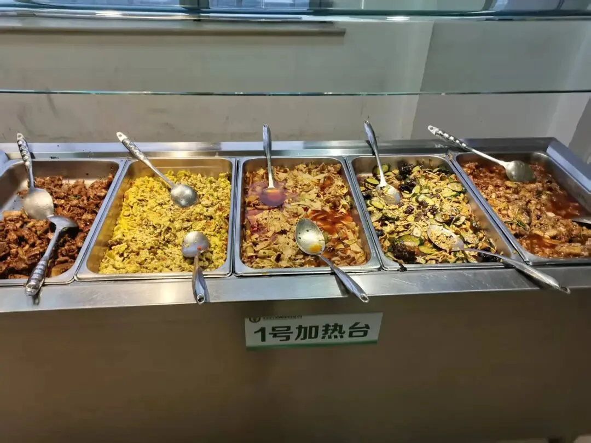
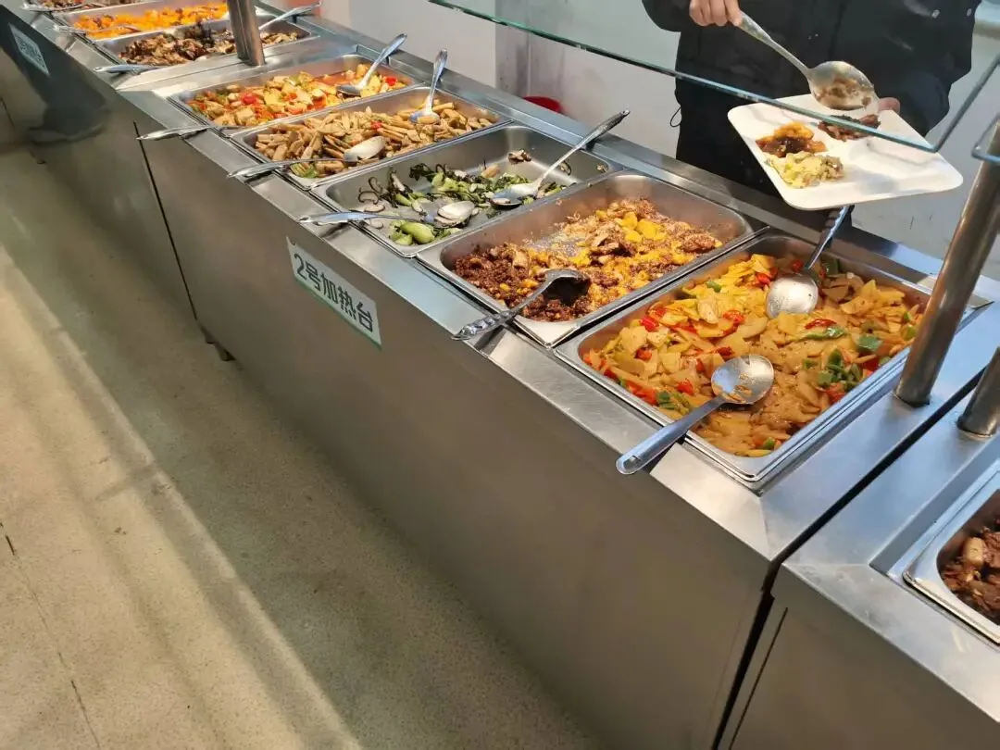
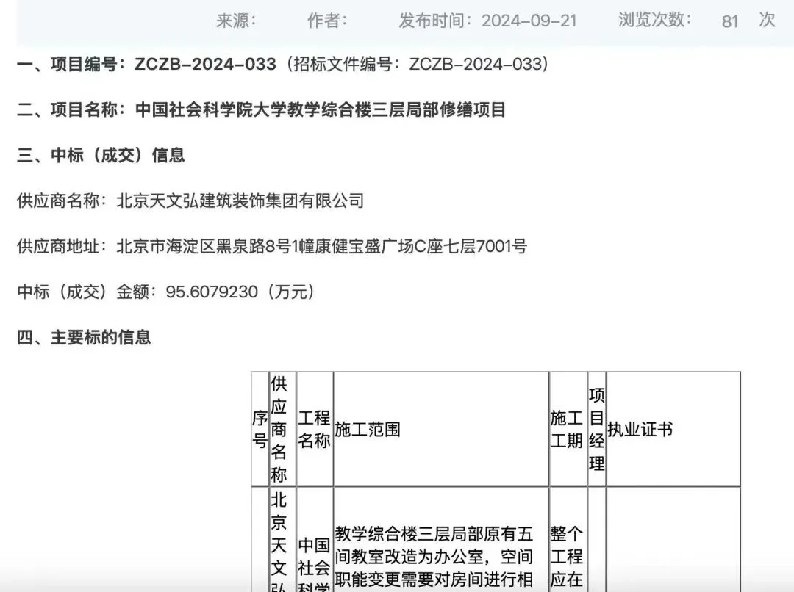
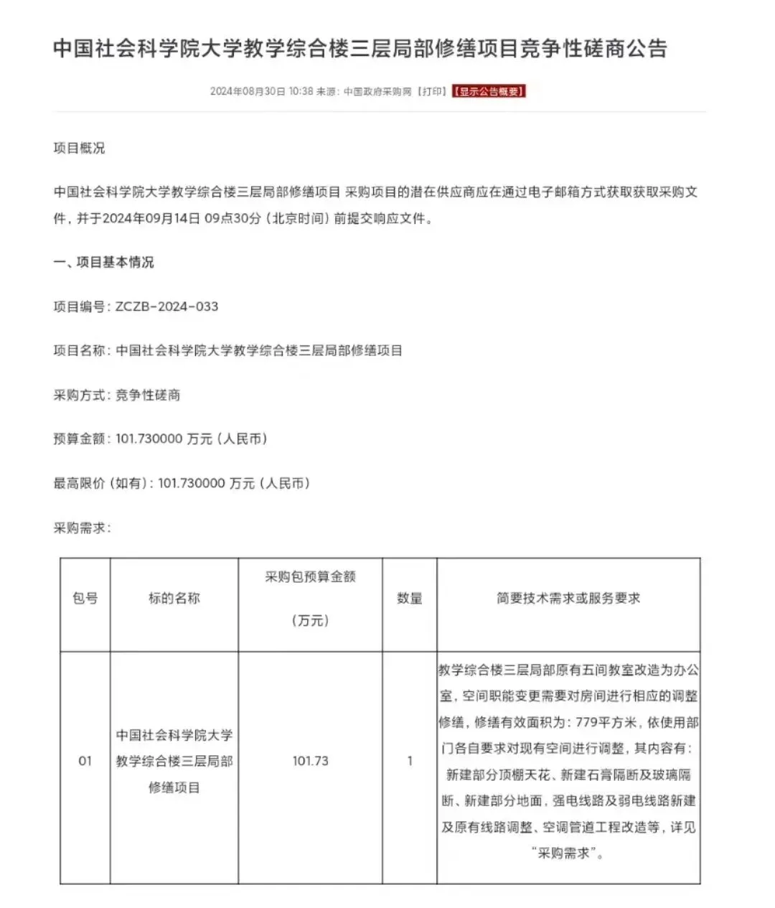
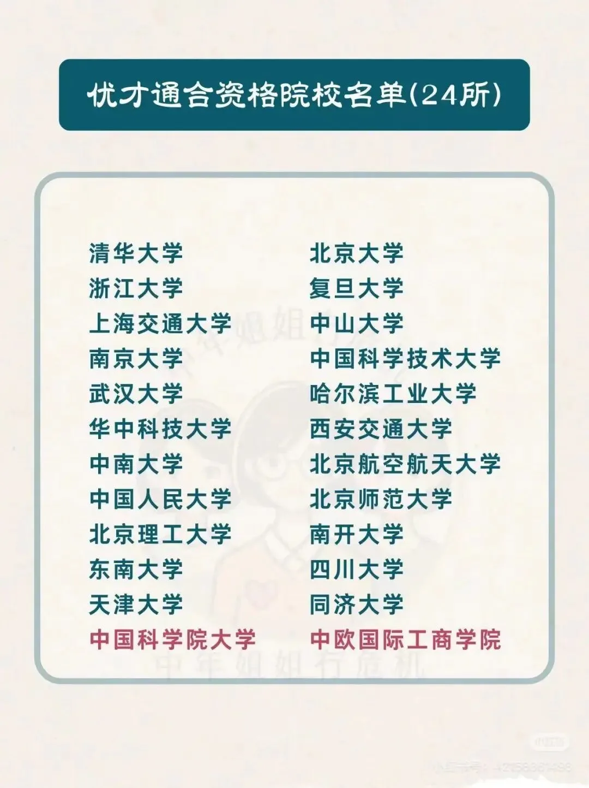

请相关部门及时关注并跟进问题。

## 1 望京校区

“投稿：望京食堂这个肉末豇豆面，不知道是什么肉都混在一起了，味道很奇怪，吃完了就想呕吐（生理呕吐，形容肠胃难受）”

## 2 良乡食堂

## “投稿：

社科大的食堂现在连刚开学的表面工作都不做了，五点二十分到自选连几个像样的荤菜都看不到，炒了几个鸡蛋滥芋充数。这就是开学之初严抓食堂的结果？”

## 3 校园规划

## “

投稿~

引用2.28第二条“2.南门新楼”。“为什么没有腾出一些空间给学生用呢？”

Skd不仅没有腾出空间给学生用，还把学生自习室、教室改成办公室呢。

新楼三楼的五间教室刚建好，甚至还没启用，就被改成办公室。如此浪费资源实在难评。见[【读者投稿】画饼充饥](https://mp.weixin.qq.com/s?__biz=Mzg2MjcwNzQ1Mw==&mid=2247490483&idx=1&sn=a0b8bfa0fafa0a41167829ad5d1e9246&scene=21#wechat_redirect)第二条

(附图)

”

## “希望1-4号楼在公共吹风机旁增设公开插座，学生可以根据需要使用自己的吹风机。”

## 4 优才计划

“社科大什么时候能上港府认定的可以优才身份的学校之一呢？2025国科大上了，2026能不能争取下😑

## 5 校园网（因编辑部失误，本稿已撤稿）

> “投稿：最近良乡校区校园网不知怎地把包月账号可用设备上限砍了，而计费价格却仍然不变，减量不减价、让人倍感幽默。这事不算什么大事，但给人的观感却非常之差，就好像在告诉你我们想大家钱想疯了，连网费都要悄悄做点手脚。而连网费都要猥琐动动，又（将）会有多少事情在我们不知不觉间就被减量不减价呢？兴许有人又会搬出那一套防止校园网滥用的陈词滥调，可是社科大究竟是有几万校园网用户、抑或是只有这一招才能防止网络资源滥用（更何况这招真的有用吗)？说起来学校校园网计费规则不合理、网络资源供给不足也不是什么新鲜事，批评质疑早已屡见不鲜。我们生活在互联网时代，网络的重要性不比任何一项基础设施保障差。望校方、尤其是校领导能够早日重视此事，既然可以协调整顿食堂（权且认为目前是有力整顿的），那当然也应该下力气整顿校园网，早日延引用户及公正第三方协定合理价格、科学提升建设质量并稳定网络供给。”

请对稿件以及公众号有评论需求或者意见的朋友移步[社论读者频道](https://mp.weixin.qq.com/s?__biz=Mzg2MjcwNzQ1Mw==&mid=2247490418&idx=1&sn=1d8ef3e70740db089163bd8605db0f42&scene=21#wechat_redirect)!
