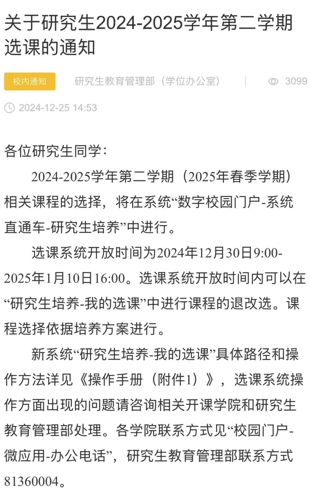
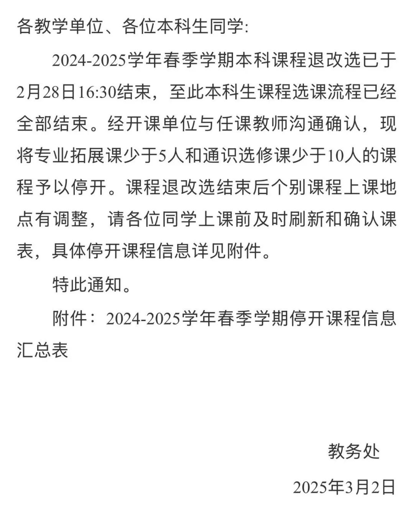
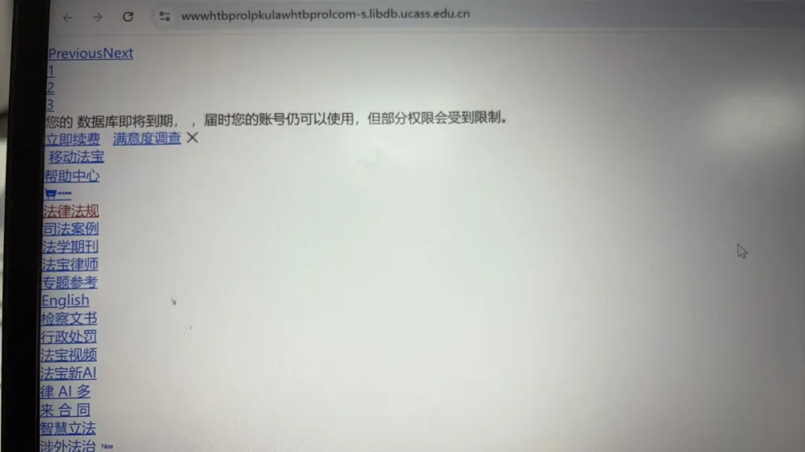

请相关部门及时关注并跟进问题。

## 1 研究生退改选

## “研究生退改选

第一周结束，才发现本应在第一周进行的退改选居然无影无踪，这是为何？

向上反馈，得到的结果是“按照研究生管理部要求，没有试听周，退改选在选课周内完成”。”选课周是何时呢？嗯，原来是去年的事情了啊。

荒谬否？再去查证上学期的选课通知，从何通知再无“试听周”的？

不少同学选择通过第一周时间选择自己时间相符、爱好相符的课程，如今却突然被学校一杆子打翻，对那些试听完第一周课程觉得不合适或多选少选课程的同学来说，本学期将倍感痛苦，学校究竟为何突然修改退改选计划？能否再给同学们一个选择的机会？是否下次涉及政策调整能提前通知留出预备时间？

刚刚教务处通知本科生退改选已结束，那为何研究生就无退改选安排了呢，学校究竟是如何规划的呢？

”

## 2 自习室改办公室

“真不知道skd是有多少官爷要养，把自习室改成办公室还不行，新建的楼也是火速改成办公室，改来改去，真不知肥了谁的腰包，学生都赶去板房和地下上自习，你们怎么不能在板房和地下办公？

拿着最好的“地”干着最烂的“事”，希望skd的领导明白你们不是“官僚”，学生也不是“刁民”，大家是师生鱼水关系啊，听点建议吧，多少干点人事让人有个念想”

## 3 deepseek

> “伴随着人工智能在教学、科研、管理方面的不断应用，已有多所高校接入deepseek并部署deepseek本地化模型。建议我校从速参考兄弟高校先进经验，搞一个“社科满血版deepseek”出来、以方便我校师生更加便捷地了解并参与AI科技发展的浪潮。”

## 4 找自己的问题

> “我真的很佩服这个设计师，他妈的搞的这个补助刚刚好，刚刚够你吃饱又饿不死。哎，这真的是智慧。想要多不可以，想饿死，诶，你别想！“自己选的社科大怎么不找找自己的问题”你申不下研创也找找自己问题好不好？你材料加不上分也找找自己问题好不好？你拿不到国奖也找找自己问题好不好？你毕业找不到工作也找找自己问题好不好？为什么学校就欺负你呢？为什么就你天天通勤四五个小时呢？为什么你每个月就一千二百五呢？全部找自己问题好不好？为什么你抢不到静音舱呢？为什么你看个大众点评打折餐拼好饭都犹豫半天要不要吃呢？找下自己问题好不好？什么都找自己问题，发不了C刊也找自己问题。我导师不管我我怎么找自己问题啊？——《社科小明》（仅供娱乐，切勿对号入座）”

## 5 补助早发

## “投稿：望学校三月尽早发低保，谢谢！”

## “您好，人文之光。想投个稿，希望这个月学校的助学金早一点发”

## 6 大巴司机

## “

如图，可以清晰看出车在行进中，手机屏幕亮着，司机在看手机而不是看路，环境是咱们校内。”

## 7 锅炉房热水

## “最近锅炉房是不是又偷工减料了，热水又很早就凉了”

## 8 研创项目疑问

> “《研创计划》 根据今年要求，申请研创计划的负责人必须提交毕业论文开题报告，但是研一研二还没有中期考核无法提交，研三作为毕业年级亦被规定无法作为项目负责人。这意味着整个硕士阶段都无法申请自己的研创计划，请问这样的一刀切又是何故？如果认为研创计划成果太少，完全可以提高审核标准或者增加验收条件，而通过人为设置某些条件来“卡走”学生申请资格，是否又是一种懒政怠政？最后，作为一项额外的科研激励支持政策，实在难以理解研究生开题报告与研创计划质量之间有什么相关性，望解惑。”

## 9 食堂

## “投稿：今天的蒸排骨好像有股肉臭味，吃的时候差点呕了……

为什么食堂的菜这么差劲，是我们学生不配吃点好的吗？？？”

## “

投稿：点赞食堂甜品店”

## 10 数据库 “投稿，社科大学子还有机会用北大法宝吗？”

