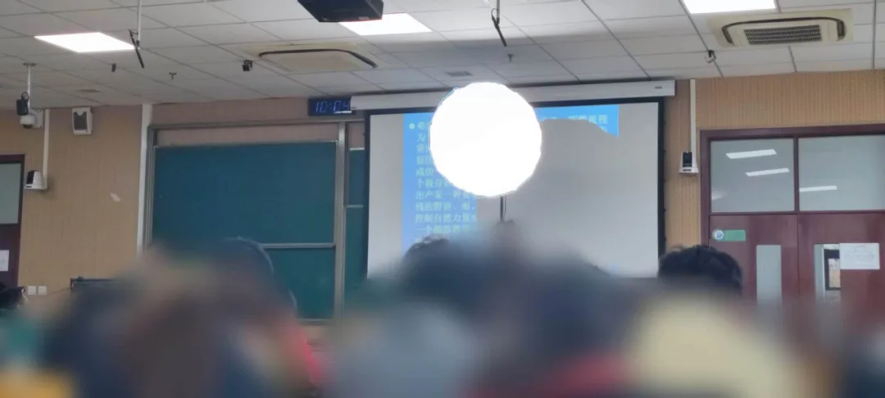

请相关部门及时关注并跟进问题。

## 1 食堂

> “自从良乡校区的自选食堂请了个大厨后个人感觉伙食改善了不少，味道控制的不错没有很咸，油量感觉还算比一食堂克制，真有点那种酒店配餐里面的炒菜的感觉了，不知道其他同学怎么想。”

“ 投稿:良乡一食堂打饭的阿姨和叔叔要不再去重新进修一下数学呢，一份1块钱的豆芽（之前也买过有其他1块钱的菜），一个2毛钱的小馒头，一个6毛钱的白煮蛋，怎么算都应该是1块8吧，已经连续三天给我打1块9了，搞得我都怀疑是不是小馒头或者鸡蛋涨价了。结果发现不是主要每次就那1毛钱也不想多计较，但是也不能天天都这样呀，好烦呀，能不能好好算算数啊，每天1毛钱也是钱呀"

## 2 研究生开题

“说实话，开题这事没啥好喷的，skd开题太晚了……按照skd很多导师这不管那不管的情况，早开题早好，不然延毕概率很大，一般高校研二上，博二下都给开了

在职的可能无所谓，全日制的还是早早开题吧，不然真耗不起。但skd应该允许开题后题目有所调整的空间，谁都是边写边改的，完成稿和开题变化大是很正常的；以及允许补开题的机会，不要回回什么事都搞的那么刻板那么死

”

## 3 校友会排名

“看到了最新校友会排名，特别开心学校在宣传工作做出了很大的努力，提高我们学校的知名度，再接再厉！”

## 4 自习室

> “增加自习室需求：社科大现在的自习资源严重紧缺，本身硕博就需要随身带电脑和厚书，一个教室一个教室的搬太累了。板房、自习室、地下又都人满为患。本来期待新学期终于能启用新楼，想不到又是遥遥无期，启用时间已经拖了一年多了，就算电子设备没准备好，那搬点桌椅做自习室也行啊。另外看着研教楼3楼的办公室搬走好多，现在全是空闲状态，能不能也改成自习室？”

## 5 门牌指示问题

> “你好，教务处和一些执能部门搬到了新的综合楼之后，因为一楼二楼乃至三楼都还在装修，所以也没有明确的指示标。进来以后只能自己摸索怎么能上三楼也不知道从哪个门进有没有这方面的指示？或者是一个说明告诉人们电梯在哪儿，如果爬楼从哪儿找楼梯”

## 6 课程录制问题

> “投稿，主题摄影作品《人文之光》。完全可以理解学校需要给学部委员的课作宣传，但是不是可以参考上学期的形式，招一些志愿者单独录制？就算实在没条件，下次能不能至少请一个不这么擅长刑讯逼供的团队？”

请对稿件以及公众号有评论需求或者意见的朋友移步[社论读者频道](https://mp.weixin.qq.com/s?__biz=Mzg2MjcwNzQ1Mw==&mid=2247490418&idx=1&sn=1d8ef3e70740db089163bd8605db0f42&scene=21#wechat_redirect)!
