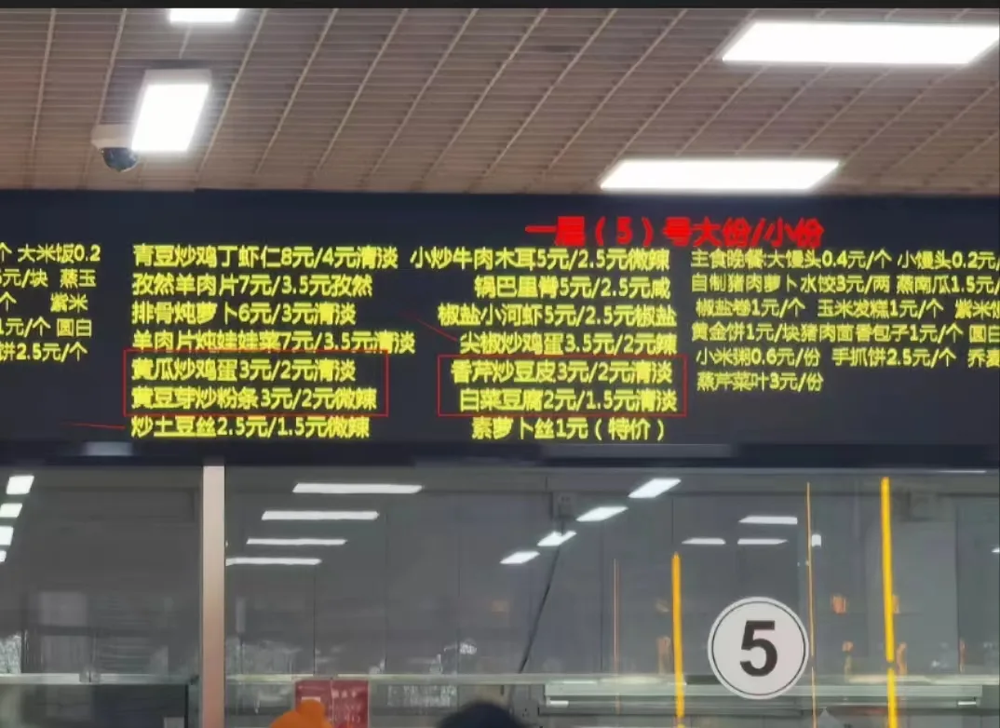

请相关部门及时关注并跟进问题。

## 1 教务安排

> “投稿，越想越不懂，想问教务处领导们几个问题：1）本科课程《数字时代的文化与创意》为什么在两个年级分属两个学分板块，且跨度从美学到自然科学模块？2）并且作为新开课程，在选课阶段并未标识出模块区别，却和Python等信息素养课程并列选课，这是否有“误导”的嫌疑？3）是否应该为该课程调整一下学分模块儿，抑或者出一个声明讲明一下情况，如果教务的老师嫌麻烦不愿解决这个问题，那之后类似情况可否提前出一个该课程模块儿“存疑”的通知，以免误导后来的学弟学妹？4）如果是本科毕业阶段遇到这个问题，难道解决方式也是“系统为大”，让学生自己再去修满该模块儿课程学分吗？希望教务的老师闲暇之余，可以回复一下。另外提醒同学们，选课阶段请务必留存影像资料，以免之后百口莫辩。”

## 2 食堂

“无论什么时候去良乡校区一食堂，去的再早，饭菜都是冷的。希望食堂对饭菜进行保温措施，让学生吃上一口热乎的饭菜。”

“新学期伊始，良乡校区一食堂迎来了大小份菜自由选择的喜讯，同学们都很开心。但最近出现了一个食堂菜价定价标准过于“随意”的问题。

第一，食堂默默涨价，就此，我们学生并没有在企业微信收到任何关于食堂菜价调整的通知。

第二，大份、小份菜定价标准不统一且出现了“随意”的现象。以2025年3月9日的晚餐为例，详情如下图所示：

未标注的“青豆炒鸡丁虾仁”等菜品，大份菜的价格均是小份菜的两倍，这个绝对理解！

箭头所指的“尖椒炒鸡蛋”、“炒土豆丝”鉴于大份菜价格的一半涉及到的价格可能不便于师傅算账，小份菜价格分别在大份菜3.5以及2.5除以2的价格基础上，上浮几毛钱凑个整，便于算账，也可以理解！

那么，框线标注的黄瓜炒鸡蛋、香芹炒豆皮、白菜豆腐等菜品，大份菜的价格与小份菜的价格为何如此定价？这样的定价合理吗？

第三，学校食堂默默涨价了，可涨价的原因我们学生不得而知，我们生活的补助并没有随着食堂菜价的上涨而提升，是国家在新学期给食堂的补贴减少了？还是菜价上涨了？恳请学校有关部门对此现象予以重视，也希望学校能给我们一个合理的理由。毕竟推行大小份菜的初衷是减少浪费，而不是给变相涨价提供“机遇”！

就此，还请学校给予我们学生合理的解释，我们对自己切身的一日三餐生活变化有知情的权利！会持续关注，期待学校相关部门予以重视并解决此事！谢谢！”

> “开学一食堂一楼和二楼都可以打小份菜本来是好事儿，方便大家选择又能减少浪费，但是，大家有没有感觉到，最近良乡一食堂涨价了，还涨了不少，早晨小米粥都是之前价格的2倍了。午餐和晚餐有的菜也涨了。哭哭，我的补助却并没有涨”

## 3 投稿

## “看到3.8日妇女节的望京餐厅女神节投稿有感：

是妇女节，不是女神节女王节，我们不要女神女王的虚假王冠，我们只要平等的权利。

希望学校后勤部可以重视，以后可不可以不要再出现女神节这种称呼，我们妇女需要的也不是被审视的美丽，需要的是祝福是智慧、是强壮的身体”

## 5 新楼

> “接上文 教室分配问题：新楼没晾好一股甲醛味道不说，问题是上课过程中还在装修，粉尘在空气中有多少？哪怕上室外体育课都比这强… 这就是社科大对学生的爱吗？难道领导班子不知道人长期在甲醛环境下呆着会得癌么”

请对稿件以及公众号有评论需求或者意见的朋友移步[社论读者频道](https://mp.weixin.qq.com/s?__biz=Mzg2MjcwNzQ1Mw==&mid=2247490418&idx=1&sn=1d8ef3e70740db089163bd8605db0f42&scene=21#wechat_redirect)!
