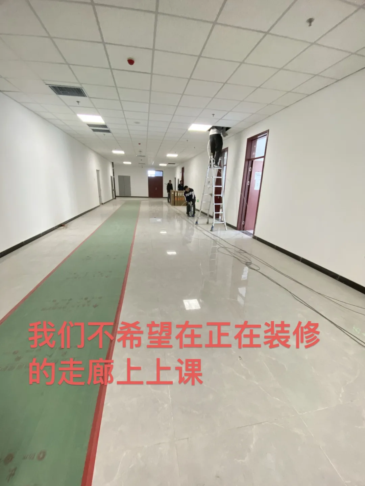
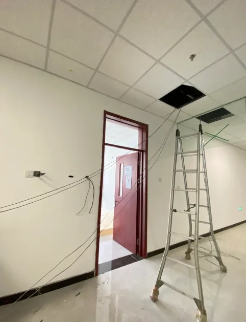

请相关部门及时关注并跟进问题。

## 1 研究生开题

> “九转大肠科研处研一、研二“没开题，无法申请研创”；研三开题后“不许作为负责人申请”。那还设计这个开题报告来恶心我们是干嘛呢？科研处的官老爷，你们脑子是直通大肠吗？能考虑下自己学生的实际情况吗？往届硕士研创结项情况差，你提高审批标准啊，搞这种因噎废食的做法，显得自己很高明？从奖学金评选到研创申请，这一桩桩一件件，哪个不是搞得天怒人怨呢。依我看，社科大的心头之患，不在社科院，不在老师，不在学生，而是在行政，就是在你们这群尸位素餐的不粘锅。”

## 2 校园氛围

“今年的校园女生节和妇女节都显得格外冷清。之前学校会挂上庆祝横幅，研源超市也会免费赠送康乃馨。希望我们能一起营造温馨舒适的校园氛围。”

## 3 教室设施

“投稿：工地上课瑜伽课和艺术体操这两门体育课在新综合楼正在装修的教室上，上课期间还能听到电钻声。教室里已经装上讲台了，还有很多装修材料，不仅没有足够活动空间，还有很大的异味和很多灰尘，导致课堂体验感非常差。我们希望有一个固定的、适宜运动的、能至少允许30人伸展开的教室上课，最好有足够大的镜子（因为瑜伽、艺术体操等对身体姿态有要求）。我们不希望在还在装修的教室上课，也不希望在走廊上课。附几张图：

”

请对稿件以及公众号有评论需求或者意见的朋友移步[社论读者频道](https://mp.weixin.qq.com/s?__biz=Mzg2MjcwNzQ1Mw==&mid=2247490418&idx=1&sn=1d8ef3e70740db089163bd8605db0f42&scene=21#wechat_redirect)!
