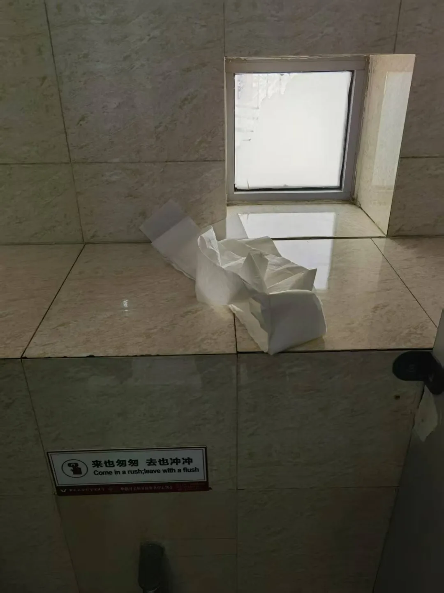
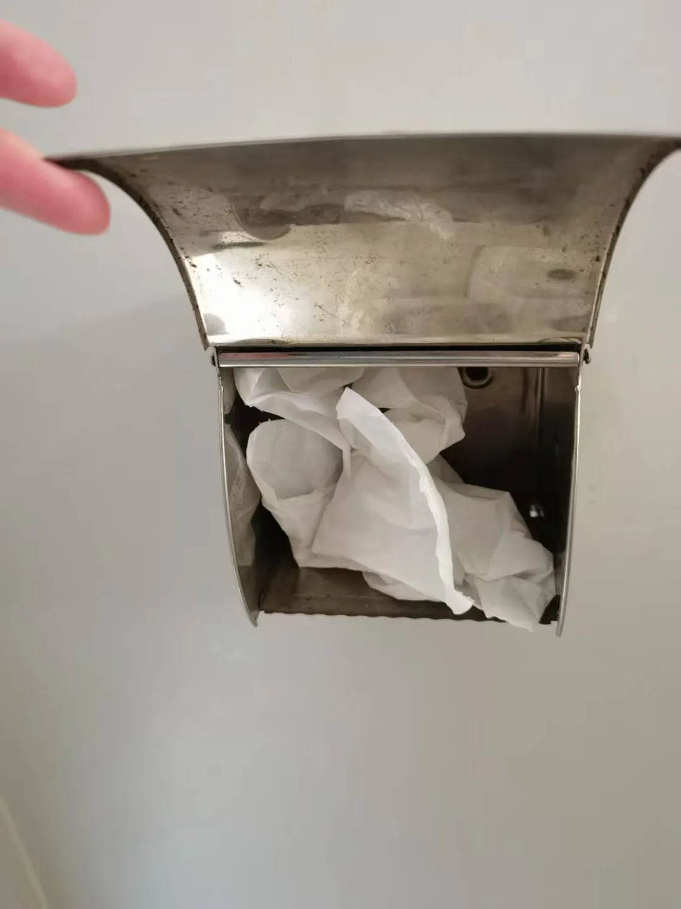

请相关部门及时关注并跟进问题。

## 1 研创计划

> “关于研创计划：建议明年学校科研处文件写明-只允许博三参与立项，其他年级哪凉快哪待着去，不要白费时间给学校科研处带来不必要的麻烦！之前每年都搞的挺好的，感觉总有搅屎棍想把学校弄到风口浪尖上”

## 2 图书馆厕所

“投稿: 良乡校区图书馆厕所的卫生纸每次上厕所都能看到各种乱扔和拽下来不用的卷纸，不知道是丢在这的还是保洁人员留着给人用的。（见图）可能工作人员是想给同学们准备一点纸以防没带，但这么“放”纸几乎都被浪费掉。不是挂一条在挂钩上，就是扔台子上。陌生人来了也不敢拿起来就用啊，而且也不知道多长时间了卫不卫生?！ 所以难道就不能装一卷卷纸在厕所隔间配的铁皮盒子里吗？或者改造一个这个铁皮盒子变成更方便抽纸的设备，这也花不了几个钱吧？反倒是每次如厕都能看见一大堆白纸挂这挂那，颇有明思宗的感觉。这么浪费更没用吧?也没达到给同学们预备纸的目的。建议改进点这个小细节，“厕所革命”的口号是国家都喊出来过的。人文之光的也要体现在细节上！

不是不能干，只是不想干。这么一点小事也不花几个钱，图书馆难道办不成吗？希望图书馆引起重视。”

## 3 俳句

## “学校公众号登了一篇俳句文章，私以为不够生动，整理了一下同学们创作的。

*食堂几个菜今天有无炸鸡柳帮我刷下卡怎么在修路原来下水道坏了每月坏一次行政楼在哪老师又不在班位塞进门口吧医务室休息老师提前下班了自己忍着吧*”

## 4 食堂

> “【投稿】良乡校区二食堂卡座窗边的杂物应该定时清理了吧 也不知道是哪些同学把食堂当作自习室了 在窗边和座位上堆满私人用品和垃圾 一占就是好几天 还不让其他同学在这里坐 再说食堂的环境比较嘈杂也并不适合自习 把公共空间占为己有还批量制造一堆垃圾 没吃完的饼干和鼻涕纸随处乱扔 做人也要积德哈 这样的我祝你逢考必不过科科都落榜”

请对稿件以及公众号有评论需求或者意见的朋友移步[社论读者频道](https://mp.weixin.qq.com/s?__biz=Mzg2MjcwNzQ1Mw==&mid=2247490418&idx=1&sn=1d8ef3e70740db089163bd8605db0f42&scene=21#wechat_redirect)!
