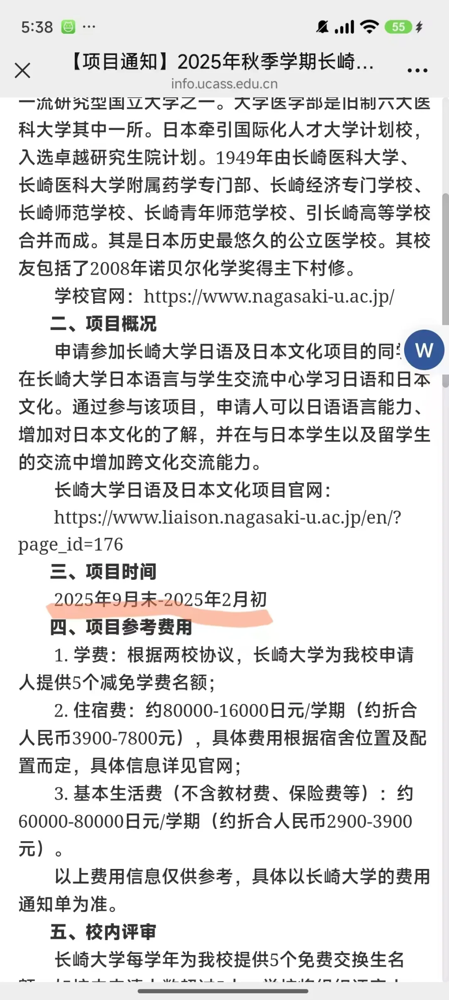
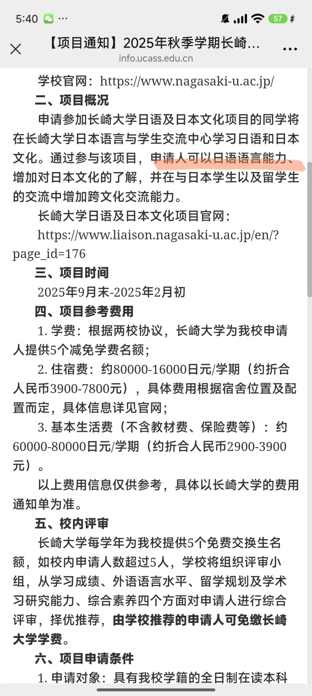
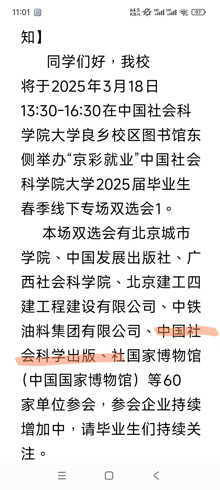
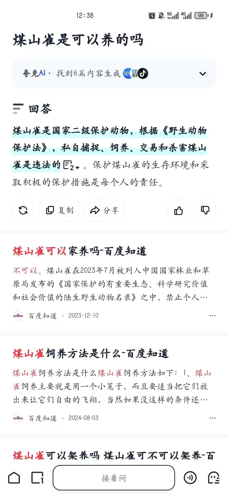
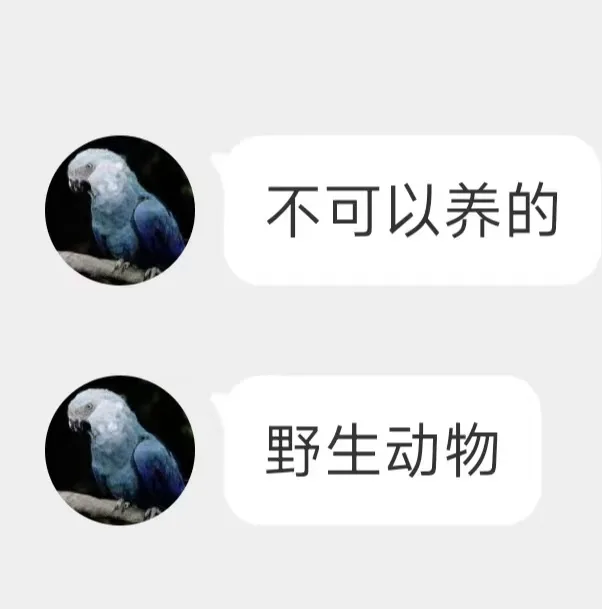

请相关部门及时关注并跟进问题。

## 1 疑问

## “图一，2025年9月到2025年2月，请问是要搞《信条》里的时间钳形作战吗？

图二，“申请人可以日语语言能力”，请问我是不是还得用古汉语语法阅读通知，把它理解成“申请人-可-以（用）-日语语言能力” 。

图三，社科大何时参与中国社会科学出版社的机构重组工作，有权力把出版社的一部分划给国家图书馆了？”

## 2 煤山雀

“［投稿］良乡校区食堂靠近宿舍楼那边的小道的树上发现挂了一只鸟笼，里面关了一只煤山雀。煤山雀是不可私人饲养的野生动物，且是国家保护动物，不管是出于什么心理（除非持证救助）都不应该私人饲养野鸟。小鸟在笼子里上蹿下跳不停叫像是应激一样，希望有关人员能打开笼子放小鸟自由

附图是网络搜索和咨询的鸟类博主得到的回答”

## 3 员工权益

“支持一下给保洁阿姨们一个好的休息环境。之前还看到二食堂收拾餐具和厨余的阿姨在操作台后面吃饭……”

## 4 食堂

“现在是晚上6点15，二食堂自选的饭基本凉了，还有那个警戒线，增大了大家打饭撞人的概率，并且增大了打汤的难度。

领导有精力去搞没毛用的警戒线，不如把精力花在如何给饭保温上。食堂饭菜在饭点凉这个问题之前就有同学反应过，但是仍然持续到现在，没有任何好转，如果食堂自己不改，只能尝试其他举报途径了。不要告诉我六点多不是饭点。”

## 5 研创计划

“〖投稿〗科研处好像将大家的建议视为对立面，学生虽然不被视为学校的主体，但却是学校教育活动的重要参与者，在教育法律关系中，我们具有受教育权，参与学校管理权等权利。在遇到同学们意见反馈时，科研处的领导绝不应表现得如同“渣女”一般，采取消极的“三不”态度——不主动沟通、不予以解释、不承担相应责任。相反，应当勇敢地担当起与其职位相匹配的职责，致力于解决问题，而非简单地去应对或忽视提出问题的人。目前，由于咱们中期考核的缘故，许多同学尚未开题，不能报研创，我们只是想请科研处能够积极协调，妥善处理这一问题，以防明年学弟学妹再度面对类似的情况。我们所期待的，仅仅是一个包容接纳的态度，一个愿意倾听并努力改善的表示而已。居高自傲的行政部门老师与学生群体渐行渐远，必将损害我们对学校的情感，说到底，您也曾是学生，不是吗？“

“投稿，学校科研处的工作做的实在差，这个研创搞的更是不地道。先说这个研创，什么叫“经过领导，各个学院的沟通协调，很遗憾的（原文如此）通知大家”？先不说这个通知发的是多么不正式，就说具体内容，怎么沟通协调的，哪些领导在这里沟通协调，有没有和相关的师生进行沟通，不好意思，没有会议记录、也没有相关发布，你一概不知，你配知道的就是很遗憾地被通知了。你要是再有问题，请去找所谓“领导”、“学院”，反正和我科研处没关系。问题仍是问题、不改就是不改、科研处继续“屹立不倒”，充分暴露出我们科研处有些人是多么凶顽不灵、推诿责任，缺乏对师生的服务意识。而这却是我们科研处的一贯作风，只希望其不是我们学校行政的通病。

科研本子可以说是科研人员的一条生命线，对于学生来说亦并不例外，平时大家也对科研处多加尊重。没想到科研处却因此把自己放在一个很高的位置上，遇事颐指气使、横加干涉、任意妄为，在处理科研项目中外行指导内行、削减科研项目及经费、做事不透明不公开、把责任推给学院及领导的丑闻时有发生，搞得大家是敢怒不敢言。由此观之，研创这个事是科研处整体行为的代表性体现。仅从项目本身而言，很多学生科研项目都遭遇了缩减、无论是拨付经费还是评选名额。为何如此？一个很重要的原因就在于科研处试图既要又要：既要保留学生科研项目充作自己研究型大学宣传的门面，又要节省资金防止师生吃掉属于行政自己的财政。道理很简单，此消彼长、这边我少给你一点，那边就有人可以多拿一点。所以巧立一堆明目，仗着大家敢怒不敢言，这边卡一点那边拒一点，最后就是标榜工作做了、有些宣传有了，皆大欢喜。当然谁没有享受到研究型大学的研究红利，恐怕不只有天知道。

一所研究型大学想必应该从各个方面鼓励科研人才的培育，可科研处这一通操作下来又算什么事，是不是自己在砸自己大学的招牌？我看既然科研处有些人这么想既要又要，反正今年极大可能大家大多交不了这个研创本子，这个研创并不是为大家服务的研创，如果科研处有些人仍肆意妄为，我们可以直接拒绝对此次研创工作的支持，不申请、拒评议、撤项目，让他们的研创工作创下零申请率、零通过率之佳绩，以便有些人继续宣传研创工作开展行之有效。要还是实在不行，我们可以集合起来汇总一下诉求，去和校领导“沟通协调”，再不行就去找领导的领导，层层加码，看看最后是不是这等本该学校里解决的事情又得捅到院里，才可能有所触动？也呼吁大家继续讲述自己在科研处遇到的种种不公之处，比如可以对比对比自己所申项目近几年的评选规则、拨付经费及申请名额的变化。我们大家一起讨回研究型大学的尊严，既然校方有些人不太重视这个招牌，那就只得由我们自己立住我们赖以生存的学校了。”

请对稿件以及公众号有评论需求或者意见的朋友移步[社论读者频道](https://mp.weixin.qq.com/s?__biz=Mzg2MjcwNzQ1Mw==&mid=2247490418&idx=1&sn=1d8ef3e70740db089163bd8605db0f42&scene=21#wechat_redirect)!
