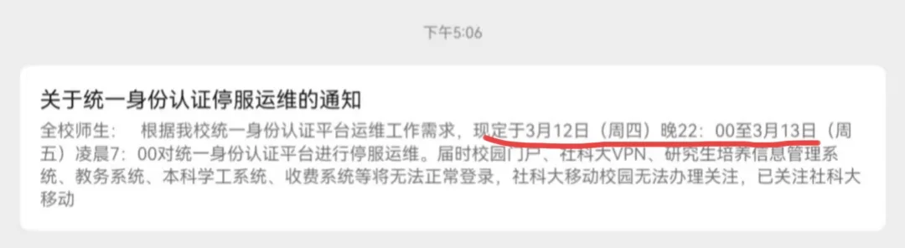
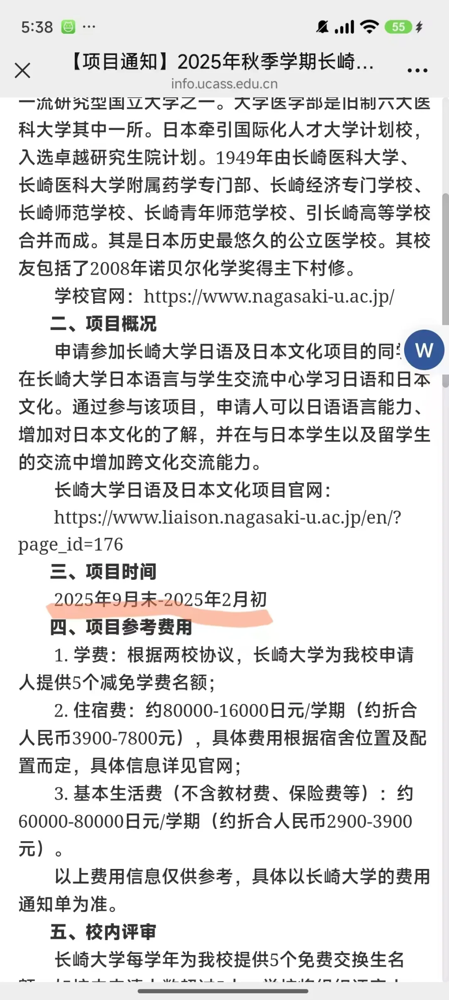
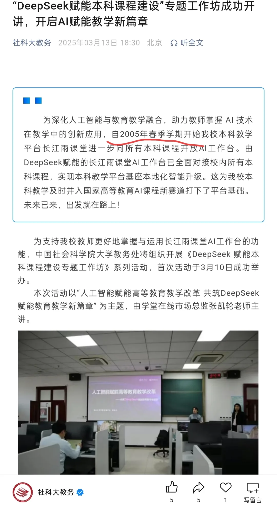

请相关部门及时关注并跟进问题。

## 1 餐车和食堂

“我求求良乡校区餐车不要再做预制的鸡蛋灌饼了好吗…每次去都是把那个干巴的饼一热 就卖了……”

## “一食堂三块钱的红烧肉 只有几块瘦肉是想干嘛”

## 2 员工权益

## “学校望京这边的保洁叔叔和阿姨。

一天下来不让他们坐，只让他们站。冷天只能站在寒风里干活。

最起码也是学校的工作人员，校园网WiFi也不让用。最起码提供个休息的避风的地方吧？”

## 3 板房

> “板房卫生间的洗手液为什么用着用着又满了？为什么老是往里面灌东西？这往里面加的都是啥东西？本来洗手液就是杀菌的，这样会不会从源头上带来更多的细菌？洗手液也不贵，都是一次性的，用完换新的不就行了吗？不知道为什么要这样操作？”

## 4 医务室

## “想问下3月初申报的医务室报销多久到账呀？”

## 5 部门发布内容

“近期看到有人吐槽社科大有部门发布内容不认真，连时间都搞错，本人深有同感。这周短短几天，已有网络中心、教务处、国际交流与合作处三个部门所发内容存在时间错谬这类基本问题。这些内容有的部门自己悄悄改了，有的甚至还没有改、直到现在还摆在那里。而至于公开的认责及整改承诺，不消说更是一概没有。

部门的公信力是部门施策的基石，而部门所发内容无疑是其公信力的重要一环。假如一个部门公而告之的内容都充斥着时间错谬、病语病句这类低级错误，其想要通知的事情又如何能使人信服、其想要传达的信息难不成是对被告知者的漫不经心、毫不在乎吗？这个事并不是什么大事，但小中见大，很能体现出校方有些部门的工作态度，望校方整改为宜并加强审核，少让已经很幽默的行政再闹一些笑话了。”

## 6 研创

“由于本人消息闭塞，从人文之光、班群以及企业微信陆续接收到了有关研创的信息（抱歉，贵院公众号似乎不怎么发与学生有关的内容，所以长久以来忘了有这么个东西），其中3月15日看到历史、外国语与社民发布了公示，然后只见得部分同学在人文之光里慷慨陈词。这么小范围的反应让我心中产生了困惑，难道大部分同学、老师和各领导都不在意学校今年研创的变动吗？

带着这个疑问我首先反思了一下这是否构成一个问题：作为一个声称办研究型的大学，其2025年“研创计划”科学研究项目不通过“所有”现研二同学的申请，导致23级硕士生三年不得做自己的科学研究项目。以上论断并不夸张，似乎已成既定事实，但仍想用微薄之力问一个说法和修正的可能。（对于这个问题的分析，其他同学的投稿已经很清楚了，烦请挪步看看）。

本人已知公示的学院如下：

外国语学院于3月15日（周六）8：59在企业微信进行了公示，用1、2、3列举了推荐项目名称和负责人，研创计划科学研究项目仅推荐1人，没有说公示期；

历史学院于3月15日（周六）12：01在官方公众号进行了公示，用简洁明了的表格展现了各项目拟推荐的项目名称、项目类型、项目申请人，甚至还有备注（这本该是各院公示要做的基础，但明显某些学院羞于使用这种方式），公示期3天；

社民学院于3月15日（周六）16：35在企业微信进行了公示，研创计划科学研究项目推荐8人，只有项目名称供大家学习，不提负责人是谁，公示期3天。

理论上最好不要打扰老师周末休息，但是上述学院行动迅速，非要从周六开始公示到下周一截至。为了让学院老师和科研处即时得到反馈，也不得不在周末打扰一下了。再一次由于本人消息闭塞，只想到“接速即办”这个渠道，于是问了一下各院研创公示情况和科研处对这一事态的解释。由于这些问题和回复并未被公开，所以按回复时间排序粘贴如下供大家了解，括号内容为本人补充：

科研处：请问您是哪个学院？同类情况，很多学院解决的很好。

（对于哪些学院解决的很好这一问题）欢迎到科研处当面交流。

立项工作都是由学院负责完成的，如果想了解详细情况，建议问学院负责学生科研的部门和老师。科研处不太了解你是哪个学院，不好在这里做更多回复。

社民学院：同学你好！关于研创，近期咨询同学较多。欢迎周一上班后到北综511办公室沟通。

（对于没有纸质公示和负责人姓名问题）学校对公示内容未做具体要求，但为了使评审工作更加公开透明，可以公开拟推荐立项的新苗和研创负责人，包括指导教师以及评审小组名单。整理这些信息需要时间，周一可到学院布告栏（北综5层）看纸质盖章版公告。如果有不符合相关规定的，学院可向学校提出申请，公示期延长。

文学院：同学你好，文学院将根据学校通知要求进行院内评审推荐，学院也将于周一进行新苗研创评审公示，请同学们持续关注！谢谢。

国政经学院：一，学院拟推荐立项项目已在学院公示栏公示。二，按照科研处2025年立项通知要求，作为项目负责人申请“研创计划”科学研究项目须提交开题报告。

政管学院：研创，新苗，返乡调研的公示统一周一公布。因为周五下午新苗和返乡调研才结束立项答辩。 研二不能申请校级研创科学研究项目，全校是一样的要求，学院没有办法改变。为了硕士研究生可以有机会申报研创，学院在经费很紧张的情况下，特资助，设立院级研创科学研究项目，解决研二博二没有开题不能申报研创的问题。 这个问题，在3月5日学院学生科研宣讲答疑会中做了解释。在2025学生科研群中，有问题欢迎随时提问。

新传学院：我院学生科研助理叶老师已在2025研创学术交流预报名群内跟大家提示并解答了跟开题相关的疑问。我院的研创已于3月12日在校内网上公示了，但只有我院的学生可见。

马学院：同学你好，请咨询学院老师。

哲学院：已公示。今年规定，须有开题报告。

以上为写下投稿时已经收到的回复，感谢各位老师拨冗回复。从回复来看有以下几点心得：

其一，科研处或“学校”下达了规定，要求必须要“开题报告”才能申请研创科学研究项目。尽管科研处或“学校”暗示这一规定是通过与学院商议之后的结果，但从各学院的回复来看似乎他们仅顺从了这一规定或无可奈何。科研处和各学院有甩锅之嫌；

其二，由于学校没有进行公示规范，各学院的公示方式“百花齐放”。以至于公示期短且可以在周末无人应答的情况下公示、可以没有纸质盖章公示、可以不公布包括负责人姓名在内的基本信息、可以不建立群聊提供反映渠道、可以仅让本院学生看到公示等等。

第三，本人执着于公示负责人名字在于想知道各学院是否真的一刀切了没有开题报告但申请科学研究的研二同学？或许科研处或“学校”想将现研二同学（23级）赶去做专项？毕竟23级研究生还没有能力在年中拿到开题报告后穿越到年初3月进行报名申请，那么只能报文史哲等专项了？

其四，再次感谢政管学院老师的详细回复，对公示时间以及学院做法进行了解释，很难得。可以看出政管学院做出了解决问题的行动，也许就是科研处所说的“解决的好的学院”吧。

对此本人有以下几点粗浅建议：

其一：为了达到真正的信息公开与程序正义，需要明文规范各学院的公示方式与公示内容，必须张贴纸质盖章版公示、公示期不得包含周末等假期、公示内容必须包括评审小组名单、拟推荐项目的名称、负责人姓名与年级、小组成员姓名与年级、项目指导老师，以及拟推荐具体理由。

其二，请科研处或相关负责老师出面解释为什么在今年2025年强调“没有开题报告不通过研创科学研究项目，以及学硕三年申请不了自己的科学研究项目”这一事情。若以上内容并无合理依据或科学要求，请重新进行项目审核与公示。

后记：各位看到此投稿的时候或许已经到了某些学院公示的尾声或已成现实。本人打下以上文字时已经从愤怒转为了无奈甚至有点想笑。这次针对的研二同学是2023年入学的，其中不乏有2019年入学本科的同学，什么培养方案改革、学院改革、上网课、宿舍调配以及研创计划变动都赶上了。看着小几级的同学上着更丰富的课程和实践活动、大一两级的同学申请上了自己想做的研究项目，而我们这一批人还住在几年前就住的旧宿舍里看着系统里的通知与公示，什么都变了但好像又都没变。”

请对稿件以及公众号有评论需求或者意见的朋友移步[社论读者频道](https://mp.weixin.qq.com/s?__biz=Mzg2MjcwNzQ1Mw==&mid=2247490418&idx=1&sn=1d8ef3e70740db089163bd8605db0f42&scene=21#wechat_redirect)!
