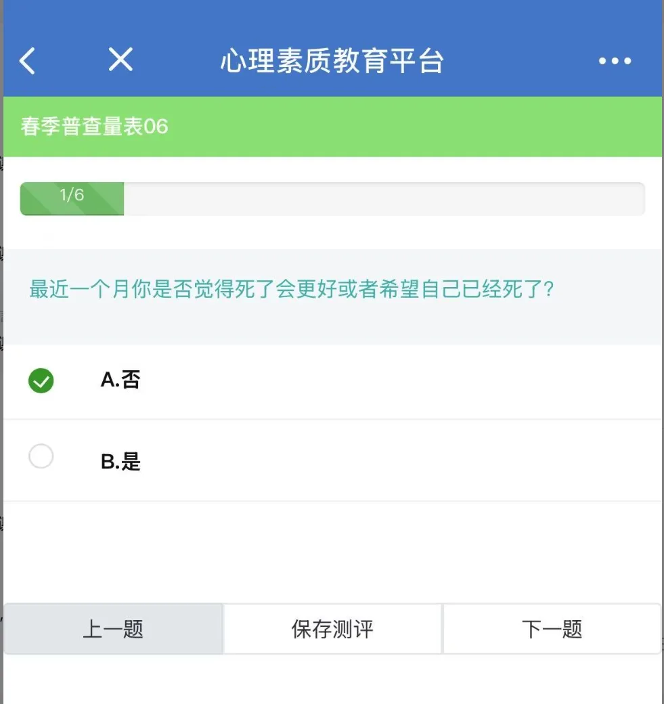
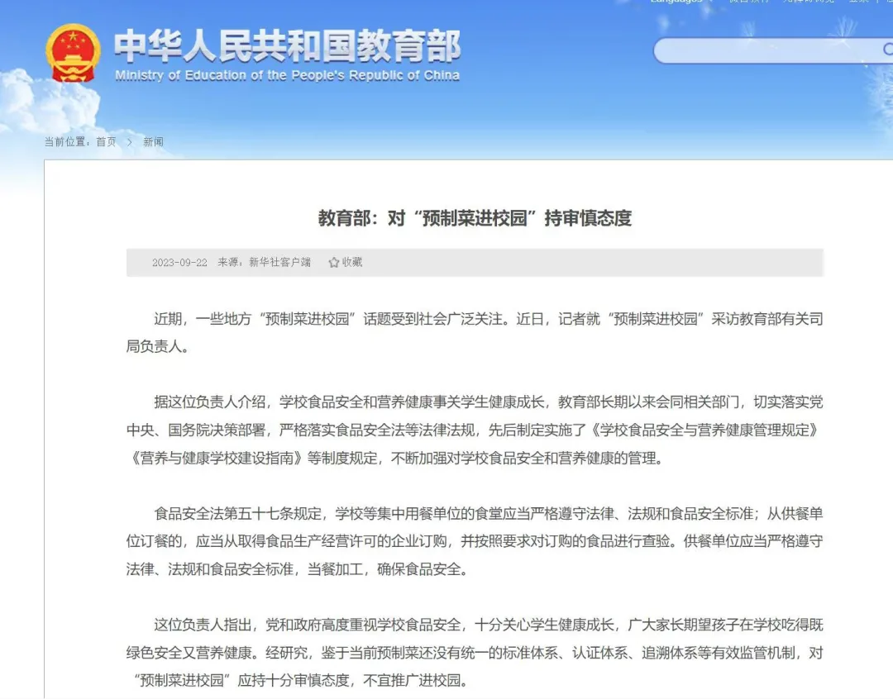

近日社论收到有关研创计划的大量投稿询问编辑部能否保证投稿者的匿名性，关于编辑部回应，请参见：《【编辑部声音】就近日研创有关舆情的说明》请相关部门及时关注并跟进问题。

## 1 沟通机制&研创问题

> “科研处在捂嘴，接诉即办不正面回复，只要求去现场当面了解。见面第一句先问你个人信息，然后告诉学院，让学院处理。好手段，不给立项，不回复，只捂嘴。还要求学院找出在社论留言的人，希望社论坚挺。”

> “研创计划通知明确指出“优先支持学硕二年级或博士二、三年级研究生申请的项目。”却暗戳戳用开题报告不让硕二博二的同学申请。建议科研处直接写“硕士及博士二年级不能申请”，避免自相矛盾。听说是因为资金紧张所以设置这个条件，skd有钱花100w把教室改造办公室，但没钱支持学生的科学研究项目，滑天下之大稽。”

> “这个研创计划真的问题多多：第一，自己辛辛苦苦写的申请书，答辩的时候明显感觉老师没有提前看，对学生讲的东西好像一点也不懂。而且我们的选题很多都是自己研究方向最前沿的选题，明显感觉到评委老师是一点不懂。第二，3个评审老师，在一天内评审几十位同学的申请答辩，而且研究选题方向千差万别。可能老师中意的是自己研究方向相关研究，对其他领域的前沿研究基本不懂。第三，每位同学3分钟，3分钟时间根本就不够，不能展开讲，有些同学刚说了前面的研究意义，就没有时间了。第四，老师的提问也流于形式，就是牛头不对马嘴那种，问的都是一些常识性的问题，就不能算得上真正的学术问题。很多问题就不是植根于学生的申请书，而是基于自己的生活常识。申请书里面和材料里面，写的清清楚楚的问题，还拿来问。第五，学校要求18号上报，现在很多学院还拖着没有公布结果。即使公布的也是乱七八糟，不符合规范。第六，从以往的结项结果来看，最后发不发论文都能结项，也不知道这个研创的意义是什么？从知网上搜索挂研创计划的论文很少很少。”

## “研创投稿

权力只对它的来源负责，研创申请的争议发展到今天，面对汹汹民意，科研处依旧保持它高傲的身段，选择了装聋作哑当鸵鸟。

我只有四个字送给你：“田文镜，” ”

### （注：该稿用语原文如此，请读者朋友们自行体会当事人的愤怒）

## 2 学校系统与图书馆有关投稿合集

“

这是哪个大聪明出的题？感觉不是心理测试，更像是诱导自杀。你也不想想人家有想法会告诉你么？”

“这学校数据库几分钟不用就给你退出来了，然后又得登陆，真的好烦啊，一天光登陆得登陆几十遍。各种史料找来找去，谁一直盯着一个数据库啊，图书馆能不能设置一下”

> “今天在图书馆二楼女厕询问了保洁阿姨休息处的情况，得知她们是有专门休息处的，可以喝热水，平时更衣等活动也在那里进行。只不过休息室在图书馆一层，离工作地点较远，一天待的时间不是很长，因为“有的时候刚打扫完又脏了”【阿姨原话】。在此也呼吁各位接受高等教育的学生们文明使用厕所，便后冲水、垃圾进篓不是那么困难的事。一方面可以减少阿姨的工作量、让其有更多的休息时间；另一方面，也能让在图书馆的同学们避免“开盲盒”的“惊喜”。”

## 3 食品安全

> “预制菜（预制包子、饼等）真的很难吃，社科大可能是唯一一个预制菜进校园的学校了（包括食堂和餐车，如食堂的奥尔良鸡肉包、红糖馒头，鸡蛋灌饼等等，餐车上很多也是预制菜）。教育部：经研究，鉴于当前预制菜还没有统一的标准体系、认证体系、追溯体系等有效监管机制，对“预制菜进校园”应持十分审慎态度，不宜推广进校园。”

