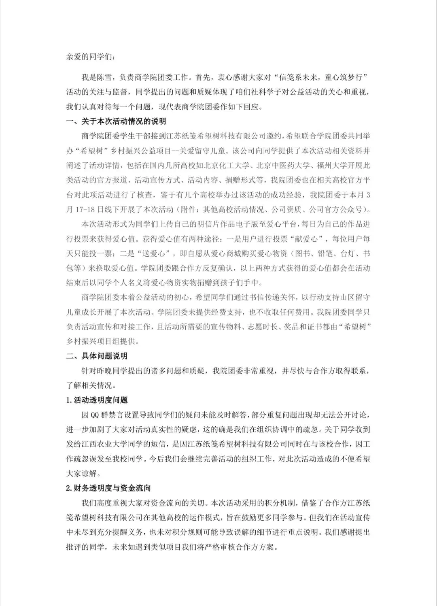
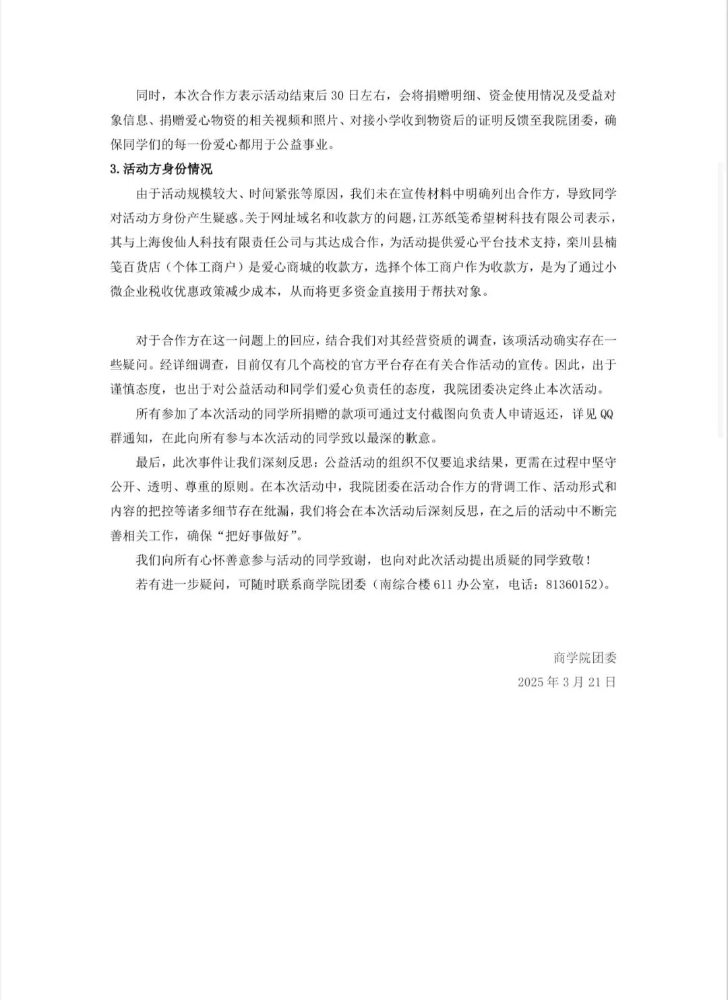
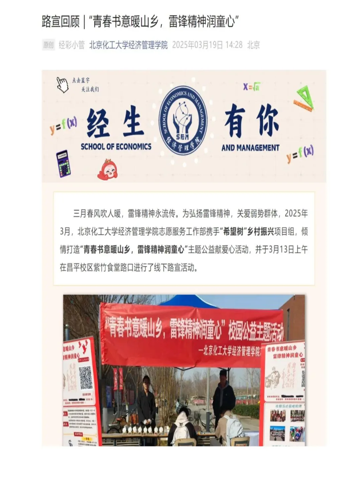
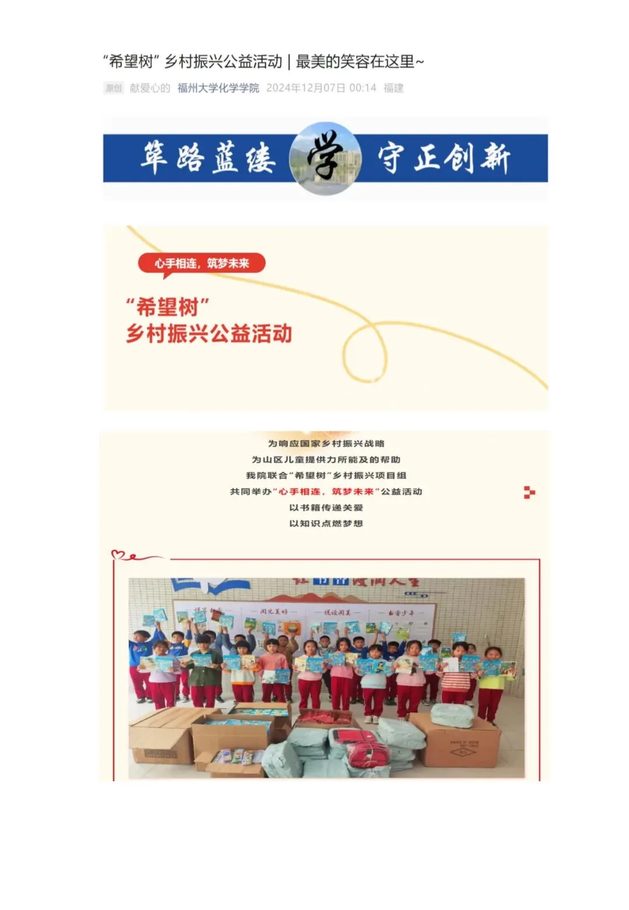
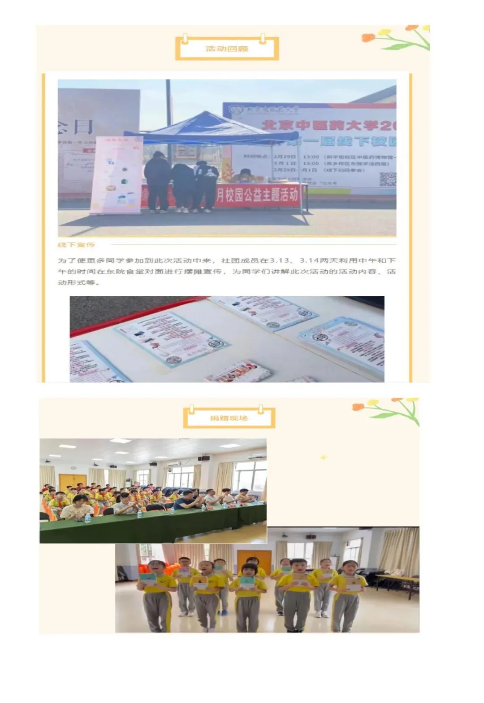
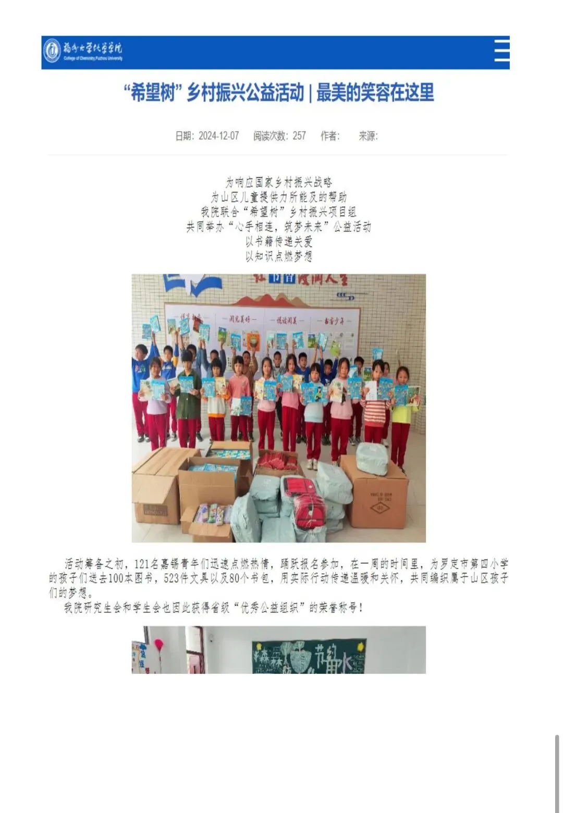
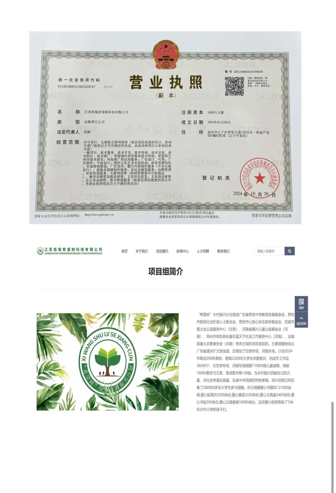

请相关部门及时关注并跟进问题。

## 1 商学院团委回应

## “

（见[【读者投稿】天平摇晃 根基动摇](https://mp.weixin.qq.com/s?__biz=Mzg2MjcwNzQ1Mw==&mid=2247490647&idx=1&sn=371d01e4f3346d9a582ff10ccdd04cc9&scene=21#wechat_redirect) 第1条）

## 2 数字基建

> “学校既然有那么多经费用于反复改造办公室，请问可以惠及一下学生、开通‘青梨AI科研服务平台’吗？查找文献真得非常好用！社科院有的所开通了，很多高校也开通了，社科大也考虑一下吧！”

## 3 黉门赋

“泮池巍巍，广厦连云斗牛寒；庠序赫赫，雕甍画栋日月昏。金玉其表，门面之饰胜孔庙；败絮其中，梁柱之朽若危栏。夏雨滂沱，墙坍三面惊飞鸟；秋风萧瑟，阶陷九重困儒冠。

朝令夕改，令出多门如弈棋。寅时倡减负，夤夜颁题海；辰刻推新政，巳时废旧章。课表叠床架屋，晨昏颠倒；讲座铺天盖地，寒暑无疆。题海无涯，谁见骊珠出水？讲座如麻，但闻瞽说绕梁。

更观司牧诸公，沐猴而冠衮服。见泥泞则避道，闻喧哗即闭户。视察则前呼后拥，俨然巡狩；议事则左顾右盼，浑如泥塑。饕餮餐补，银箸频举；辗转会场，鼾声时露。问经邦济世之策，唯唯连声；及修墙补漏之事，诺诺疾步。

膏火学子，囚于斯狱：食宿不异圄牢，六艺竟成桎梏。晨披星以抄记，暮戴月而诵读。笔阵摧眉，犹闻训诰谆谆；试卷埋身，更添讲章簇簇。春华尽付流水，秋实皆化飞霂。

嗟乎！画地作饼，岂能充辘辘饥肠？凿光为日，何堪照昏昏孽帐？黉门已成商肆，教化早作戏场。诸公高坐，可闻稚子啼饥之声？广厦千间，不见寒士展眉之状！

呜呼！庠序若斯，教化安在？但见廊庙燕雀，争衔彩羽饰太平耳！”

## 4 研创问题&沟通渠道

## “投稿：

科研处到现在都没有正面回应任何一则疑问。学院申报截止了，该学校申项目了。估计之后就这么不了了之过去了吧。反正铁打的科研处，流水的学生。学生嘛，毕业了就过去了。只不过社科大又多了一个被传颂的故事。估计这么解决问题多了，也就给了各部门各学院一个非常好的示例。工作失误怎么办？别管，就该学生承担。怎么解决问题？别管，有人冒头就敲打一下，截止时间过了就行了。年底成为一项政绩，回顾这件事就这么说：‘今年科研处只通过有开题报告的项目，虽然推进过程受到阻力，但也是改革必然，长痛不如短痛，项目进展情况确实比以往更好，受到学生肯定。’

多好，多棒，到时候找一些立上项目的同学问问情况，发个推文，漂亮，谁不说一个好字。如果科研处没给一个合理的公开解释，或者给一个妥善的解决方案，这事慢慢地也就没人讨论了，我想这就是解决方案吧。”

（见《[【读者投稿】天平摇晃 根基动摇](https://mp.weixin.qq.com/s?__biz=Mzg2MjcwNzQ1Mw==&mid=2247490647&idx=1&sn=371d01e4f3346d9a582ff10ccdd04cc9&scene=21#wechat_redirect)》第4条）

## 5 食品安全

## “投稿：

今天中午十一点半在食堂吃过午饭（鸡翅、番茄炒蛋等），两点左右开始肚子疼，已经持续一下午了，现在还没缓解。早上和上午没有吃其他东西。不知道有没有其他同学一样的情况。”

（见《[【读者投稿】人文之光，你是否暗淡？](https://mp.weixin.qq.com/s?__biz=Mzg2MjcwNzQ1Mw==&mid=2247490630&idx=1&sn=1b653ccec587c0344ef59471bcbeb11f&scene=21#wechat_redirect)》第3条）

## 6 学院问题

> “反馈该言论：实在过于离谱，‘学生会为学院做了极大贡献’？？？这是哪里得出来的狗屁结论。学生会做的贡献大还是老师以及每一位同学做的贡献大？？？另外，研创要看研究水平决定，经济学院本就不应该向学生会人员倾斜。这是学生会和经济学院的高级黑么？？？”

（见《[【读者投稿】人文之光，你是否暗淡？](https://mp.weixin.qq.com/s?__biz=Mzg2MjcwNzQ1Mw==&mid=2247490630&idx=1&sn=1b653ccec587c0344ef59471bcbeb11f&scene=21#wechat_redirect)》第2条）
